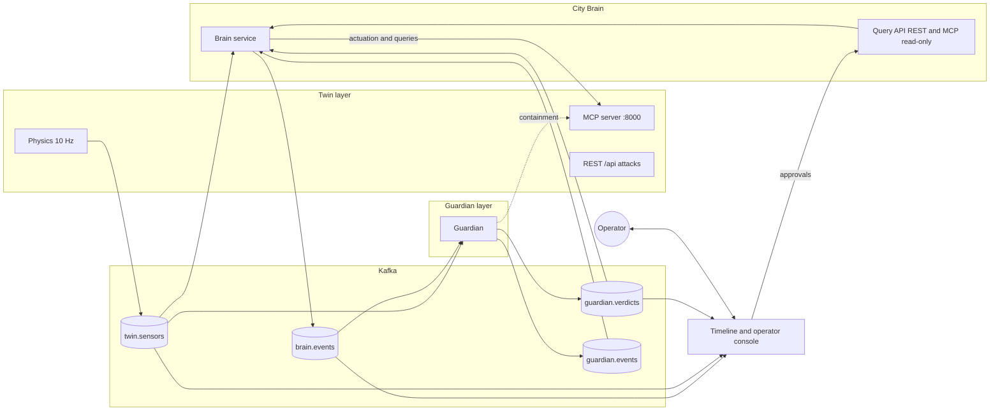
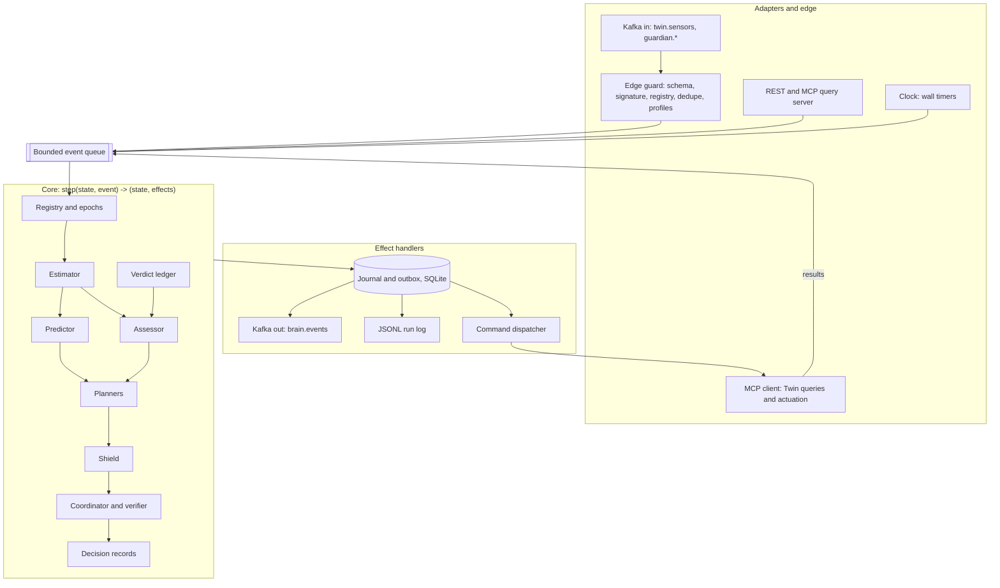
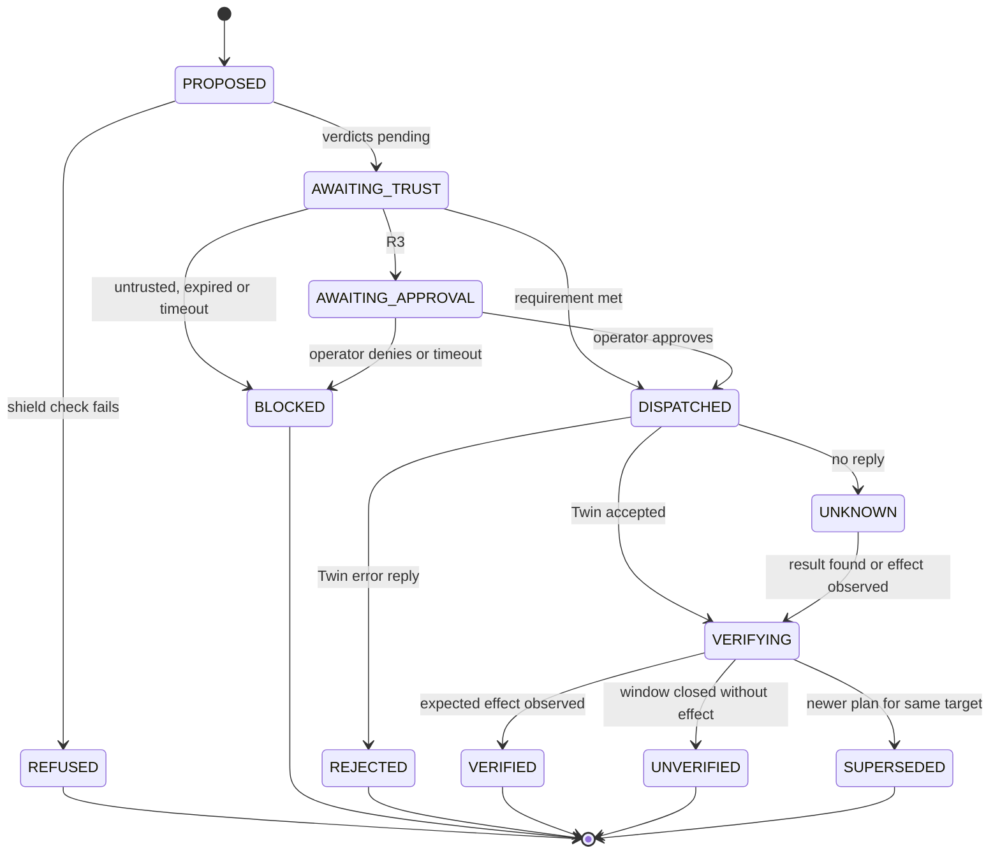

# City Brain — Final Architecture and System Design

TSYP14 · Triplet 07 · City Brain team · Version 2.1 · 5 November 2026

Supersedes "CITY BRAIN CONVERGENCE — Implementation reference" (11 October 2026). Version 2.1 merges in the strongest ideas from "CITY BRAIN — ARCHITECTURE MAÎTRE" (5 November 2026): the guiding principle, the "must not" list, the three trust questions, the four kinds of state, labelled correlations, the nine explainability questions, and the no-retroactive-trust rule.

---

## 0. How to read this document

**Scope.** This is the target design for the City Brain layer, written as if time were not a constraint. It is meant to be built from: every component has a defined job, interface, data model and test. The order in which to build it is in section 17; the first milestones are a usable Brain on their own.

**Sources of truth, in order of authority.**

| Rank | Source | Used for |
|---|---|---|
| 1 | Twin source code in `triplet-07`, commit `418a024` (4 Nov 2026): `twin/simulation.py`, `twin/mcp_server.py`, `twin/kafka_streamer.py`, `twin/crypto_utils.py`, `twin/main.py` | What the Twin actually does |
| 2 | `INTERFACE.md` at the repo root (identical to `twin/INTERFACE.md`) | Twin contract; agrees with the code |
| 3 | "Phase 1 City Brain Convergence" spec book (latest version) | Rules R1–R3, scoring, Test Book and report format |
| 4 | Twin `INTEGRATION.md`, `DEVELOPER_GUIDE`, `PHYSICS_AND_ADVERSARY_SPEC` | Not trusted where they contradict 1–2 (they list `all_red`, `adaptive`, `half`, `island`, which the code does not implement) |

**Labels used throughout.**

- **[FACT]** verified in the Twin code or the spec book.
- **[PROPOSAL]** our design for a contract with a partner; needs their agreement.
- **[DECISION]** an internal Brain choice; ours to make.

**Report mapping.** The spec book requires six subheadings for the Brain's part of the report. They map to this document as follows: Role and goals → §1; Architecture → §§4, 6–8; Tech stack and why → §13; Interfaces in/out → §5; Security measures → §11; Known limitations → §20.

### What changed from the October document

| October document | This version | Why |
|---|---|---|
| Topic `city.sensor.readings` | `twin.sensors` [FACT] | The Twin publishes there |
| Commands over Kafka (`city.actions.authorized`, `gate.authorizations`, `twin.actuator.feedback`) | Commands are MCP tool calls; results are the tool reply plus `get_command_result`; effects are observed in telemetry [FACT] | The Twin never takes commands over Kafka |
| MCP client "only if a partner exposes MCP" | MCP client is the mandatory actuation adapter | The partner does expose MCP |
| An Intersection Gate as the authorization boundary | A trust gate inside the Brain (the Shield) by default; an external Gate is a configuration mode | Nobody has built a Gate; the Twin's tools accept no authorization token |
| Units cm, %, kW; rainfall sensor; pumps; feeder capacity | Metres, MW, veh/min, AQI, call/min; no rainfall, no pumps, no feeder capacity [FACT] | That is the Twin's inventory |
| Legacy schema bridge (`sensor_id`, `cluster_id`, `packet_order`) | Native Twin schema (`device_id`, `device_type`, `seq`, `location`, `sig`) | The legacy schema is not on the wire |
| "False Flood and Overloaded Grid" demo | Scenarios that run on this Twin (§16) | The original needs devices that don't exist |
| R1–R4, 7 Nov | R1–R3, 8 Nov (latest spec book) | Spec book update |
| `assess_flood` with hard-coded sensors and thresholds | Trust-weighted estimator and assessor configured per partner (§8) | Portability and correctness |
| Ed25519 not mentioned | Signature verification at the edge | Every reading is signed |

---

## 1. Role and goals

**Role (spec book).** Detect real incidents from the Twin's live data, decide the right response, and act through the Twin's actuators — but only on data the Guardian has judged, and with every step visible on a shared timeline.

**Guiding principle.**

> The City Brain understands before it acts, justifies before it proposes, checks trust before it executes, and verifies after it executes.

**Goals of this design.**

1. **Correct and safe.** Never act on untrusted evidence; never send a command the Twin should not receive; verify that every action had its intended physical effect.
2. **Explainable.** Every decision — including "do nothing" — is a record naming its evidence, the Guardian verdicts, the rule or plan used, and the alternatives rejected.
3. **Deterministic.** Replaying the same input stream produces byte-identical decisions. This makes scenario logs (R2) checkable and tests exact.
4. **Interoperable.** Swapping the Twin or Guardian for another team's implementation needs a configuration profile and possibly an adapter, never a change to the decision logic. This is proven with tests, not claimed.
5. **Standalone.** The Brain runs with its own Twin and Guardian mocks and no network (R1).

**Non-goals.** The Brain does not judge sensor trust, quarantine or isolate devices, roll back readings, or simulate physics. Those belong to the Guardian and the Twin. An AI language model never sits on the path that issues commands.

**The Brain must never:**

- treat data as reliable because it is well formed;
- treat a valid signature as proof that a measurement is true;
- take on the Guardian's authority (declaring a device compromised, containing it);
- send a command without passing the Shield and the trust requirement for its risk class;
- treat an `ok` reply from the Twin as proof that an action worked;
- depend on a single protocol or partner implementation for its decision logic;
- present an estimated value as a measured one.

**Success criteria (observable).**

| # | Criterion | How it is checked |
|---|---|---|
| S1 | Brain runs alone with mocks; one command starts each scenario | `make scenario name=T03` with only the `standalone` profile |
| S2 | Each run writes `logs/<scenario>-<run>.jsonl` | File exists, validates against `brain-event.v1` schema |
| S3 | Timeline shows reading → verdict → decision → command → verification with timestamps | Live page during demo; same chain reconstructible from the log |
| S4 | No high-risk command ever cites untrusted or unknown evidence | Property test over all scenarios and random event orders |
| S5 | Replay is deterministic | Two replays of a recorded run produce identical decision logs |
| S6 | Every Twin attack preset produces the expected Brain behaviour | Test Book T03–T12 pass against the real Twin |
| S7 | Partner swap needs no core change | Conformance tests pass for Kafka, REST and file adapters with the same core build |

---

## 2. Ground truth: what the Twin actually does

All of this is **[FACT]**, read from the code at commit `418a024`. The Brain's design depends on it; anything Twin-specific lives in the Twin profile (§10), not in the core.

### 2.1 Telemetry

| Item | Value |
|---|---|
| Topic | `twin.sensors`; key = UTF-8 `device_id`; 3 partitions (broker default) |
| Broker | `kafka:9092` inside `twin_network`, `localhost:19092` from the host; PLAINTEXT, no authentication |
| Rate | 42 devices × 10 Hz = 420 messages/s, each ≤ 300 bytes |
| Payload | Exactly `schema.json`: `reading_id, device_id, device_type, ts, seq, value, unit, location, status, sig`; `additionalProperties: false` |
| `reading_id` | `r-<device_id>-<seq>`; restarts from 1 on every Twin start |
| `seq` | Per-device counter, +1 per tick |
| `ts` | Simulation time, **second precision**; starts at `2026-10-17T12:00:00Z` on every start; advances 0.1 s per tick, so ~10 consecutive readings per device share one `ts` |
| `value` | Rounded to 2 decimals before signing |
| `location` | Always a zone string, e.g. `zone-1` (never the object form) |
| `status` | `ok`, `isolated`, `quarantined`, `rolled_back`, `modelled`; quarantined and isolated devices **keep publishing** with that status |
| `sig` | Base64 Ed25519 over `json.dumps(payload_without_sig, sort_keys=True, separators=(",", ":"))`; keys are regenerated on every Twin start; public key via MCP `get_device_key` |

### 2.2 Devices and physics

Six zones (`zone-1`…`zone-6`), seven devices each: `tc1`, `tc2` (traffic cameras), `wl1`, `wl2` (water level, each with its own valve), `pl1` (power load), `aq1` (air quality), `ec1` (emergency calls).

| Channel | Model (per 0.1 s tick) | Typical values | Actuator effect |
|---|---|---|---|
| Water | level += (inflow − 0.045 × valve_ratio) × 0.1 + noise; inflow = 0.015 × (1 + 0.2 sin(…)) m/s | Starts 3.2 m (`wl1`), 2.8 m (`wl2`); valves start **closed**, so levels rise ~0.015 m/s and hit the 12 m clamp after ~10 min | Open: net ≈ −0.03 m/s. A ratio near 33% holds the level steady |
| Traffic | first-order lag (0.05/tick) toward (40 + 80 × diurnal) × plan factor | ≈ 101 veh/min at 12:00 | `green_wave` ×1.35, `red_restriction` ×0.55, `normal` ×1.0 |
| Power | lag (0.08/tick) toward (30 + 55 × diurnal) × grid factor | ≈ 68 MW at 12:00; 30–85 MW range | `grid_b` ×0.85, `shed` ×0.40, `standby` ×0.20, `grid_a` ×1.0 |
| Air quality | lag (0.02/tick) toward 20 + 0.45 × mean zone traffic | ≈ 65 AQI at 12:00 | none (follows traffic) |
| Emergency calls | lag toward 1.2 call/min; with n dispatches toward max(0.2, 0.8 − 0.3n) | ≈ 1.2 | each `dispatch` lowers the zone's rate **permanently** |

Consequences for the Brain:

- **Water is the only channel where incidents arise naturally**, and it always does: a closed valve becomes a flood within minutes. The Brain's main job on this Twin is level control.
- Traffic, power, air quality and calls never produce incidents on their own. Their anomalies come from attacks or faults. The Brain must therefore be very good at *not* acting on them.
- The two water channels in a zone are independent (each has its own valve), so they only agree when their valves are in the same state. They are not redundant measurements of one quantity.

### 2.3 Commands (MCP over SSE, `http://twin_layer:8000/sse`)

| Tool | Arguments | Accepted states (code) |
|---|---|---|
| `set_valve` | `device_id` (a `wlN`), `target_state`, `idempotency_key?` | `open`, `closed`, `"NN%"` |
| `set_signal_plan` | `device_id` (a `tcN`), `target_state`, `idempotency_key?` | `green_wave`, `normal`, `red_restriction` |
| `switch_grid` | `device_id` (a `pl1`), `target_state`, `idempotency_key?` | `grid_a`, `grid_b`, `shed`, `standby` |
| `dispatch` | `incident_type`, `zone_id`, `idempotency_key?` | any incident type string |
| `get_command_result` | `idempotency_key` | returns the cached reply or `null` |

Queries: `list_devices`, `get_device_key`, `get_device_state`, `get_city_state`, `get_reading`, `get_readings`. Containment tools (`isolate_device`, `quarantine_device`, `reinstate_device`, `release_device`, `rollback_reading`) belong to the Guardian; the Brain never calls them.

### 2.4 Twin behaviours the Brain must defend against

| Behaviour | Effect | Brain defence |
|---|---|---|
| Any unknown `target_state` returns `ok` (`"half"` closes the valve; `"foo"` sets grid factor 1.0) | Silent wrong actuation | Per-capability allowlist in the Shield; `half` is mapped to `"50%"` |
| Commands to isolated or quarantined devices are executed | Brain could actuate a contained device | Shield refuses unless the containment exception (§8.7) applies |
| A repeated `idempotency_key` is executed again | Retries double-actuate | Brain never resends a key; checks `get_command_result` first |
| Replies are synchronous `ok` even under the actuator attack | "ok" ≠ effect | Verification against telemetry (§8.6) |
| Dispatches never expire | Each dispatch permanently lowers call rate | Dispatch is high-risk and rate-limited per zone |
| `reading_id` and `ts` restart on every Twin start | Dedupe and verdict joins break across runs | Run epochs (§9.3); verdicts bind to `reading_id + sig_hash` |
| Rogue (unregistered) readings never reach Kafka (stream loop skips them) | The rogue preset can't be demonstrated | Brain still rejects unknown devices; ask the Twin team to fix |
| Broker has no authentication | Anyone on the network can produce anything | Signed readings, signed verdicts, signed Brain events (§11) |

### 2.5 Adversary presets (via Twin REST `/api/attack/inject`)

| Capability | What goes on the wire | Signature | Brain's expected handling |
|---|---|---|---|
| `device_physical` | value × 2.5 (or a set value) | valid | Implausible jump and contradiction; hold |
| `device_key` | true + 50 (or a set value) | **valid** (attacker holds the key) | Only physics plausibility and the Guardian can catch it; hold |
| `sensor_fault` | stuck at 42.0, dropout to 0.0, or drift +0.5/s | valid | Stuck/dropout detectors; drift caught by sibling divergence over time |
| `link: corrupt_bytes` | signature broken | invalid | Rejected at the edge; channel goes stale |
| `link: drop` | readings missing | — | `seq` gaps; channel goes stale |
| `link: replay` | the previous reading re-sent, byte-identical | valid | Duplicate; dropped by dedupe |
| `actuator` | commands answered `ok` but not executed | — | Verification fails; alert and advisory |
| `rogue` | (does not reach Kafka today) | — | Unknown device → dead-letter |

---

## 3. Architecture principles

| # | Principle | Consequence |
|---|---|---|
| P1 | **Functional core, imperative shell.** All decision logic is a pure function `step(state, event) → (state', effects)` | No I/O, no clock, no randomness in the core; deterministic replay; table-driven tests |
| P2 | **Ports and adapters.** The core defines what it needs; adapters decide how | Kafka, MCP, REST and files are interchangeable at the edge |
| P3 | **Anti-corruption layer.** Partner vocabularies are translated at the edge by declarative profiles | A new partner is a new profile file |
| P4 | **Plan, then shield.** Planners propose; a deterministic Shield disposes | Intelligence can grow without weakening safety |
| P5 | **Acknowledgement is not effect.** Every action declares an expected effect and is verified from telemetry | Catches faulty and attacked actuators |
| P6 | **The Brain may lower trust, never raise it** | The Guardian stays the trust authority |
| P7 | **Fail closed, degrade gracefully.** Missing trust means no high-risk actions; the Brain keeps observing, assessing and alerting | Safety under partner failure |
| P8 | **Everything is an event with a correlation chain** | The timeline and the log are the same data |
| P9 | **Learn offline, run deterministic online.** Calibration and models are fitted from recorded runs and shipped as versioned parameters | Determinism and explainability are preserved |

### 3.1 Three separate questions

No single check answers all three; the Brain keeps them apart in code and in its records.

| Question | Answered by | What it proves | What it does not prove |
|---|---|---|---|
| Is the data **authentic**? | Edge guard: Ed25519 signature, registry, schema | It came from a registered device and was not altered in transit | That the value is true (the `device_key` attack has valid signatures) |
| Is the data **trustworthy**? | Guardian verdict + the Brain's plausibility and corroboration checks | The source and value are judged reliable enough for the risk at hand | That an action based on it will work |
| Was the action **effective**? | Verifier, from later telemetry | The expected physical effect was observed | — (an `ok` reply from the Twin proves only receipt) |

---

## 4. System context



### 4.1 Boundary channels

| # | Channel | Direction | Transport | Status |
|---|---|---|---|---|
| C1 | Sensor readings | Twin → Brain | Kafka `twin.sensors` | [FACT] |
| C2 | Device inventory, keys, state | Brain → Twin (query) | MCP `list_devices`, `get_device_key`, `get_device_state`, `get_city_state` | [FACT] |
| C3 | Actuation | Brain → Twin | MCP `set_valve`, `set_signal_plan`, `switch_grid`, `dispatch` | [FACT] |
| C4 | Command result | Twin → Brain | MCP tool reply; `get_command_result` | [FACT] |
| C5 | Trust verdicts | Guardian → Brain | Kafka `guardian.verdicts` | [PROPOSAL] |
| C6 | Heartbeat and containment notices | Guardian → Brain | Kafka `guardian.events` | [PROPOSAL] |
| C7 | Brain events (decisions, commands, verifications, alerts, status) | Brain → anyone | Kafka `brain.events` + `logs/*.jsonl` | [PROPOSAL] |
| C8 | Advisories to the Guardian ("valve did not respond") | Brain → Guardian | Inside C7, type `alert`, audience `guardian` | [PROPOSAL] |
| C9 | Authorization (Gate mode only) | Gate → Brain | Kafka `gate.decisions` | [PROPOSAL], off by default |
| C10 | Read-only queries and operator approvals | Clients → Brain | REST `/v1/...`; read-only MCP server | [DECISION] |

---

## 5. External contracts

### 5.1 C1 — Ingesting `twin.sensors`

- **Consumer group** `city-brain` (distinct from the Guardian's and the timeline's groups, so each receives every message).
- **Offsets.** `enable.auto.commit=false`. Commit only after the event is written to the Brain's journal (§9.4). `auto.offset.reset=latest` on a fresh group; on restart, resume from committed offsets and let the journal rebuild state.
- **Ordering.** Kafka orders only within a partition, and keys are device ids, so per-device order is preserved. The Brain orders a device's readings by `seq`, never by `ts`.
- **Validation** (in this order, each failure goes to the dead-letter log with a reason code):

| Check | Reason code |
|---|---|
| Parses as JSON | `MALFORMED_JSON` |
| Validates against the Twin profile's schema (format checker on, so `date-time` is enforced) | `SCHEMA_VIOLATION` |
| Device is in the registry from `list_devices` | `UNKNOWN_DEVICE` |
| `device_type` and `unit` match the registry | `TYPE_MISMATCH` |
| Signature verifies with the device's current key | `BAD_SIGNATURE` |
| Not already seen in this run epoch (`reading_id` + `sig`) | `DUPLICATE` (counted, not dead-lettered) |
| `seq` is greater than the last seen | `OUT_OF_ORDER` or new epoch (§9.3) |
| Value within registry bounds `[min_val, max_val]` | `OUT_OF_RANGE` (kept, flagged) |

### 5.2 C2–C4 — MCP client to the Twin

- One long-lived SSE session; calls are serialised through a single adapter task; timeout 2 s wall clock; reconnect with exponential backoff (0.5 s → 8 s).
- **Startup sequence:** `list_devices` → registry; `get_device_key` for each device → key ring; `get_city_state` → initial actuator states and sim time.
- **Key refresh:** on a run-epoch change or a burst of `BAD_SIGNATURE` from one device, refresh that device's key once; persistent failure is reported, not retried in a loop.
- **Actuation:** the adapter receives a canonical `CommandRequest` from the core and maps it through the Twin profile:

```yaml
# profiles/twin-triplet07.yaml (excerpt)
actuators:
  valve:
    tool: set_valve
    target: device            # device_id of the water_level sensor
    states: { open: "open", closed: "closed", ratio: "{pct}%" }
  signal:
    tool: set_signal_plan
    target: device
    states: { boost: "green_wave", normal: "normal", restrict: "red_restriction" }
  grid:
    tool: switch_grid
    target: device
    states: { primary: "grid_a", secondary: "grid_b", shed: "shed", standby: "standby" }
  dispatch:
    tool: dispatch
    target: zone
    args: { incident_type: "{incident_type}" }
```

- **Idempotency key** = `brain-<epoch>-<action_id>`. `action_id` is a hash of (incident, capability, target, state, plan version), so recomputing after a crash yields the same key. The adapter calls `get_command_result(key)` before any resend; if a result exists, it is used and nothing is sent.
- **Result mapping:** reply `status: ok` → `ACCEPTED`; `status: error` → `REJECTED` with the message; timeout → `UNKNOWN` (never `FAILED`; the effect is checked from telemetry).

### 5.3 C5–C6 — Guardian contract [PROPOSAL]

The Guardian folder in the repo is empty, so this is the contract we propose. It is Kafka because the Guardian already consumes `twin.sensors` from the same broker, the timeline can display verdicts directly, and neither side needs the other's address.

**`guardian.verdicts`** (key `device_id`), one verdict per evaluated reading:

```json
{
  "verdict_id": "v-000981",
  "reading_id": "r-z1-wl1-905",
  "sig_hash": "9f2c41d0a7be3e11",
  "device_id": "z1-wl1",
  "state": "TRUSTED",
  "trust": 0.97,
  "reasons": [],
  "issued_at": "2026-10-17T12:01:30Z",
  "expires_at": "2026-10-17T12:02:00Z",
  "sig": "<base64 Ed25519 by the Guardian key>"
}
```

- `sig_hash` = first 16 hex chars of SHA-256 of the reading's `sig`. With `reading_id`, it identifies one reading across Twin restarts (keys change every start).
- `state` uses the Guardian's own vocabulary; the Guardian profile maps it (§7.3). `trust` is optional, 0 = false, 1 = true.
- `reasons` are uppercase codes (e.g. `STALE`, `RATE_OF_CHANGE`, `CROSS_SENSOR_CONFLICT`, `REPLAY`, `BAD_SIGNATURE`, `STUCK`). The Brain uses them to avoid counting the same contradiction twice.
- `issued_at` and `expires_at` are simulation time.

**`guardian.events`** (key `device_id`, or `guardian` for heartbeats):

```json
{"kind": "heartbeat", "evaluated_through": "2026-10-17T12:01:30Z", "issued_at": "...", "sig": "..."}
{"kind": "containment", "device_id": "z2-wl1", "action": "quarantined", "effective_at": "...", "reasons": ["BAD_SIGNATURE"], "sig": "..."}
{"kind": "verdict_revoked", "verdict_id": "v-000981", "issued_at": "...", "sig": "..."}
```

`action` is one of `isolated`, `quarantined`, `released`, `rolled_back`. If the Guardian publishes no containment events, the Brain falls back to the `status` field on readings and `get_device_state`.

**Fallbacks if the Guardian chooses another transport:** a REST adapter accepting `POST /v1/verdicts` and `POST /v1/guardian-events` with the same bodies, or an MCP client calling a Guardian `get_verdict(reading_id)` tool. Both land on the same core port.

### 5.4 C7 — Brain output: `brain.events` [PROPOSAL]

One topic, keyed by `zone_id` (so a zone's events stay ordered), carrying CloudEvents 1.0 structured-mode JSON. The same events are written one per line to `logs/<scenario>-<epoch>.jsonl` (R2). Schema: `brain/schemas/brain-event.v1.schema.json`.

Envelope fields: `specversion`, `id`, `source` (`urn:tsyp14:triplet-07:brain`), `type`, `time` (wall clock), `subject` (zone or device), plus extensions `simtime`, `epoch`, `correlationid`, `actionid`, `schemaversion`.

| `type` | Emitted when | Key data |
|---|---|---|
| `tn.tsyp.brain.decision.v1` | Every assessment that changes or confirms a decision, including holds | `outcome` (act/hold/notify/dismiss), `incident`, `belief`, `rule_or_plan`, `evidence[]` (reading_id, sig_hash, verdict_id, state, weight), `alternatives[]`, `would_change_if[]` |
| `tn.tsyp.brain.command.v1` | A command is sent, refused or blocked | `capability`, `target`, `state`, `tool`, `risk_class`, `shield` (passed/refused + reasons), `twin_reply` |
| `tn.tsyp.brain.verification.v1` | An expected-effect window closes | `expected` (e.g. rate ≤ −0.01 m/s within 3 s), `observed`, `verdict` (verified/unverified/inconclusive) |
| `tn.tsyp.brain.alert.v1` | Something needs an operator or the Guardian | `audience` (operator/guardian), `severity`, `code`, `message`, `refs` |
| `tn.tsyp.brain.status.v1` | Mode changes, startup, every 10 s | `mode`, `capability_tier`, `config_hash`, `model_versions`, ingest rate, verdict lag |

Compatibility rules: consumers ignore unknown fields; reason codes are an open list; any breaking change gets a new `type` (`.v2`).

**Explainability acceptance test.** From the `decision`, `command` and `verification` events of one `actionid` (or one hold), a reader must be able to answer all nine questions. A contract test checks that each field is present and non-empty:

| # | Question | Field |
|---|---|---|
| 1 | What incident was detected (or ruled out)? | `incident` (kind, zone, belief, status) |
| 2 | Which observations were used? | `evidence[].reading_id`, `sig_hash`, `state_kind` |
| 3 | Which trust verdicts applied? | `evidence[].verdict_id`, `state`, `weight` |
| 4 | Which rules, policies and constraints were applied? | `rule_or_plan`, `shield.checks[]`, `risk_class` |
| 5 | Which alternatives were considered? | `alternatives[]` |
| 6 | Why was this option chosen? | `rationale` |
| 7 | Why were the others rejected? | `alternatives[].rejected_because` |
| 8 | What result was expected? | `expected` (in `command` and `verification`) |
| 9 | Was it verified? | `verification.verdict`, `observed` |

### 5.5 C9 — Gate mode [PROPOSAL, off by default]

If the triplet later agrees on an external Gate, the Coordinator publishes the `command` event with `shield.passed` and waits for a `gate.decisions` record (`ALLOW`, `LIMIT` with the permitted state, or `BLOCK`) bound to `actionid` before calling the Twin. On `LIMIT`, the Brain executes the permitted state and verifies against that. On `BLOCK`, it records the reason and never retries the same action. The Brain's own Shield still runs first: a Gate adds a check, it does not replace one.

### 5.6 C10 — Query API and operator approvals [DECISION]

REST (FastAPI, OpenAPI generated):

| Endpoint | Purpose |
|---|---|
| `GET /health`, `GET /ready` | Liveness; readiness (registry loaded, Guardian heard from) |
| `GET /v1/status` | Mode, tier, epoch, lag, versions |
| `GET /v1/zones/{zone}` | Channel estimates, beliefs, active incidents, actuator states |
| `GET /v1/incidents`, `GET /v1/incidents/{id}` | Incident with its decision history |
| `GET /v1/actions/{action_id}` | Lifecycle and verification |
| `GET /v1/explain/{decision_id}` | Evidence, rule or plan, alternatives |
| `GET /v1/approvals`, `POST /v1/approvals/{action_id}` | Pending operator approvals; approve or deny (token-authenticated) |
| `POST /v1/control/pause`, `/resume` | Kill switch: stop all actuation (token-authenticated) |

A read-only MCP server exposes the same queries as tools (`get_zone_state`, `list_incidents`, `explain_decision`) for agent clients. There is deliberately no "execute command" endpoint or tool.

---

## 6. Internal architecture

### 6.1 Process and threads

One Brain process (Python, asyncio). Adapters run as tasks and push typed events into a bounded queue; a single core task pops events, calls `step`, and hands the resulting effects to effect handlers. One writer of state means no locks and a single, replayable order of events.



Backpressure: if the queue fills (default 10 000 events), the Kafka adapter pauses its partitions until it drains below half. Readings are never dropped silently.

### 6.2 Core events and effects

Events (inputs to `step`):

| Event | Source |
|---|---|
| `ReadingReceived(observation)` | Kafka adapter after the edge guard |
| `ReadingRejected(reason, device, raw_ref)` | Edge guard (so the core can count and mark channels stale) |
| `VerdictReceived(verdict)` | Kafka (or REST) Guardian adapter |
| `GuardianEvent(heartbeat / containment / revocation)` | Same |
| `RegistryLoaded(devices, actuator_states)` | MCP client at startup and on refresh |
| `CommandResult(action_id, outcome, reply)` | MCP client |
| `TimerFired(timer_id, kind)` | Clock (wall-clock timeouts only) |
| `OperatorInput(approve/deny/pause/resume)` | REST |
| `GateDecision(action_id, allow/limit/block)` | Gate adapter (Gate mode) |

Effects (outputs of `step`): `Publish(brain_event)`, `SendCommand(command_request)`, `QueryTwin(query)`, `StartTimer(id, wall_seconds)`, `CancelTimer(id)`, `CommitOffsets(upto)`.

### 6.3 Component responsibilities

| Component | Input | Output | Owns |
|---|---|---|---|
| Edge guard | Raw bytes + headers | `ReadingReceived` or `ReadingRejected` | Schema validation, signature verification, key ring, profile mapping (stateless apart from the key ring) |
| Registry and epochs | Registry and readings | Device and actuator model; epoch number | Device profiles, actuator states, run-epoch detection, dedupe set per epoch (kept in the core so replay reproduces it) |
| Estimator | Observations | Channel state estimate (level, rate, variance, staleness, flags) | One filter per channel |
| Verdict ledger | Verdicts, Guardian events | Trust per reading and per device | Join on `reading_id + sig_hash`, expiry, revocation, containment, heartbeat watermark |
| Assessor | Estimates + trust + couplings | Beliefs per (zone, incident type); incidents | Detectors, evidence model, incident lifecycle |
| Predictor | Estimates + actuator states + models | Forecasts with intervals; expected effects | Channel and effect models |
| Planners | Incidents + forecasts + capabilities | Ranked `ActionIntent`s | Water MPC, response catalog, resource allocator |
| Shield | Intents + trust + state + policy | Approved commands or refusals with reasons | Allowlists, invariants, risk policy, rate limits |
| Coordinator and verifier | Approved commands, results, estimates | Lifecycle transitions, verification outcomes | Action state machine, idempotency, timeouts |
| Decision records | All of the above | `brain.events` | Correlation, explanations |

---

## 7. Data model

### 7.1 Canonical types (Pydantic v2, frozen)

```python
class Observation:            # one accepted reading
    reading_id: str; sig_hash: str; epoch: int
    device_id: str; zone_id: str; kind: SensorKind   # WATER_LEVEL, TRAFFIC_FLOW, POWER_LOAD, AIR_QUALITY, CALL_RATE
    seq: int; sim_time: datetime; tick: int          # tick derived from seq, see §9.1
    value: float; unit: CanonicalUnit                # m, veh_per_min, MW, AQI, calls_per_min
    device_status: DeviceStatus                      # OK, ISOLATED, QUARANTINED, ROLLED_BACK, MODELLED
    flags: frozenset[str]                            # OUT_OF_RANGE, AT_CEILING, AT_FLOOR

class Verdict:
    verdict_id: str; reading_id: str; sig_hash: str; device_id: str
    state: TrustState                                # TRUSTED, DOUBTFUL, UNTRUSTED, UNKNOWN
    trust: float | None; reasons: frozenset[str]
    issued_at: datetime; expires_at: datetime        # sim time

class DeviceProfile:
    device_id: str; zone_id: str; kind: SensorKind; unit: CanonicalUnit
    min_val: float; max_val: float; status: DeviceStatus
    actuator: ActuatorCapability | None

class ActuatorCapability:
    capability: Literal["valve", "signal", "grid", "dispatch"]
    target: str                                      # device_id or zone_id
    states: frozenset[str]                           # canonical: open, closed, ratio:<0..100>, boost, normal, restrict, primary, secondary, shed, standby
    current_state: str | None

class ChannelEstimate:
    device_id: str; level: float; rate: float; var_level: float; var_rate: float
    last_tick: int; stale: bool; flags: frozenset[str]   # STUCK, DROPOUT, IMPLAUSIBLE_JUMP, CEILING

class Incident:
    incident_id: str; zone_id: str; kind: IncidentKind   # FLOOD_RISK, CONGESTION, GRID_STRESS, AIR_QUALITY, CALL_SURGE
    belief: float; severity: Severity; status: Literal["suspected", "confirmed", "mitigating", "resolved", "dismissed"]
    evidence: tuple[EvidenceRef, ...]; opened_at: datetime

class ActionIntent:
    action_id: str; incident_id: str; plan_version: int
    capability: str; target: str; state: str
    risk_class: Literal["R0", "R1", "R2", "R3"]
    expected_effect: ExpectedEffect; evidence: tuple[EvidenceRef, ...]
    rationale: str; alternatives: tuple[str, ...]

class ExpectedEffect:
    channel: str; metric: Literal["rate", "level"]
    comparator: Literal["<=", ">="]; threshold: float; window_s: float   # sim seconds
```

### 7.2 Brain state (owned by the core)

`registry`, `epoch`, `estimates[device]`, `verdicts` (ledger keyed by `(reading_id, sig_hash)`, bounded to the last 120 s of sim time), `device_trust[device]`, `guardian_watermark`, `incidents[id]`, `actions[action_id]`, `cooldowns`, `mode`, `pending_approvals`, `counters`. All of it is derivable by replaying the journal.

**Four kinds of state.** Every value the Brain holds or shows carries one of these labels (`StateKind`), and records and the timeline display it:

| Kind | Meaning | Example |
|---|---|---|
| OBSERVED | What an accepted reading said, before trust is known | `z1-wl1` reported 5.42 m, verdict pending |
| VALIDATED | An observation whose verdict meets the requirement it is used for | Same reading, verdict TRUSTED |
| ESTIMATED | Inferred by the estimator or predictor, not measured | Filter level 5.44 m ± 0.01; forecast 6.0 m in 38 s |
| UNKNOWN | Missing, stale, contained or untrusted | Channel `STALE` after a corrupted link |

An ESTIMATED value is never presented as a measurement, and an UNKNOWN value is never silently replaced by the last good one: the timeline shows it as unknown, with its age.

### 7.3 Trust vocabulary mapping (Guardian profile)

| Partner states | Canonical |
|---|---|
| `TRUSTED` | TRUSTED |
| `SUSPECT`, `SUSPICIOUS`, `UNCERTAIN`, `DOUBTFUL` | DOUBTFUL |
| `UNTRUSTED`, `MALICIOUS`, `COMPROMISED` | UNTRUSTED |
| `PENDING`, missing, expired | UNKNOWN |
| anything else | rejected at the edge (`UNKNOWN_VERDICT_STATE`) |

---

## 8. Decision engine

The engine runs as a pipeline, **Sense → Estimate → Assess → Predict → Plan → Shield → Act → Verify**, with offline **Learn** feeding parameters back. Each stage is a pure function inside `step`.

### 8.1 Sense — per reading

The edge guard has already validated and authenticated the reading. The core then:

1. Detects a run-epoch change (§9.3).
2. Updates the channel estimate (§8.2).
3. Notes the device status. Readings from `isolated`, `quarantined` or `rolled_back` devices are kept for display but carry **zero evidence weight**. `modelled` readings are a prior only, never independent corroboration.
4. Looks up the verdict for this reading, or parks the reading as awaiting a verdict (verdicts may arrive before or after their reading).

### 8.2 Estimate — one filter per channel

A two-state Kalman filter per channel, stepped per tick (dt = 0.1 s, derived from `seq`). For water the state is (level, inflow); for other channels (value, drift):

- **Process model (water):** level' = level + (inflow − B·u)·dt; inflow' = inflow + small random walk. u is the commanded valve ratio and B the learned effect gain (§8.4). The net rate used everywhere else is `rate = inflow − B·u`. Including u means the filter expects the drop after a valve opens instead of treating it as a surprise. Other channels use a first-order lag toward a target with the actuator's factor as input.
- **Measurement noise** R = R₀ / w², where w is the trust weight of the reading (§8.3.2). An UNTRUSTED or UNKNOWN reading (w = 0) is not used to update the filter; the filter coasts on its model and its variance grows.
- **Fault flags** computed alongside:
  - `STUCK`: identical value for ≥ 30 ticks while the model predicts change.
  - `DROPOUT`: value at the device floor (e.g. exactly 0.0) inconsistent with the previous estimate.
  - `IMPLAUSIBLE_JUMP`: |innovation| > k·√S with k = 6 (configurable), or a change larger than the learned per-tick slew limit.
  - `CEILING`: value at `max_val`; the true level may be higher, so the estimate is marked censored.
  - `STALE`: no accepted reading for 2 s sim time.

Why Kalman rather than median-and-slope: it uses the trust weights directly, uses the known actuator command, and produces a variance that later stages use as confidence. Median-and-slope remains the fallback when a channel has no model (capability tier T0, §10.3).

### 8.3 Assess — what is happening

#### 8.3.1 Detectors

Detectors turn estimates into findings. They are parameterised per partner profile, never hard-coded:

| Domain | Finding | Default parameters (Twin profile) |
|---|---|---|
| Water | `LEVEL_HIGH` (level ≥ high band), `LEVEL_CRITICAL` (≥ critical), `RISING` (rate > ε and level + rate·H ≥ high band) | high 6.0 m, critical 9.0 m, ε 0.005 m/s, horizon H 60 s |
| Traffic | `FLOW_ANOMALY` vs rolling baseline (z-score over 5 min) | z ≥ 4 |
| Power | `LOAD_HIGH` vs configured capacity; `LOAD_JUMP` | capacity 100 MW (assumed, Twin publishes none) |
| Air quality | `AQI_HIGH` | 150 |
| Calls | `CALL_SURGE` vs rolling baseline | ≥ 3× baseline and ≥ 4 call/min |

#### 8.3.2 Evidence model

For each (zone, incident kind) the Assessor maintains a belief that the incident is real, as log-odds:

```
L = prior(kind, zone)
  + Σ_i  w_i · s_i · LR_i
belief = sigmoid(L)
```

- `LR_i` is the log-likelihood ratio of finding i (how much more likely the finding is if the incident is real). Default values are hand-set; calibrated values come from Learn (§8.8).
- `s_i` is +1 if the finding supports the incident, −1 if it contradicts it (e.g. the sibling camera reads normal).
- `w_i` is the trust weight: `min(trust or default, cap[state])` with caps TRUSTED 1.0, DOUBTFUL 0.5, UNTRUSTED 0, UNKNOWN 0; multiplied by 0 for contained devices and by a recency decay exp(−Δt/τ), τ = 10 s sim time.
- **Independence:** two findings from the same device count once. If the Guardian's verdict lists `CROSS_SENSOR_CONFLICT`, the Brain does not add its own contradiction term for the same pair (no double counting).
- **Couplings** (from the Twin profile, or learned in onboarding): `tc1 ↔ tc2` same zone; `aq1` follows mean traffic with ~5 s lag; `pl1` slew limited; `ec1` responds to dispatch. A spoofed reading fails these couplings because the Twin's physics keeps running on the true values.
- **Hysteresis:** an incident opens at belief ≥ 0.8 and closes at ≤ 0.3; a 10 s cooldown applies before re-opening.

#### 8.3.3 Incident lifecycle

`suspected → confirmed → mitigating → resolved`, or `suspected → dismissed`. Duplicate findings in the same zone and kind merge into one incident. Each transition emits a `decision` event with its evidence.

#### 8.3.4 Labelled correlations

When the Assessor links incidents or findings (same zone and time window, a coupling, or an actuator effect), the link carries a label, so coincidence is never recorded as cause:

| Label | Requires | Example |
|---|---|---|
| CONFIRMED | A modelled coupling with matching lag and magnitude, on VALIDATED data | AQI rose ~5 s after both cameras rose |
| PROBABLE | Same zone and window, consistent direction, but no model or incomplete trust | Calls rose while water passed 9 m |
| HYPOTHETICAL | Co-occurrence only | Power jump in zone 3 at the same second as a water rise in zone 3 |

Only CONFIRMED links may add evidence to a belief. PROBABLE and HYPOTHETICAL links are shown and logged but carry no weight.

### 8.4 Predict — what will happen

- **Channel models.** For each channel: the filter's process model, with parameters (inflow estimate, effect gain B, time constants) identified from data. For water: rate = inflow − B·ratio, with B learned (the Twin's true value is 0.045 m/s per unit ratio, but the Brain must not assume it).
- **Identification online.** Every executed command is a natural experiment: the change in rate after a valve command updates B by recursive least squares, bounded so one bad sample can't swing it.
- **Safe probing (onboarding only, optional).** On a new Twin, after confirming the Guardian is live and trusted, the Brain may send a small reversible command (valve to 20% for 5 s, then back) on a channel well inside its safe band to measure B. This is R1, logged, and disabled by default in demos.
- **Forecasts.** The model gives the level at horizon H with a variance. A pretrained forecaster (e.g. Chronos-Bolt) is an optional plug-in behind the same interface; it is only adopted if it beats the model on recorded data (§15.6).
- **Expected effects.** For every intent, the Predictor states what should be observed and when; the verifier checks exactly that.

### 8.5 Plan — what to do

Planners propose `ActionIntent`s. They never send anything.

**Water: model predictive control (per channel).**

- Decision variable: valve ratio from a finite set {0, 20, 33, 50, 75, 100}%.
- Horizon 60 s, re-planned every 1 s of sim time.
- Objective: minimise Σ (level − target)² + λ·(number of valve changes) + μ·(level above high band)², with target 4.0 m, band [3.0, 6.0] m.
- Solved by enumeration (6 options × piecewise-constant horizon) — exact, fast, deterministic.
- Only proposes a change when the best option differs from the current ratio by enough cost to beat the change penalty, which removes flapping.
- Fallback when no model exists (tier T0): bang-bang with hysteresis — open at ≥ 6.0 m, close at ≤ 3.0 m.

Effect on this Twin: instead of cycling between open and closed, each channel settles near 33% with the level held around 4 m, and changes only when inflow drifts.

**Response catalog (other domains).** Declarative entries per incident kind, ordered by escalation:

| Incident | Responses (capability → state), escalating | Risk |
|---|---|---|
| CONGESTION (confirmed) | signal → boost on the affected camera(s); then dispatch `traffic_accident` if calls also rise | R1, R2 |
| GRID_STRESS (confirmed) | grid → secondary; then grid → shed | R2, R2 |
| AIR_QUALITY (confirmed) | signal → restrict on the zone's cameras; alert operator | R1, R0 |
| CALL_SURGE (confirmed) | dispatch `medical_surge` to the zone | R2 |
| FLOOD_RISK at critical with valve already fully open | dispatch `flood`; alert operator | R2, R0 |

A response is selected when its preconditions hold (the actuator exists in the zone, supports the state, isn't already in it, isn't contained or cooling down) and the incident's belief and severity meet the response's threshold. Escalation moves down the list only if the previous response was verified ineffective.

**Resource allocation (when the Twin publishes resources).** When several incidents compete for finite units or for the same actuator, a CP-SAT model chooses the set of responses maximising Σ severity × expected benefit subject to: one state per actuator, unit counts, and mutual exclusions from the catalog. The current Twin publishes no unit limits and dispatch is unlimited, so this planner is implemented and tested against mocks and enabled only when the partner profile declares resources.

### 8.6 Shield — may this be done

A deterministic gate applied to every intent. All checks run; every failure is recorded.

| # | Check | Refusal code |
|---|---|---|
| 1 | Capability and state are in the profile's allowlist | `STATE_NOT_ALLOWED` |
| 2 | Target exists in the registry | `UNKNOWN_TARGET` |
| 3 | Target device status is `ok` (or the containment exception applies, §8.7) | `TARGET_CONTAINED` |
| 4 | Target is not already in that state | `NO_OP` |
| 5 | No other action on this target is in flight | `IN_FLIGHT` |
| 6 | No conflicting intent this cycle (opposite states on one target) | `CONFLICT` |
| 7 | Per-target cooldown elapsed (valve 5 s, signal 30 s, grid 60 s, dispatch per zone 120 s sim time) | `COOLDOWN` |
| 8 | Global rate limit (token bucket, burst 8, 2 commands/s) | `RATE_LIMIT` |
| 9 | Mode allows this risk class (§8.9) | `MODE_FORBIDS` |
| 10 | Trust requirement for the risk class holds, at decision time **and again at dispatch time** | `TRUST_INSUFFICIENT`, `VERDICT_EXPIRED`, `VERDICT_TIMEOUT` |
| 11 | Operator approval present where the class requires it | `AWAITING_APPROVAL` |

**Risk classes and trust requirements** (policy file, not code):

| Class | Commands on this Twin | Evidence required | Approval |
|---|---|---|---|
| R0 | Notify, alert, advisory | none | no |
| R1 | Valve open or ratio increase (drain direction); signal boost or normal | All cited readings TRUSTED or DOUBTFUL, none UNTRUSTED; at least one TRUSTED | no |
| R2 | Valve close or ratio decrease; signal restrict; grid secondary or shed; dispatch | All cited readings TRUSTED; ≥ 2 independent findings, or 1 finding sustained ≥ 5 s | no |
| R3 | Grid standby; any action on a contained device | All TRUSTED | **operator** |

The verdict wait is 2 s wall clock per reading; after that the reading counts as UNKNOWN. The burst of 8 exists because all twelve valves start closed and every channel rises at the same rate: the six `wl1` channels (starting at 3.2 m) need a command at almost the same moment, and the six `wl2` channels (2.8 m) about 27 s later.

### 8.7 The containment dilemma

The Guardian may quarantine a water sensor whose device id is also the valve's address, while the water keeps rising. Policy:

- The Shield refuses any command to a contained device by default (`TARGET_CONTAINED`).
- If the command is **drain-direction** (valve open or ratio up), the channel's last trusted estimate plus the model predict crossing the critical level within the horizon, and no alternative exists, the Brain raises an R3 approval request: "z2-wl1 is quarantined; last trusted level 7.4 m rising 0.015 m/s; predicted critical in 107 s; request approval to open its valve."
- The operator approves or denies on the console. Either way, the record shows the dilemma and who decided.
- Never automatic, because a quarantined device's address may itself be the attack.

### 8.8 Act and verify

**Action lifecycle** (one state machine per `action_id`):



- **Verification** uses the observed slope: a least-squares fit over the trusted measurements in the window, never the model's prediction. (The filter's rate includes the commanded effect, so a valve that ignores the command would otherwise be "verified" by the model's own expectation.) Valve open: expect slope ≤ −0.01 m/s within 3 s sim time. Ratio change: expect rate ≈ inflow − B·ratio ± 3σ. Signal plan: expect the flow to move toward the new target within 20 s. Grid: expect load to move toward the new factor within 15 s. Dispatch: expect the call rate to decrease within 30 s.
- **UNVERIFIED** produces: an operator alert, a Guardian advisory (`ACTUATOR_NO_EFFECT`, with the action and observations), the actuator marked suspect in the Brain's own registry (it won't be chosen again until verified), and escalation to the next catalog entry. The same action is **never** resent automatically.
- **Reconciliation:** after a restart or an UNKNOWN, the Brain calls `get_command_result` and `get_device_state` and adopts the Twin's reported actuator state.

### 8.9 Modes (degradation)

| Mode | Entered when | Allowed | Exit |
|---|---|---|---|
| WARMUP | Startup | Observe and assess only | Registry loaded, keys loaded, first Guardian heartbeat |
| NORMAL | All partners healthy | R0–R2 automatically, R3 with approval | — |
| GUARDIAN_DEGRADED | No heartbeat for 5 s wall clock, or verdict lag > 3 s | R0 only (alerts); optional config `safe_baseline_r1: true` allows drain-direction R1 when the level is predicted to exceed critical | Heartbeat resumes and lag < 1 s for 5 s |
| TWIN_DEGRADED | No readings for 2 s, or MCP unreachable | R0 only; pending actions go UNKNOWN | Stream and MCP recover; reconcile |
| PAUSED | Operator kill switch | R0 only | Operator resume |

Every mode change emits a `status` event, so the timeline shows exactly when and why the Brain stopped acting.

**No retroactive trust.** When the Guardian comes back, readings received during the outage stay UNKNOWN unless the Guardian issues verdicts for them explicitly. Beliefs built during the outage are re-scored with those readings at zero weight, and the Brain re-enters NORMAL only on fresh, verdict-backed evidence.

### 8.10 Learn — offline calibration

- **Data:** recorded `twin.sensors` streams, Brain journals, and the Twin's ground-truth ledger (`ground_truth.db`, which records `true_value`, `broadcast_value` and `is_attacked` for every reading).
- **What is fitted:** the evidence model's likelihood ratios (logistic regression on findings → "incident real" labels), the filter noise parameters, slew limits, coupling lags, and the forecaster comparison.
- **Rule:** the ground-truth ledger is used **only offline** for training and scoring. The Brain never reads it at runtime; that would be cheating, and it doesn't exist on another team's Twin.
- **Shipping:** parameters are a versioned file (`params/twin-triplet07-v3.yaml`) with the dataset hash and evaluation scores. The `status` event reports the version in use.
- **Gate:** a new parameter version is adopted only if the replay suite (§15.4) passes and detection scores don't regress.

### 8.11 Worked trace — real flood during a stolen-key attack

| Sim time | Event | Brain |
|---|---|---|
| 12:05:20 | `z3-wl1` estimate 5.70 m, rate +0.015 m/s; valve closed | `RISING` finding; forecast crosses 6.0 m in 20 s |
| 12:05:21 | Attack `device_key` on `z3-pl1`: 68 → 118 MW in one tick, valid signature | Edge accepts (signature is genuine); estimator flags `IMPLAUSIBLE_JUMP` |
| 12:05:21.4 | Guardian: `z3-pl1` reading DOUBTFUL, reasons `RATE_OF_CHANGE` | Weight 0.5; Brain skips its own jump penalty (same fact); belief GRID_STRESS 0.04 → `decision: hold`, `would_change_if: [verdict TRUSTED, sustained 5 s]` |
| 12:05:22 | Water MPC: best ratio 33%; cost improvement exceeds change penalty | `ActionIntent` valve `ratio:33` on `z3-wl1`, R1 |
| 12:05:22.3 | Verdicts for the 3 cited water readings: TRUSTED | Shield passes; `command` event; `set_valve("z3-wl1","33%", key=brain-1-a91f…)` → `ok` |
| 12:05:25 | Rate ≈ 0.000 ± 0.002 m/s, matching expected | `verification: verified` |

The timeline shows both chains side by side: the power spike held with its reason, and the water channel brought under control.

---

## 9. Time, ordering, determinism and persistence

### 9.1 Two clocks

- **Simulation time** drives everything about the city: windows, freshness, cooldowns, verification windows, verdict expiry. Because `ts` has second precision, the Brain derives a fine-grained tick: `tick = seq` per device, with dt = 0.1 s (learned in onboarding from the ratio of `seq` steps to `ts` steps).
- **Wall-clock time** is used only for timeouts that concern partners being slow or down: verdict wait (2 s), MCP reply (2 s), Guardian heartbeat (5 s), approval timeout (60 s). These arrive in the core as `TimerFired` events.

### 9.2 Determinism

The core has no clock, no randomness and no I/O; given the same sequence of events (including `TimerFired`), it emits the same effects. Iteration over sets and dicts is always sorted. Floating-point results are rounded to fixed precision before being written to records.

### 9.3 Run epochs

The Twin restarts its sim clock, `seq`, `reading_id` and keys on every start. Because the keys change, a restart first shows up at the edge as `BAD_SIGNATURE` from many devices at once; `BAD_SIGNATURE` from at least 5 distinct devices within one second triggers a registry and key reload (at most every 10 s), after which the epoch rule below applies. The Brain starts a new epoch when, for any device, `seq` drops by more than 100 or `ts` goes backwards by more than 60 s, or when keys change. On a new epoch: dedupe sets and verdict ledger are cleared, estimates reset, the registry and keys are reloaded, and a `status` event marks the boundary. Epoch numbers appear in every event, log file name and idempotency key.

### 9.4 Journal and outbox

- **Journal** (SQLite, WAL mode): every event entering the core is appended before its Kafka offset is committed. Restart = replay the journal from the last snapshot.
- **Snapshots** every 60 s of sim time keep replay short.
- **Outbox:** effects (events to publish, commands to send) are written in the same transaction as the journal entry, then drained by the effect handlers. A crash can therefore neither lose a decision nor send a command twice (the idempotency key and `get_command_result` cover the window between send and record).
- **Retention:** journal rotated per epoch; old epochs kept as recordings for Learn.

---

## 10. Interoperability design

### 10.1 Partner profiles (anti-corruption layer)

Every partner-specific fact is in a profile file; the core reads only canonical types.

```yaml
# profiles/twin-triplet07.yaml (excerpt)
profile: twin-triplet07
schema: schemas/partners/twin-triplet07.reading.schema.json
fields:            # partner field -> canonical field
  device_id: device_id
  device_type: kind
  value: value
  unit: unit
  location: zone_id
  ts: sim_time
  seq: seq
  status: device_status
kinds:  { water_level: WATER_LEVEL, traffic_camera: TRAFFIC_FLOW, power_load: POWER_LOAD, air_quality: AIR_QUALITY, emergency_call: CALL_RATE }
units:  { meters: m, "veh/min": veh_per_min, MW: MW, AQI: AQI, "call/min": calls_per_min }
signature: { alg: ed25519, encoding: base64, canonical: sorted_compact_json_without_sig, keys: mcp:get_device_key }
registry: mcp:list_devices
couplings:
  - { kind: sibling, a: "{zone}-tc1", b: "{zone}-tc2" }
  - { kind: follows, a: "{zone}-aq1", b: "mean({zone}-tc*)", lag_s: 5 }
actuators: { ... see §5.2 ... }
detectors: { water: { high: 6.0, critical: 9.0, target: 4.0, band: [3.0, 6.0] } }
```

A second Twin with different field names (`reading` instead of `value`, `flood_sensor` instead of `water_level`, centimetres instead of metres) is a second profile. A golden test asserts both profiles turn equivalent inputs into identical canonical observations and identical decisions.

### 10.2 Onboarding a new partner

1. **Discover:** read the partner's self-description (MCP `list_tools`, `list_devices`, or an AsyncAPI/OpenAPI document) and sample 60 s of messages.
2. **Draft a profile:** the onboarding tool proposes field and unit mappings from names and value ranges; a human confirms them. Nothing is auto-accepted.
3. **Calibrate:** observe for 10 minutes (observe-only mode) to learn baselines, noise, slew limits, sample period and couplings.
4. **Identify effects (optional):** safe probing per §8.4.
5. **Certify:** run the conformance kit (§10.4) and the scenario suite against the new partner.

### 10.3 Capability tiers

The Brain reports which tier it is running, per domain, in every `status` event:

| Tier | Requires | Behaviour |
|---|---|---|
| T0 | Readings + bounds | Thresholds and median-and-slope; bang-bang water control |
| T1 | + zones and couplings | Evidence model with corroboration and contradiction |
| T2 | + actuator effect models | Kalman with control input, MPC, model-based verification |
| T3 | + resources and topology | CP-SAT allocation across incidents |

Missing information lowers the tier; it never crashes the Brain.

### 10.4 Conformance kit

A pytest package other teams can run against **their** layer:

- **Twin conformance:** schema of every reading, signature verification with published keys, `seq` monotonic per device, tool list and argument types, command result semantics, behaviour on invalid states.
- **Guardian conformance:** verdict schema and signature, binding to real `reading_id + sig_hash`, heartbeat interval, containment event format, expiry in sim time.
- **Brain self-conformance:** the same suites run against our mocks in CI, so our mocks are proven to match the contracts.

### 10.5 Published contracts

- `brain/contracts/asyncapi.yaml`: every Kafka channel the Brain reads or writes, with message schemas.
- `brain/contracts/openapi.json`: generated from the REST adapter.
- `brain/schemas/*.schema.json`: canonical and output schemas (JSON Schema 2020-12).
- `brain/INTERFACE.md`: the one-page Interface Card (R1), linking to the above.
- Optional mapping of canonical observations to OGC SensorThings `Observation` / FIWARE NGSI-LD Smart Data Models, so Twins that already speak those need no custom profile.

---

## 11. Security

### 11.1 Threats to the Brain and controls

| Threat | Example | Control |
|---|---|---|
| Spoofed readings on the broker | Producer writes fake `twin.sensors` messages | Ed25519 verification with keys from MCP; unknown devices rejected |
| Valid-signature lies (stolen key, physical tamper) | `device_key` preset | Physics plausibility, couplings, Guardian verdicts; R2 needs TRUSTED evidence |
| Forged trust verdicts | Fake `TRUSTED` on `guardian.verdicts` | Guardian-signed verdicts verified with a configured public key; unsigned verdicts treated as UNKNOWN |
| Replay of old readings or verdicts | `link: replay` | Dedupe per epoch; `seq` ordering; verdict expiry in sim time |
| Malformed or oversized input | Fuzzed JSON | Strict schema, size limit 4 KB, dead-letter with reason |
| Actuator lies | `actuator` preset | Verification from telemetry, never from the reply |
| Brain compromise or bug | Wrong command | Allowlist, Shield invariants, rate limits, kill switch, operator approval for R3 |
| Forged Brain events | Someone writes to `brain.events` | Brain events signed (Ed25519, Brain key); timeline verifies |
| Tampering with logs after the fact | Edited `logs/*.jsonl` | Hash chain: each record carries `prev_hash`; the run's final hash is printed and committed |
| Unauthorised operator actions | Anyone posts approvals | Bearer token from config/env; approvals logged with operator id |
| Secrets in the repo | Keys committed | Keys from environment or mounted files; `.env` git-ignored; example file only |

### 11.2 Broker hardening (proposal to the triplet)

The shared broker is PLAINTEXT. The target configuration is SASL/SCRAM with per-team users and ACLs: Twin writes `twin.*`, Guardian writes `guardian.*`, Brain writes `brain.*`, everyone reads all. That makes "the Brain cannot forge a verdict" a property enforced by the broker. Until agreed, message signatures provide authenticity.

---

## 12. Observability, logs and the timeline

### 12.1 Correlation chain

```
reading_id + sig_hash  →  verdict_id  →  decision id (incident_id)  →  action_id  →  idempotency key  →  verification id
```

Every `brain.events` record carries `correlationid` (the incident) and `actionid` where relevant, plus `evidence[]` with the reading and verdict ids. The timeline reconstructs the whole chain from Kafka alone.

### 12.2 Run logs (R2)

- `logs/<scenario>-e<epoch>-<UTC start>.jsonl`: every Brain event in order, hash-chained.
- `logs/<scenario>-…-summary.json`: counts per event type, refusals by code, verifications, mode changes, final hash, config hash, parameter versions.
- Written by the Brain itself, so they exist with or without Kafka.

### 12.3 Timeline and operator console (R3)

A separate process (FastAPI + server-sent events + a single HTML page) that consumes `twin.sensors` (sampled to 1 Hz per device), `guardian.verdicts`, `guardian.events` and `brain.events` in its own consumer group.

- One lane per layer (Twin, Guardian, Brain), one row per correlation chain, sim-time and wall-time stamps.
- Click a decision to see its evidence, alternatives and "would change if".
- Per-zone panel: water levels with band, forecast and valve ratio; the Brain's mode.
- Approval queue for R3 actions; pause/resume button.
- If the Brain crashes, the timeline keeps showing Twin and Guardian data, making the failure visible rather than hiding it.

### 12.4 Metrics

Exposed at `/metrics` (Prometheus text format): ingest rate, signature failures by device, dedupe count, queue depth, verdict lag (p50/p95), decision latency (reading arrival → decision record), commands by outcome, verifications by outcome, mode.

---

## 13. Technology stack

| Concern | Choice | Why | Alternative and when it would win |
|---|---|---|---|
| Language | Python 3.12 | Same as the Twin; MCP SDK, Kafka client, OR-Tools, numpy all native | Go/Rust if per-message CPU becomes the bottleneck |
| Concurrency | asyncio, single core task | One writer of state; determinism | Multiprocessing by zone if load grows (shard key = zone) |
| Models | Pydantic v2 (strict) | Validation with clear errors; JSON Schema export | dataclasses + jsonschema only, if Pydantic overhead matters at 420 msg/s |
| Schema validation at the edge | `jsonschema` with `FormatChecker` | Validates against the partner's own schema file | fastjsonschema for speed |
| Kafka | `confluent-kafka` | Mature, fast (librdkafka), manual commits | aiokafka for pure-asyncio integration |
| MCP | official `mcp` Python SDK (SSE client; FastMCP for our read-only server) | Matches the Twin's server | — |
| Crypto | `cryptography` (Ed25519) | Same library as the Twin, identical canonicalization | PyNaCl |
| Numerics | numpy | Kalman filters, regression | — |
| Planning | Enumerative MPC (pure Python); OR-Tools CP-SAT for allocation | Exact on small action sets; CP-SAT for combinatorial cases | MILP (HiGHS) if objectives become continuous |
| Storage | SQLite (WAL) | Zero-ops, file-based, transactional outbox | Postgres if several Brain instances share state |
| REST | FastAPI + uvicorn | OpenAPI for free | — |
| Timeline UI | FastAPI + SSE + one static HTML/JS page | No build step; runs offline | Streamlit (the Twin's dashboard uses it) if the team prefers |
| Testing | pytest, hypothesis, testcontainers (Kafka) | Unit, property and integration in one runner | — |
| Packaging | Docker, Compose v2 profiles | One command; offline demo | — |

**Benchmark before committing:** Ed25519 verification of 420 messages/s in Python (expected ~50–100 µs each, i.e. ≤ 5% of one core; measure). If it costs more than 30% of a core, verify in a thread pool or sample-verify non-cited readings and fully verify every reading cited as evidence.

---

## 14. Deployment

### 14.1 Compose profiles (`brain/docker-compose.yml`)

| Profile | Services | Use |
|---|---|---|
| `standalone` | `brain`, `mock-twin` (Kafka-free: in-memory bus + MCP mock), `mock-guardian`, `timeline` | R1: the Brain alone, no broker |
| `mocks-kafka` | + `kafka` (single-node KRaft) | Brain with mocks over a real broker |
| `triplet` | `brain`, `timeline`, joining the external `twin_network` | With the real Twin and Guardian |

The root `docker-compose.yml` (shared) should `include:` each team's compose file so one command starts the whole city.

### 14.2 Configuration

`config/<profile>.yaml` + environment overrides (`BRAIN__KAFKA__BOOTSTRAP=kafka:9092`). Nothing partner-specific in code.

```yaml
kafka:   { bootstrap: "kafka:9092", group: "city-brain", topics: { readings: "twin.sensors", verdicts: "guardian.verdicts", guardian_events: "guardian.events", out: "brain.events" } }
twin:    { profile: "profiles/twin-triplet07.yaml", mcp_url: "http://twin_layer:8000/sse", call_timeout_s: 2 }
guardian:{ profile: "profiles/guardian-triplet07.yaml", public_key_file: "/run/secrets/guardian.pub", verdict_wait_s: 2, heartbeat_timeout_s: 5 }
policy:  { file: "policy/default.yaml", authorization_mode: "brain" }   # or "gate"
params:  { file: "params/twin-triplet07-v1.yaml" }
logs:    { dir: "../logs", sign: true }
api:     { port: 8100, operator_token_env: "BRAIN_OPERATOR_TOKEN" }
```

### 14.3 Ports

Twin: 19092 (Kafka external), 8000 (MCP), 8501 (Twin dashboard). Brain: 8100 (REST and metrics), 8110 (read-only MCP server), 8120 (timeline).

---

## 15. Testing strategy

| Level | What | Tooling | Runs |
|---|---|---|---|
| 15.1 Unit | Each pure function: filters, detectors, evidence math, MPC, Shield checks, lifecycle transitions | pytest, table-driven | Every commit |
| 15.2 Property | Invariants over random event orders: no R2/R3 without TRUSTED evidence; no command to contained device without approval; no duplicate idempotency key; determinism (same events → same effects) | hypothesis | Every commit |
| 15.3 Contract | Adapters against recorded real Twin messages and replies; mocks against the same contracts; conformance kit | pytest, golden files | Every commit |
| 15.4 Replay | Recorded Twin runs (clean and each preset) replayed through the core; decision logs compared to approved golden logs | pytest | Every commit |
| 15.5 Integration | Brain + Kafka + real Twin container + Guardian mock; full scenarios | testcontainers, Compose | Nightly / before merge to main |
| 15.6 Experiments | Forecaster vs model baseline; parameter calibration; Ed25519 throughput; end-to-end latency at 420 msg/s and 10× | scripts + notebooks | When parameters change |
| 15.7 Fault injection | Kill Kafka, kill MCP, delay verdicts, flood the queue, restart Twin mid-run | Compose + chaos script | Before releases |

**Mocks are deliverables** (the spec scores layers through them):

- `mock-twin`: replays recorded `twin.sensors` files, or runs a simplified physics model with the same equations and an MCP server exposing the same tools (including the Twin's known behaviours, configurable: accept unknown states, re-execute repeated keys, actuator no-op).
- `mock-guardian`: scripted policies — trust all, delay N s, silent, flip state after N readings, mark device X untrusted, quarantine device X at time T, send expired or unsigned verdicts.

---

## 16. Test Book (spec-book format)

All triggers are `make scenario name=<ID>` (or `python -m scenarios run <ID>`); every run writes `logs/<ID>-…jsonl`. Thresholds refer to the default Twin profile.

| ID | Name | Layers | Trigger | Expected: Twin | Expected: Guardian | Expected: Brain | How to verify |
|---|---|---|---|---|---|---|---|
| T01 | Calm city, valves managed | Twin, Brain, Guardian | Start city; no attacks; 15 min | Streams normal physics | All verdicts TRUSTED; heartbeat 1 s | Every water channel held in [3.0, 6.0] m; 0 traffic/power/call commands; ≤ 2 valve changes per channel after settling | Log: count of commands by capability; per-channel max level |
| T02 | Rising water controlled | Twin, Brain | Start with valves closed | `z1-wl1` rises 0.015 m/s | TRUSTED | Valve command on `z1-wl1` before 6.0 m; `verification: verified` within 3 s; level then within band | Timeline chain reading → verdict → decision → command → verification |
| T03 | Fake flood (physical tamper) | All | Inject `device_physical` on `z2-wl2` | Broadcasts value × 2.5 | Marks readings DOUBTFUL/UNTRUSTED within 10 s | No close/open command caused by `z2-wl2`'s false level; `decision: hold` with `IMPLAUSIBLE_JUMP`; `z2-wl1` keeps being controlled normally | Log: no command citing `z2-wl2` readings; hold record present |
| T04 | Stolen key on power | All | Inject `device_key` on `z3-pl1` | 68 → ~118 MW with valid signature | DOUBTFUL with `RATE_OF_CHANGE` | No `switch_grid`; hold with reason; belief GRID_STRESS < 0.3 | Log: zero `grid` commands; hold record |
| T05 | Faulty valve | Twin, Brain, Guardian | Inject `actuator` on `z4-wl1` before the Brain's first valve command on it | Replies `ok`, valve unchanged | Receives advisory | `verification: unverified` within 3 s; operator alert; advisory `ACTUATOR_NO_EFFECT`; no automatic resend | Log: unverified + alert + advisory events |
| T06 | Corrupted link | Twin, Brain | Inject `link: corrupt_bytes` on `z2-wl1` | Signatures broken | Marks device, may quarantine | Readings dead-lettered `BAD_SIGNATURE`; channel `STALE` after 2 s; no action on it; operator alert if the model predicts critical | DLQ counts; status/alert events |
| T07 | Replay storm | Twin, Brain | Inject `link: replay` on `z1-tc1` | Re-sends identical readings | Flags `REPLAY` | Duplicates counted, not processed; no decision change | Summary: dedupe count > 0; no new decisions from `z1-tc1` |
| T08 | Stuck sensor | All | Inject `sensor_fault: stuck` on `z5-wl1` | Broadcasts a constant 42.0 (above the 12 m bound) | Flags `STUCK` | Readings flagged `OUT_OF_RANGE` and channel flagged `STUCK`; no command based on it; alert | Log |
| T09 | Quarantined drain valve | All | Corrupt `z2-wl1`'s link until the Guardian quarantines it, with its level rising | Device publishes with `status: quarantined` | Quarantine event | Shield refuses `TARGET_CONTAINED`; R3 approval request when critical is predicted; acts only on operator approval | Console approval; log shows request and decision |
| T10 | Guardian outage | Twin, Brain | Stop the Guardian (or mock silent) | Normal | Silent | Mode `GUARDIAN_DEGRADED` within 5 s; no R1/R2 commands; alerts continue; returns to NORMAL after heartbeats resume | Status events with timestamps |
| T11 | Twin restart mid-run | Twin, Brain | Restart Twin container | Ids, clock and keys restart | — | New epoch detected; keys reloaded; no false duplicates or replay alerts; control resumes | Status event `epoch` 2; decisions continue |
| T12 | Real incident during an attack | All | `device_key` on `z3-pl1` while `z3-wl1` rises | Both | DOUBTFUL on power; TRUSTED on water | Hold on power; water controlled and verified (trace §8.11) | Timeline shows both chains |
| T13 | Partner swap | Brain | Run T02 through the REST adapter and the alt-Twin profile | — | — | Decision log identical to the Kafka run except transport metadata | Diff of the two logs |

---

## 17. Implementation roadmap

Milestones are ordered by dependency. Each ends in something runnable and tested.

| M | Milestone | Contents | Exit criteria |
|---|---|---|---|
| M0 | Ground truth recorded | Run the real Twin; record 10 min clean + each preset (`twin.sensors` + `ground_truth.db` + `list_devices` + keys); benchmark signature verification | Recordings in `brain/fixtures/`; 100% of clean readings verify; throughput measured |
| M1 | Skeleton and contracts | Repo layout, canonical models, `brain-event.v1` schema, config loader, profile loader, `step` stub, JSONL log sink | `pytest` green; a dummy event produces a valid log line |
| M2 | Ingest | Kafka adapter, edge guard (schema, signature, registry, dedupe, epochs), MCP client for queries | Replaying fixtures: 0 false rejects on clean data; each link preset produces the expected rejects |
| M3 | Estimate and water control (T0 → T2) | Kalman per channel; bang-bang fallback; MCP actuation adapter; Shield checks 1–8; lifecycle; verification | T02 passes against the real Twin; T05 detects the faulty valve |
| M4 | Trust | Guardian mock, verdict ledger, trust gate (check 10), modes | T03, T04, T06, T10 pass with the mock |
| M5 | Timeline and Test Book | Timeline service, scenario runner, summaries, hash chain | R1–R3 demonstrable; T01–T11 pass |
| M6 | Evidence model and other domains | Detectors for traffic/power/AQ/calls, couplings, response catalog | T04, T07, T08, T12 pass; zero commands in T01 |
| M7 | Persistence | Journal, outbox, snapshots, restart reconciliation | Kill -9 mid-run: no lost decision, no duplicate command |
| M8 | Prediction and MPC | Effect-gain identification, MPC, forecaster experiment | Valve changes per channel in T01 reduced ≥ 50% vs bang-bang; levels within band |
| M9 | Interoperability proof | REST adapter, alt-Twin profile, conformance kit, AsyncAPI/OpenAPI, Interface Card | T13 passes; conformance kit passes on our mocks and the real Twin |
| M10 | Operator and security hardening | Console approvals, kill switch, signed events, Guardian signature verification, containment exception | T09 passes; tamper test on logs detected |
| M11 | Learning loop | Calibration pipeline from recordings + ledger; parameter versioning | New parameters improve detection scores on held-out runs |
| M12 | Allocation (when resources exist) | CP-SAT allocator behind the planner interface | Multi-incident mock scenario passes |

M0–M5 is a complete Phase 1 Brain. M6–M12 deepen it without changing its interfaces.

---

## 18. Repository layout (`brain/`)

```
brain/
├── README.md                 # run alone: make standalone; make scenario name=T02
├── INTERFACE.md              # one-page Interface Card (R1)
├── docker-compose.yml        # profiles: standalone, mocks-kafka, triplet
├── Dockerfile
├── pyproject.toml
├── Makefile
├── config/                   # standalone.yaml, mocks-kafka.yaml, triplet.yaml
├── profiles/                 # twin-triplet07.yaml, guardian-triplet07.yaml, twin-alt-example.yaml
├── policy/                   # default.yaml (risk classes, cooldowns, limits)
├── params/                   # calibrated parameter versions
├── contracts/                # asyncapi.yaml, openapi.json
├── schemas/                  # brain-event.v1, canonical, partners/*
├── src/city_brain/
│   ├── domain/               # canonical types, enums, ids
│   ├── core/                 # step.py, registry.py, estimator.py, trust.py, assessor.py,
│   │                         # predictor.py, planners/{water_mpc,catalog,allocator}.py,
│   │                         # shield.py, coordinator.py, records.py, modes.py
│   ├── ports/                # telemetry.py, trust.py, actuation.py, events_out.py, clock.py
│   ├── edge/                 # guard.py, signatures.py, profiles.py, dedupe.py
│   ├── adapters/
│   │   ├── kafka/            # consumer.py, producer.py
│   │   ├── mcp_twin/         # client.py (queries + actuation)
│   │   ├── rest/             # api.py (queries, approvals, optional ingest)
│   │   ├── mcp_server/       # read-only tools
│   │   └── memory/           # in-process bus for standalone and tests
│   ├── persistence/          # journal.py, outbox.py, snapshots.py
│   ├── runtime/              # main.py, wiring, effect handlers
│   └── learn/                # calibration, identification, onboarding
├── timeline/                 # service + static page
├── mocks/
│   ├── twin/                 # replay mode + physics mode + MCP server
│   └── guardian/             # scripted policies
├── scenarios/                # T01..T13 definitions (YAML) + runner
├── fixtures/                 # recorded Twin streams, replies, keys
├── conformance/              # partner test kit
└── tests/                    # unit/, property/, contract/, replay/, integration/
```

Shared root items to agree with the triplet: `.github/CODEOWNERS` (each team owns its folder), root `docker-compose.yml` including each team's file, `scenarios/` trigger scripts, `logs/`, `TESTBOOK.md`.

---

## 19. Decision records (summary)

| ADR | Decision | Rejected alternatives | Revisit if |
|---|---|---|---|
| 01 | Pure `step` core with effects | Logic inside adapters; actor framework | Never for Phase 1–2 |
| 02 | Kafka in, MCP out (follow the Twin) | Commands over Kafka; REST to the Twin | A Phase 2 Twin offers only REST or Kafka commands (new adapter) |
| 03 | Brain-side Shield is the enforcement point; Gate is optional | Gate required; trust the Twin to refuse | The triplet builds a Gate (enable `gate` mode) |
| 04 | Verdicts bound to `reading_id + sig_hash` | `reading_id` alone; `reading_id + ts` | Twin adds a globally unique run id |
| 05 | Guardian over Kafka, push, one verdict per reading | MCP pull per action; REST push | Guardian prefers pull (add MCP client, same port) |
| 06 | Kalman estimator with trust-weighted noise | Median and slope; raw readings | No model available (tier T0 falls back) |
| 07 | Log-odds evidence model, calibrated offline | ML classifier online; pure thresholds | Labelled data from many Twins exists |
| 08 | Enumerative MPC for valves | Bang-bang; PID; RL | Continuous actuators with large state spaces |
| 09 | CP-SAT only when resources are declared | Always-on optimiser | Twin publishes units and topology |
| 10 | Risk classes with trust requirements in a policy file | One threshold for all actions | — |
| 11 | Verify from telemetry, never from replies | Trust `ok` | — |
| 12 | Single process, SQLite journal and outbox | Microservices; external DB | Multi-instance Brain |
| 13 | CloudEvents on one `brain.events` topic + JSONL logs | One topic per event type; custom envelope | Consumers need separate retention per type |
| 14 | No LLM in the command path; optional narrator off-path | LLM agent choosing actions | — |
| 15 | Ground-truth ledger used only offline | Reading it at runtime | Never |

---

## 20. Known limitations and open questions

**Limitations.**

1. On this Twin, only water produces real incidents. Detection for other domains is exercised only against attacks and mocks until the Twin can inject real incidents (accident, heat wave, power surge, call surge).
2. Learned parameters come from one simulator; a new Twin needs onboarding and recalibration.
3. Without broker authentication, authenticity relies on message signatures; the Guardian's signatures don't exist until the Guardian implements them.
4. The Brain cannot detect a sensor that lies consistently with physics and is trusted by the Guardian. That is by design the Guardian's problem.
5. Python per-message cost must be measured (§13); sharding by zone is the scaling path.

**Questions for the Twin team.**

1. Can the Twin inject real (non-attack) incidents per zone? Without it, T-scenarios for traffic, power and calls can only test non-reaction.
2. Fix or document: unknown target states return `ok` (`half` closes the valve); repeated idempotency keys re-execute; rogue readings never reach Kafka; dispatches never expire; the reading buffer grows without limit.
3. Should commands to isolated or quarantined devices be refused by the Twin?
4. Can the Twin add a run id (or start time) to readings or a status endpoint, so epochs are explicit?
5. Mark `DEVELOPER_GUIDE`, `PHYSICS_AND_ADVERSARY_SPEC` and `INTEGRATION.md` as outdated where they contradict the code.
6. Move root-level Twin code into `twin/` only, so the root is shared and `twin/` runs alone.

**Questions for the Guardian team.**

1. Accept `guardian.verdicts` and `guardian.events` as in §5.3, or propose another transport?
2. One verdict per reading, or per device window? (The Brain supports both if each verdict names the readings it covers.)
3. Will verdicts and events be signed, and where is the public key published?
4. Will containment actions be announced as events, with sim-time effective times?
5. Will the Guardian consume Brain advisories (`ACTUATOR_NO_EFFECT`)?

**Questions for the triplet.**

1. CODEOWNERS and the root compose `include:`.
2. SASL/ACLs on the broker.
3. Shared timeline: ours, a shared one, or each layer's own?
