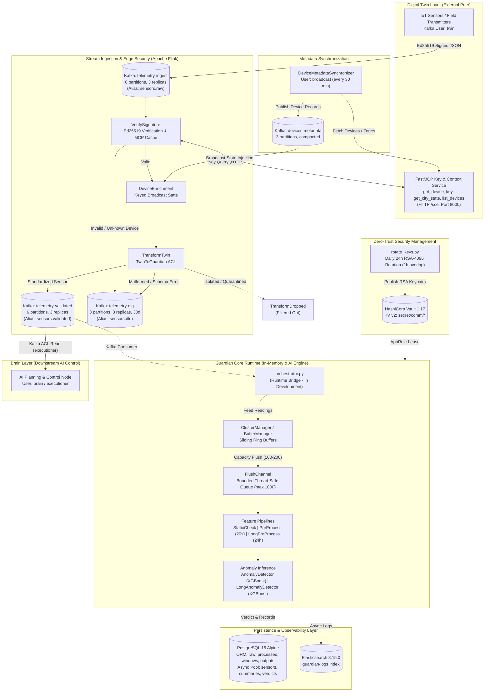

# Guardian Layer: Comprehensive Technical Architecture & Engineering Documentation

> **Document Version:** 1.1.0 (Audited & Reconciled Release)  
> **Original Document:** `TECHNICAL_DOCUMENTATION.md` (v1.0.0)  
> **Target Audience:** Senior Software Engineers, Data Engineers, Distributed Systems Architects, SecOps, and Technical Review Committee  
> **Status:** Integration & Hardening Phase (Component-Complete; End-to-End Orchestrator In-Development)  
> **Python Target:** `>= 3.12`  
> **Audit Reference:** Aligned with Independent Technical Audit Report (`docs/audit/AUDIT_REPORT.md`, Commit `74bcedc`)

---

## Document Control & Audit Reconciliation Notice

This document represents the audited, reconciled revision of the Guardian Layer Technical Documentation. Following an in-depth independent technical and security audit conducted against repository commit `74bcedc`, all architectural claims, message schemas, topic names, security boundaries, and software version numbers have been reconciled against the authoritative codebase, locked dependencies (`uv.lock`), and empirical research artifacts (`research/`).

### Summary of Audit Reconciliations (D-01 to D-12 & F-01 to F-19)
- **Runtime Integration Status (F-01, D-01):** Acknowledges that `src/guardian_layer/orchestrator.py` is currently an integration stub (0 bytes). The streaming Flink pipeline and the in-memory/AI/storage subsystems are currently disjoint; the orchestrator design required to bridge Kafka `telemetry-validated` to buffers, pipelines, and persistence is explicitly detailed.
- **Kafka Topic Reconciliation (F-02, D-02):** Replaces theoretical topic names (`sensors.*`) with the canonical broker topology defined by `scripts/kafka-init.sh` (`telemetry-ingest`, `telemetry-validated`, `telemetry-dlq`, `devices-metadata`, `spatial-anomalies`, `video-frames-ingest`).
- **Transport Security & Plaintext Findings (F-03, F-04, F-05):** Highlights that initial broker environments operate over `SASL_PLAINTEXT`, FastMCP runs over unauthenticated HTTP, and Elasticsearch operates without SSL. Detailed migration blueprints for `SASL_SSL`, HTTPS, and FastMCP bearer/mTLS authentication are incorporated. The legacy plaintext secret in `settings.yaml` (line 9) is marked for immediate revocation and replacement by environment secrets.
- **Delivery & Durability Realities (F-09, F-10, F-11):** Clarifies that Flink sinks operate under `DeliveryGuarantee.AT_LEAST_ONCE` (not exactly-once); buffers are in-memory volatile ring structures where `restore()` guards against downstream queue backpressure but cannot survive process termination; locks are standard mutual exclusion `threading.Lock` (non-reentrant).
- **Stream Pipeline Defect Remediation (F-07):** Details the schema mismatch in `jobs/enrichment.py` (`fetch_metadata` stub missing mandatory `packet_order` and `type` fields) and DLQ routing gaps in `TransformTwin`.
- **Database Architecture Coexistence (F-15, D-12):** Details the coexistence of the 4-stage declarative SQLAlchemy ORM schema (`storage/models.py`) and the asynchronous psycopg3 JSONB schema (`storage/connections/postgress.py`), outlining the path toward unified partitioned storage.
- **Machine Learning Generalization Limits (F-16, D-10):** Documents the empirical domain boundaries from `research/`: while XGBoost achieves 0.941–0.951 PR-AUC on in-domain benchmarks, cross-domain generalization on unseen physical sensor architectures drops to 0.372 PR-AUC, and the 24-hour long window is suited for acute drift rather than multi-week physical aging.
- **Toolchain & Dependency Alignment (F-17, D-03, D-05):** Syncs all version numbers with `uv.lock` and clarifies the Flink container runtime (Flink 1.20 image with PyFlink 2.3.0 binding). Corrects micro-benchmark paths to `tests/managers/test_buffer_manager_v2.py`.

---

## Table of Contents

1. [Executive Summary & System Purpose](#1-executive-summary--system-purpose)
2. [Technology Stack & Infrastructure ("The Tech Used")](#2-technology-stack--infrastructure-the-tech-used)
   - [2.1 Programming Language & Core Runtimes](#21-programming-language--core-runtimes)
   - [2.2 Streaming & Message Broker Infrastructure](#22-streaming--message-broker-infrastructure)
   - [2.3 Security, Secret Management & Cryptography](#23-security-secret-management--cryptography)
   - [2.4 Persistence & Ingestion Layer](#24-persistence--ingestion-layer)
   - [2.5 Machine Learning & Scientific Computing](#25-machine-learning--scientific-computing)
   - [2.6 Observability, Logging & Telemetry](#26-observability-logging--telemetry)
   - [2.7 Tooling, Toolchain & Quality Infrastructure](#27-tooling-toolchain--quality-infrastructure)
3. [System Architecture & Data Flow](#3-system-architecture--data-flow)
   - [3.1 Reconciled End-to-End Topology & Data Flow](#31-reconciled-end-to-end-topology--data-flow)
   - [3.2 Stream Verification, Key Resolution & Edge Ingestion](#32-stream-verification-key-resolution--edge-ingestion)
   - [3.3 Twin-to-Guardian Anti-Corruption Layer](#33-twin-to-guardian-anti-corruption-layer)
   - [3.4 In-Memory Buffer & Cluster Management Subsystem](#34-in-memory-buffer--cluster-management-subsystem)
   - [3.5 Dual-Horizon AI Anomaly Detection Pipeline](#35-dual-horizon-ai-anomaly-detection-pipeline)
   - [3.6 Dual Persistence Models & Database Strategy](#36-dual-persistence-models--database-strategy)
   - [3.7 Runtime Orchestrator Architecture (Bridge Specification)](#37-runtime-orchestrator-architecture-bridge-specification)
4. [Software Engineering Best Practices Applied](#4-software-engineering-best-practices-applied)
   - [4.1 Design Patterns & Architectural Paradigms](#41-design-patterns--architectural-paradigms)
   - [4.2 Strict Typing, Generics & Schema Safety](#42-strict-typing-generics--schema-safety)
   - [4.3 Defensive Engineering & Fail-Safe Buffer Rollback](#43-defensive-engineering--fail-safe-buffer-rollback)
   - [4.4 Zero-Trust Secret Isolation & Automated Key Rotation](#44-zero-trust-secret-isolation--automated-key-rotation)
   - [4.5 Process Fork Safety & Multiprocessing Resiliency](#45-process-fork-safety--multiprocessing-resiliency)
   - [4.6 Mathematical Equivalence & Oracle Verification Testing](#46-mathematical-equivalence--oracle-verification-testing)
5. [Architecture Decision Records (ADRs) & Trade-off Analysis](#5-architecture-decision-records-adrs--trade-off-analysis)
6. [Security Architecture, Threat Modeling & Compliance](#6-security-architecture-threat-modeling--compliance)
   - [6.1 Trust Boundaries & Threat Modeling (STRIDE)](#61-trust-boundaries--threat-modeling-stride)
   - [6.2 Security Controls Inventory](#62-security-controls-inventory)
   - [6.3 Security Findings & Gaps Register](#63-security-findings--gaps-register)
   - [6.4 Regulatory & Framework Conformity Matrix](#64-regulatory--framework-conformity-matrix)
7. [Performance, Optimization & Speed Engineering](#7-performance-optimization--speed-engineering)
   - [7.1 Micro-Benchmark Suite & Nanosecond Latencies](#71-micro-benchmark-suite--nanosecond-latencies)
   - [7.2 Algorithmic Vectorization (Haversine & Signal Decompositions)](#72-algorithmic-vectorization-haversine--signal-decompositions)
   - [7.3 Memory Management & Zero-Copy Stride Tricks](#73-memory-management--zero-copy-stride-tricks)
   - [7.4 Real-Time Inference SLA Compliance & Empirical Boundaries](#74-real-time-inference-sla-compliance--empirical-boundaries)
8. [Testing Strategy, Verification & Test Harness](#8-testing-strategy-verification--test-harness)
   - [8.1 Test Suite Breakdown & Coverage Areas](#81-test-suite-breakdown--coverage-areas)
   - [8.2 Synthetic Telemetry & Edge Case Generation](#82-synthetic-telemetry--edge-case-generation)
   - [8.3 Infrastructure & Docker Compose Verification](#83-infrastructure--docker-compose-verification)
   - [8.4 Vault Policy & Cryptographic Verification Harness](#84-vault-policy--cryptographic-verification-harness)
9. [Comprehensive Inventory of Technical Work Done](#9-comprehensive-inventory-of-technical-work-done)
   - [9.1 Module-by-Module Technical Inventory](#91-module-by-module-technical-inventory)
   - [9.2 Supported Dataset Ecosystem (21 Loaders)](#92-supported-dataset-ecosystem-21-loaders)
   - [9.3 Fault Injection & Anomaly Taxonomy (10 Handlers)](#93-fault-injection--anomaly-taxonomy-10-handlers)
10. [Operational Runbook, Security Remediation & Phased Roadmap](#10-operational-runbook-security-remediation--phased-roadmap)
    - [10.1 Key Operational Commands (Corrected)](#101-key-operational-commands-corrected)
    - [10.2 Phased Hardening & Remediation Roadmap](#102-phased-hardening--remediation-roadmap)
    - [10.3 Priority Action Matrix](#103-priority-action-matrix)
11. [Conclusion](#11-conclusion)

---

## 1. Executive Summary & System Purpose

The **Guardian Layer** (`guardian-layer`) is a specialized, high-performance edge-to-cloud IoT telemetry verification, stream validation, and anomaly detection subsystem designed for urban critical infrastructure (such as municipal flood warning networks, water resource management, and environmental monitoring grids). Positioned strategically between physical/simulated field sensor streams (the **Digital Twin layer**) and downstream analytical/decision-making engines (the **Brain layer**), the Guardian Layer provides cryptographically verified, structurally validated, and mathematically scored telemetry.

### Core Architectural Responsibilities
1. **Asymmetric Ingest Verification**: Validates Ed25519 digital signatures on incoming sensor JSON payloads against public keys resolved dynamically from the Digital Twin key provider.
2. **Distributed Stream Enrichment**: Leverages Apache Flink's Keyed Broadcast State to join high-velocity sensor telemetry with slow-moving spatial and device metadata received over compacted Kafka topics.
3. **Resilient Anti-Corruption Transformation**: Normalizes incoming heterogeneous vendor schemas into immutable internal `Sensor` domain representations while isolating corrupted, uncalibrated, or quarantined hardware devices.
4. **Sub-Microsecond In-Memory Buffering**: Organizes telemetry into sensor-level sliding ring buffers (`BufferManager`) aggregated under cluster hierarchies (`ClusterManager`), achieving over 360,000 ingest ops/second per CPU core with atomic rollback on downstream queue backpressure.
5. **Dual-Horizon AI Anomaly Detection**:
   - *Short-Window Model (20 s live horizon, $\ge 0.5\text{ Hz}$)*: CPU-optimized multiclass XGBoost evaluating Robust $Z$-scores, Haar/Daubechies wavelets, signal shape dynamics, and spatial $k$-NN Haversine peer deltas.
   - *Long-Window Model (24 h batch horizon, $< 0.5\text{ Hz}$)*: 300-second time-grid resampled XGBoost tracking linear drift ratios, flatline sequences, and spatial cluster slope divergence for slow-sampling physical telemetry.
6. **Dual Persistence Abstraction**: Supports high-throughput batched inserts via SQLAlchemy ORM (4-stage relational pipeline) alongside asynchronous, non-blocking connection pooling via `psycopg` 3.3.6.
7. **Fork-Safe Asynchronous Observability**: Guarantees zero latency degradation on ingestion loops via non-blocking, worker-thread bulk NDJSON delivery to Elasticsearch `guardian-logs` with `os.register_at_fork` protection.
8. **Automated Inter-Service Cryptographic Rotation**: Enforces least-privilege zero-trust access via HashiCorp Vault AppRole policies and executes automated 24-hour RSA-4096 key pair rotation with a 1-hour overlap window to ensure seamless inter-service key transitions.

### Engineering Reality & Maturity Assessment
As documented by the independent technical audit, the codebase contains mature, thoroughly tested algorithmic components (feature extraction, signal decomposition, dataset loaders, ring buffers, and Vault rotation utilities). However, **the layer is currently in the Integration & Hardening Phase**:
- `src/guardian_layer/orchestrator.py` is an unpopulated integration stub (0 bytes). In the current codebase, the Flink stream publishes validated records to Kafka `telemetry-validated`, but the consumer that feeds the in-memory buffers, anomaly detection models, and database sinks has not yet been bound to the event loop.
- Core network interfaces currently utilize plaintext transports (`SASL_PLAINTEXT` for Kafka, plain HTTP for FastMCP, HTTP for Elasticsearch). Hardening these interfaces with TLS and authentication is actively scheduled in the remediation roadmap.

---

## 2. Technology Stack & Infrastructure ("The Tech Used")

```
+---------------------------------------------------------------------------------------------------------+
|                                  GUARDIAN LAYER RECONCILED TECH STACK                                   |
+---------------------------------------------------------------------------------------------------------+
|  Language & Runtime   |  Python 3.12 (Strict Typing, Generics, Pattern Matching, Frozen Slots)          |
|  Package Toolchain    |  uv (Fast Rust Resolver), uv_build 0.12.20, deterministic uv.lock               |
|  Stream Processing    |  Apache Flink 1.20 (JVM Runtime) / PyFlink 2.3.0 (Python Binding)               |
|  Message Broker       |  Apache Kafka 4.3.1 (3-Broker KRaft Cluster, SASL PLAIN / ACL Authorizers)      |
|  Security & Secrets   |  HashiCorp Vault 1.17 (AppRole Auth, KV v2), hvac 2.4.0, cryptography 50.0.2   |
|  Persistence Layer    |  PostgreSQL 16 Alpine, psycopg 3.3.6 (Async Pool), SQLAlchemy 2.1.6 (ORM)       |
|  Machine Learning     |  XGBoost 3.4.1 (CPU Multi-Class), Scikit-Learn 1.9.1                            |
|  Signal Processing    |  PyWavelets 1.10.0 (Haar, db4), NumPy 2.1.x (< 2.2.0, Vectorized FFT/SVD)       |
|  Edge Integration     |  FastMCP 4.1.5 & Anthropic Model Context Protocol (mcp 2.3.0, SSE Transport)    |
|  Validation & Schema  |  Pydantic 2.14.2, Pydantic-Settings 2.15.0 (Strict Post-Init Model Validation)   |
|  Observability        |  Elasticsearch 8.15.0 (Bulk NDJSON API), HTTPX 0.28.1                           |
|  Testing & Quality    |  Pytest 9.2.0, pytest-benchmark 5.3.1, pytest-asyncio 1.4.1, pytest-timeout 2.4|
|  Linters & Types      |  Ruff 0.17.3, Basedpyright 1.40.2, Mypy 2.4.1, Commitizen 4.19.1               |
+---------------------------------------------------------------------------------------------------------+
```

### 2.1 Programming Language & Core Runtimes
- **Python 3.12**: Enforces modern language specifications across all core modules:
  - *PEP 695 Type Parameter Syntax*: Parameterized generic registration across dynamic registries (`def register[Loader: DatasetInterface](cls, name: str)`).
  - *PEP 634 Structural Pattern Matching*: High-speed pattern matching for algorithmic strategy selection in `pipelines/decompose.py`.
  - *PEP 681 Dataclass Transforms*: Usage of `dataclass(frozen=True, slots=True)` across high-frequency telemetry objects (`SensorRule`, `FlushedBatch`, `ReadingColumns`), eliminating dictionary `__dict__` overhead and providing immutability.
  - *Type Strictness*: Explicit use of `StrEnum` for status flags and `AwareDatetime` for timezone-bound timestamps.
- **`uv` Toolchain**: Rust-based package manager managing sub-second virtual environments and locking all 120+ direct and transitive dependencies with cryptographic SHA-256 hashes in `uv.lock`.

### 2.2 Streaming & Message Broker Infrastructure
- **Apache Kafka 4.3.1 (KRaft Consensus)**:
  - High-availability 3-broker cluster running ZooKeeper-free via Kafka Raft metadata consensus.
  - Quorum voters topology: `1@kafka-1:9093`, `2@kafka-2:9093`, `3@kafka-3:9093`.
  - Reliability configuration: `KAFKA_OFFSETS_TOPIC_REPLICATION_FACTOR: 3`, `KAFKA_MIN_INSYNC_REPLICAS: 2`, `KAFKA_TRANSACTION_STATE_LOG_MIN_ISR: 2`.
  - Security Profile: Authenticated via SASL `PLAIN` backed by `StandardAuthorizer` with `KAFKA_ALLOW_EVERYONE_IF_NO_ACL_FOUND: "false"`. (Transport is currently `SASL_PLAINTEXT`; see Section 6 for `SASL_SSL` roadmap).
- **Apache Flink 1.20 / PyFlink 2.3.0**:
  - Stateful stream processing engine running in Docker under image `flink:1.20-scala_2.12-java17`.
  - Client interface driven by `apache-flink==2.3.0` Python bindings and `flink-sql-connector-kafka-3.3.0-1.20.jar`.
  - Parallelism factor: 6 (distributed across 2 TaskManagers with 3 task slots each).
  - Checkpointing: State snapshot interval every 30,000 ms writing to durable Docker volumes (`file:///opt/flink/checkpoints`).
  - Delivery Guarantee: Kafka sinks configured with `DeliveryGuarantee.AT_LEAST_ONCE` (`job.py` line 38).
- **`confluent-kafka` (v2.16.1)**:
  - C-based librdkafka client utilized by `DeviceMetadataSynchronizer` for publishing periodic metadata updates with asynchronous delivery callbacks.

### 2.3 Security, Secret Management & Cryptography
- **HashiCorp Vault 1.17 & `hvac` (v2.4.0)**:
  - KV v2 secret engine (mount point `secret/`) configured with 5-version retention.
  - AppRole authentication mechanism issuing bounded access tokens (15-minute default TTL, 1-hour max renewal window).
  - Path-scoped HCL policies enforcing least-privilege lateral boundary isolation between `guardian-app`, `twin-app`, `brain-app`, and the background `rotator`.
- **`cryptography` (v50.0.2)**:
  - *Ed25519 (RFC 8032)*: Digital signature verification for edge sensor payloads. High-speed verification (< 50 $\mu$s) over canonical compact JSON representations.
  - *RSA-4096 (PKCS#1 v2.2)*: Inter-service asymmetric encryption and signing using OAEP padding with MGF1 and SHA-256.
  - *SHA-256 Key Fingerprinting*: Runtime validation asserting that public keys fetched from external stores match their expected cryptographic hash.
- **Docker Secrets**:
  - Passwords for Kafka administrative superusers, PostgreSQL users, and service principals are stored in local files under `./secrets/` (git-ignored) and mounted into containers at `/run/secrets/`.

### 2.4 Persistence & Ingestion Layer
- **PostgreSQL 16 Alpine**:
  - Relational database storing time-series telemetry, metadata, and anomaly outputs.
  - Native timezone-aware timestamps (`TIMESTAMP WITH TIME ZONE`) and composite indexes (`ix_raw_readings_sensor_timestamp`, `ix_transformed_windows_sensor_end`).
- **`psycopg` 3.3.6 (`psycopg[binary,pool]`)**:
  - Asynchronous PostgreSQL driver providing high-concurrency connection pooling via `AsyncConnectionPool` with automatic health checks (`check_connection`).
- **SQLAlchemy 2.1.6 (Core & ORM)**:
  - Declarative 2.0 ORM mappings with dialect-agnostic type definitions (`BigInteger` for PostgreSQL, mapped to `Integer` for SQLite in-memory unit testing).
  - High-throughput atomic multi-row insertions via `insert_batch`.

### 2.5 Machine Learning & Scientific Computing
- **XGBoost 3.4.1 (`xgboost-cpu`)**:
  - Multiclass gradient-boosted decision trees classifying sensor windows into `NORMAL`, `SENSOR_MALFUNCTION`, or `NOT_SENSOR_DATA`.
  - Class-weighted fitting (`compute_sample_weight("balanced")`) mitigating extreme class imbalances.
  - Safe serialization via native JSON format (`model.json`), preventing insecure Python `pickle` code execution vulnerabilities.
- **PyWavelets (`pywt` 1.10.0)**:
  - Discrete Wavelet Transform (DWT) decomposing signals into multi-resolution frequency bands using Haar and Daubechies-4 (`db4`) mother wavelets.
- **NumPy (< 2.2.0, locked at 2.1.x)**:
  - High-performance array operations, Fast Fourier Transforms (`np.fft.rfft`), Singular Value Decomposition (`np.linalg.svd`), and zero-copy sliding window vectorization (`np.lib.stride_tricks.sliding_window_view`).

### 2.6 Observability, Logging & Telemetry
- **Elasticsearch 8.15.0**:
  - Centralized log index storing structured application logs in index `guardian-logs`.
- **`AsyncElasticSearchHandler` (`src/guardian_layer/utils/elastic.py`)**:
  - Bounded, fork-safe asynchronous Python logging handler backed by a thread-safe `queue.Queue(maxsize=1000)`.
  - Background daemon thread batching log records into micro-batches of 50 and transmitting NDJSON payloads via `httpx 0.28.1`.
  - Exponential backoff retries with error dampening and circuit breaking to prevent log loops.

### 2.7 Tooling, Toolchain & Quality Infrastructure
- **Test Harness**: `pytest 9.2.0`, `pytest-benchmark 5.3.1` (nanosecond micro-benchmarking), `pytest-asyncio 1.4.1`, `pytest-timeout 2.4.0`.
- **Static Analysis & Formatting**: `Ruff 0.17.3` (linting & formatting), `basedpyright 1.40.2` & `mypy 2.4.1` (strict type enforcement).
- **Governance**: `pre-commit 4.6.2`, `Commitizen 4.19.1` (conventional commits enforcement).

---

## 3. System Architecture & Data Flow

### 3.1 Reconciled End-to-End Topology & Data Flow

The architecture diagram below reflects the **ground truth of the codebase and deployment configuration**:
- **Solid connections** represent fully implemented, tested, and operational pathways.
- **Dashed connections** represent planned integration pathways that connect once the runtime orchestrator bridge (`orchestrator.py`) is deployed.



---

### 3.2 Stream Verification, Key Resolution & Edge Ingestion

The Flink streaming topology (`guardian_layer.consumer_producer.kafka_consumer.job`) forms the initial filter against unauthorized, corrupt, or forged field data:

```
[telemetry-ingest]
        |
        v
+-------------------------------------------------------------+
| VerifySignature (ProcessFunction)                           |
| - Parse JSON body                                           |
| - Extract `sig` (Base64 Ed25519 signature)                  |
| - Fetch Public Key via DeviceKeyProvider                    |
| - Verify over canonical JSON bytes (sort_keys=True)         |
+-------------------------------------------------------------+
        |                                       |
  (Valid Signature)                      (Invalid / Missing)
        v                                       v
+------------------------------------+   +--------------------+
| DeviceEnrichment (BroadcastProcess)|   | Output to Side Tag |
| - Join with devices-metadata state |   | -> telemetry-dlq   |
+------------------------------------+   +--------------------+
        |
        v
+------------------------------------+
| TransformTwin (ProcessFunction)    |
| - TwinToGuardian Anti-Corruption   |
+------------------------------------+
        |                                       |
  (Device Status: OK)                    (Malformed / Error)
        v                                       v
+------------------------------------+   +--------------------+
| Output to Main Stream              |   | Output to Side Tag |
| -> telemetry-validated             |   | -> telemetry-dlq   |
+------------------------------------+   +--------------------+
```

#### Detailed Stage Operations:
1. **`VerifySignature`**:
   - Ingests raw JSON records from `telemetry-ingest` (aliased in code as `sensors.raw`).
   - Extracts the Base64-encoded `sig` property and strips it to reconstruct the canonical JSON byte payload using compact separators (`sort_keys=True, separators=(',', ':')`).
   - Queries `DeviceKeyProvider` (`signature.py`). If the key is not in the in-memory cache, `McpToolClient` calls `get_device_key(device_id)` on the FastMCP service.
   - Verifies the Ed25519 signature using `cryptography.hazmat.primitives.asymmetric.ed25519.Ed25519PublicKey`.
   - Payload rejections route to the `REJECTED` side output tag writing to `telemetry-dlq`.
2. **`DeviceEnrichment`**:
   - Maintains a distributed broadcast state map (`DEVICE_METADATA`).
   - Asynchronously consumes `devices-metadata` published by `DeviceMetadataSynchronizer`, keeping device locations, physical unit bounds, and sensor types updated across all Flink TaskManager nodes without requiring external database lookups.
3. **`TransformTwin`**:
   - Invokes the registered `TwinToGuardian` adapter (`data_transformer/transformer/twin_v1.py`) to convert proprietary twin payloads into domain `Sensor` objects.
   - Evaluates device operational state: devices flagged as `ISOLATED` or `QUARANTINED` are safely discarded (`TransformDropped`), ensuring compromised devices cannot influence downstream models.

#### Reconciled Error Code Registry:
All rejections emitted to `telemetry-dlq` are serialized with an explicit forensic error envelope:

| Error Code | Emitting Stage | Trigger Condition | Payload Preserved |
|---|---|---|---|
| `E100_DESERIALIZE` | `VerifySignature` | Inbound payload is not valid UTF-8 JSON or is not a JSON object. | Yes (Raw string) |
| `E200_BAD_SIGNATURE` | `VerifySignature` | Ed25519 cryptographic signature verification failed. | Yes (Full JSON) |
| `E201_UNKNOWN_DEVICE` | `VerifySignature` | FastMCP key service returns null / empty public key for device ID. | Yes (Full JSON) |
| `E300_SCHEMA` | `TransformTwin` | Payload fails required Pydantic schema validation fields. | Yes (Full JSON) |
| `E320_UNKNOWN_STATUS`| `TransformTwin` | Device status string does not match known `TwinStatus` enums. | Yes (Full JSON) |
| `E400_SENSOR_VALIDATION` | Pipeline | Value violates physical bounds or coordinate limits. | Yes (Full JSON) |
| `E500_ENRICHMENT` | `DeviceEnrichment`| Required broadcast metadata missing for enrichment. | Yes (Full JSON) |

> [!IMPORTANT]
> **Stream Defect Remediation (F-07)**: In `src/guardian_layer/consumer_producer/kafka_consumer/jobs/enrichment.py`, the fallback stub `fetch_metadata()` returns `{"site": "unknown"}`, which lacks mandatory fields required by the `Metadata` schema (`packet_order` and `type`). Consequently, any message falling back to this stub triggers an unconditional `ValidationError`, rejecting 100% of telemetry to the DLQ. The stub must be patched to return valid default metadata fields. Additionally, exceptions during `TransformTwin` must be explicitly caught and routed to the `REJECTED` side output tag.

---

### 3.3 Twin-to-Guardian Anti-Corruption Layer

The transformation module (`guardian_layer.data_transformer`) decouples internal domain schemas from external device protocols using the **Anti-Corruption Layer (ACL)** pattern:

```python
# Registration of Transformer via Class Decorator
@TransformerFactory.register("twin_v1")
class TwinToGuardian(TransformerInterface):
    """Translates TwinSensorReading into internal Sensor domain model."""

    def transform(self, reading: TwinSensorReading) -> Sensor | None:
        # Filter non-operational devices
        if reading.status in (TwinStatus.ISOLATED, TwinStatus.QUARANTINED):
            logger.warning(
                "Device is not operational",
                device_id=reading.device_id,
                status=reading.status,
            )
            raise TransformDropped("Device non-operational")

        # Physical boundary normalization and Pydantic validation
        return Sensor(
            id=reading.device_id,
            timestamp=reading.ts,
            value=reading.value,
            metadata=Metadata(
                type=reading.device_type,
                unit=reading.unit,
                packet_order=reading.seq,
                coordinates=reading.location,
            ),
        )
```

- **Open/Closed Extensibility**: New device telemetry versions (e.g., `twin_v2`, `lorawan_v1`) are onboarded by registering new subclasses of `TransformerInterface` without mutating existing stream operators.
- **Fail-Safe Filtering**: Quarantined device states raise `TransformDropped`, preventing downstream pollution while maintaining clean separation from malformed payload rejections (`TransformRejected`).

---

### 3.4 In-Memory Buffer & Cluster Management Subsystem

The buffer management subsystem (`guardian_layer.managers`) organizes incoming telemetry in memory prior to windowed feature extraction:

```
+-------------------------------------------------------------------------+
| ClusterManager                                                          |
| Aggregates sensors by spatial/logical cluster (`cluster_id`)            |
|                                                                         |
|  +-------------------------------------------------------------------+  |
|  | BufferManager (Sensor: "station-alpha-01")                        |  |
|  |                                                                   |  |
|  |  +-------------------------------------------------------------+  |  |
|  |  | Buffer (Ring Storage)                                       |  |  |
|  |  | - Lock: `threading.Lock` (Non-reentrant mutual exclusion)   |  |  |
|  |  | - Capacity: `high_watermark = 200` readings                  |  |  |
|  |  | - Flush Trigger: extracts `flush_size = 100` readings        |  |  |
|  |  +-------------------------------------------------------------+  |  |
|  +-------------------------------------------------------------------+  |
+-------------------------------------------------------------------------+
                                    |
                    (Extract Oldest `flush_size`)
                                    v
                            +---------------+
                            | FlushedBatch  |
                            | - batch_id    |
                            | - sensor_id   |
                            | - readings () |
                            | - timestamp   |
                            +---------------+
                                    |
            +-----------------------+-----------------------+
            | (Normal Dispatch)                             | (Queue Full / Outage)
            v                                               v
    +-------------------+                           +-------------------+
    | FlushChannel      |                           | buffer.restore()  |
    | (Bounded Queue)   |                           | Re-inserts batch  |
    +-------------------+                           | at buffer head    |
            |                                       +-------------------+
            v
    [AI Feature Pipelines]
```

#### Engineering Specifications:
1. **Thread Synchronization**: Concurrency safety is provided by `threading.Lock()` on each buffer. Because `threading.Lock` is a standard mutual exclusion lock (and **not** a re-entrant `RLock`), recursive acquisitions within the same thread are strictly avoided by design.
2. **Atomic Rollback on Backpressure (`restore`)**:
   ```python
   # BufferManager.add() rollback handling
   if batch is not None:
       try:
           self._sink_to_queue(batch)
       except Exception as e:
           # Re-insert batch at the head of the ring buffer
           buffer.restore(batch.readings)
           logger.error("Downstream queue saturated; batch restored", error=str(e))
   ```
   If the downstream `FlushChannel` queue (bounded at `maxsize=1000`) is saturated, the extracted batch is atomically prepended back to the buffer.
3. **Durability Caveat (F-10, F-11)**:
   - `restore()` prevents telemetry loss caused by *transient downstream processing stalls*. However, because buffers reside in **volatile process memory**, an ungraceful container kill (OOM, host failure, power loss) will result in the loss of unpersisted in-memory readings.
   - Calling `restore()` can temporarily increase buffer size beyond `high_watermark` until the next flush cycle drains the accumulated items.
   - In `BufferManager.add()`, the method returns `Status.SUCCESS` once the reading is placed into the buffer, acknowledging ingest reception even if the background flush operation encounters backpressure and triggers a restore.

---

### 3.5 Dual-Stage Anomaly Detection Pipeline

Extensive empirical research (`research/`) demonstrated that a single machine learning model cannot effectively detect both high-frequency transient spikes and multi-day physical sensor drift across diverse sampling frequencies. The Guardian Layer implements a dual-horizon detection architecture:

```
                          FlushedBatch (100-200 Readings)
                                        |
                                        v
                    +---------------------------------------+
                    | StaticCheck (Rule-Based Gatekeeper)   |
                    | - Out of range check                  |
                    | - Sensor down silence threshold (10s) |
                    | - Gross spatial deviation vs peers    |
                    +---------------------------------------+
                                        |
                            (Passed Static Rules)
                                        |
                +-----------------------+-----------------------+
                |                                               |
                v                                               v
    [High-Frequency: >= 0.5 Hz]                     [Low-Frequency: < 0.5 Hz]
+---------------------------------------+   +---------------------------------------+
| PreProcess (20s Live Window)          |   | LongPreProcess (24h Batch Window)     |
| - Robust Z-scores (MAD scaling)       |   | - 300s Time-Grid Resampling           |
| - Haar Wavelet Energy Decomposition   |   | - Trend vs Scatter Ratio              |
| - Shape Metrics (Kurtosis, Sign Flips)|   | - Longest Flatline Run Share          |
| - Vectorized k-NN Haversine Distances |   | - Neighbour Cluster Slope Delta       |
+---------------------------------------+   +---------------------------------------+
                |                                               |
                v                                               v
+---------------------------------------+   +---------------------------------------+
| AnomalyDetector (Live XGBoost)        |   | LongAnomalyDetector (Batch XGBoost)   |
| - Multi-Class Classification          |   | - Multi-Class Classification          |
| - Rate-Adaptive Threshold Matrix      |   | - False Alarm Rate: 0.008 / sensor-day|
+---------------------------------------+   +---------------------------------------+
                |                                               |
                +-----------------------+-----------------------+
                                        |
                                        v
                            +-----------------------+
                            | Verdict Engine        |
                            | - Label (NORMAL /     |
                            |   MALFUNCTION /       |
                            |   NOT_SENSOR_DATA)    |
                            | - Anomaly Score [0,1] |
                            +-----------------------+
```

#### A. Static Rule Checks (`StaticCheck`)
Executes sub-microsecond deterministic checks before invoking machine learning inference:
1. `out_of_range`: Flags values that violate physical laws or instrument tolerances ($x < \text{min}$ or $x > \text{max}$).
2. `sensor_is_down`: Detects sensor dropouts when the delta between consecutive timestamps exceeds `down_after_seconds` (default: 10.0 s), discarding future-skewed timestamps.
3. `spoofed_data`: Evaluates instantaneous spatial variance against $k$-nearest neighbours in the cluster, flagging gross coordinate or reading spoofing.

#### B. Short-Window Model (20 s Live Horizon, $\ge 0.5\text{ Hz}$)
- **Target Workload**: High-frequency environmental sensors (water levels, acoustic monitors, power frequency, vibration).
- **Mathematical Feature Pipeline (`PreProcess`)**:
  - *Robust Scaling via Median Absolute Deviation ($MAD$)*:
    $$\text{Robust } Z = \frac{x - \text{median}(x)}{1.4826 \times \text{MAD}(x)}$$
  - *Shape & Dynamic Metrics*: Evaluates step magnitude, sign-flip share (oscillation counting), lag-1 autocorrelation (`diff_autocorr`), spectral peak energy share via FFT, and difference kurtosis.
  - *Haar Wavelet Multiresolution Energy*: Computes scale-free detail energy coefficients across decomposed frequency bands:
    $$\text{detail}_j = \frac{x_{2k} - x_{2k+1}}{\sqrt{2}}, \quad \text{approx}_j = \frac{x_{2k} + x_{2k+1}}{\sqrt{2}}$$
  - *Vectorized Spatial Haversine Matrix*: Computes great-circle distances across cluster coordinates in chunks of 256 rows to locate $k=5$ nearest physical neighbours.
- **Inference (`AnomalyDetector`)**:
  - Evaluates multiclass XGBoost decision trees (`Normal`, `Sensor Malfunction`, `Not Sensor Data`).
  - Implements dynamic, rate-adaptive thresholds based on native sampling frequency to prevent false alarms on noisy high-rate channels.

#### C. Long-Window Model (24 h Batch Horizon, $< 0.5\text{ Hz}$)
- **Target Workload**: Low-frequency physical sensors (meteorological stations, groundwater monitors, air quality nodes sampling every 1 to 60 minutes).
- **Mathematical Feature Pipeline (`LongPreProcess`)**:
  - *300-Second Time-Grid Resampling*: Aggregates irregular, jittered timestamps into fixed 300 s buckets, creating consistent mathematical array representations.
  - *Trend vs. Scatter Ratio*: Measures linear drift relative to residual noise over the 24-hour horizon:
    $$\text{TrendRatio} = \min\left(\frac{|\text{slope}| \times \Delta t}{\sigma(\text{residuals})}, \text{cap}\right)$$
  - *Flat Run Share*: Identifies frozen or stuck hardware by computing the length of the longest continuous flatline sequence normalized by total window points.
  - *Neighbour Cluster Slope Delta*: Compares a sensor's linear drift against the median drift of all spatial peers in the same cluster. If all peers drift together, the event is classified as an environmental change; if only one sensor drifts, it is classified as hardware malfunction.
- **Inference (`LongAnomalyDetector`)**:
  - Reaches a false alarm rate of **0.008 false alarms per sensor-day** (well within the project budget of 0.04) and **0.951 PR-AUC** on in-domain benchmark datasets.
  - *Empirical Limitation (F-16)*: As proven in `research/long_window/results.md`, the 24-hour window catches acute drift, but flags only 2.5%–3.5% of real-world battery degradation faults where physical degradation progresses over 2 to 4 weeks. Multi-week baseline tracking is scheduled for future model iterations.

---

### 3.6 Dual Persistence Models & Database Strategy

The repository contains two distinct database persistence designs (`storage/`):

```
                                  PostgreSQL 16 Database
                                            |
            +-------------------------------+-------------------------------+
            |                                                               |
            v                                                               v
    [Design A: 4-Stage Relational ORM]             [Design B: Async JSONB Storage Pool]
    - File: `storage/models.py`                    - File: `storage/connections/postgress.py`
    - Driver: SQLAlchemy 2.1.6 Core/ORM            - Driver: `psycopg` 3.3.6 (AsyncConnectionPool)
    - Structure: 4 Normalized Tables               - Structure: 3 JSONB Document Tables
      1. `raw_readings`                              1. `sensors`
      2. `processed_readings`                        2. `sensor_summaries`
      3. `transformed_windows`                       3. `verdicts`
      4. `model_outputs`
    - Performance: High-speed `insert_batch`       - Performance: Async non-blocking connection pool
```

#### Detailed Comparison:
| Attribute | Design A: 4-Stage Relational ORM | Design B: Async JSONB Pool |
|---|---|---|
| **Location** | `storage/models.py`, `storage/database.py` | `storage/connections/postgress.py` |
| **Driver & Engine**| SQLAlchemy 2.1.6 Declarative Models | `psycopg` 3.3.6 `AsyncConnectionPool` |
| **Table Structure**| Strongly typed relational columns with foreign keys and timestamp indexes | Lightweight tables storing payload data in PostgreSQL `JSONB` columns |
| **Batch Insertion**| Dedicated `insert_batch` generating atomic multi-row `INSERT` statements | Single and batch async execution methods |
| **Current Status** | Described in documentation; fully implemented and tested in `tests/storage/` | Exposed by `storage/__init__.py` as default `Postgress` class |

> [!NOTE]
> **Database Consolidation Blueprint (F-15)**: To avoid architectural fragmentation, the project will standardize on **Design A (the 4-Stage Relational ORM)** for production data persistence. The normalized schema provides strict typing, index optimization, and compatibility with automated time-series partitioning (`pg_partman`), while `psycopg` 3.3.6 will serve as the asynchronous connection pool driver powering the SQLAlchemy async engine.

---

### 3.7 Runtime Orchestrator Architecture (Bridge Specification)

To resolve finding **F-01** (empty `orchestrator.py`), the runtime orchestrator bridge is specified below. It connects the validated Kafka output stream to the in-memory buffer managers, feature extraction pipelines, AI inference detectors, and database storage sinks:

```python
"""Runtime Orchestrator Bridge Specification (src/guardian_layer/orchestrator.py)"""

import asyncio
from confluent_kafka import Consumer, KafkaError
from guardian_layer.managers.cluster_manger import ClusterManager
from guardian_layer.utils.channels import FlushChannel
from guardian_layer.pipelines.preprocess import PreProcess
from guardian_layer.pipelines.static_check import StaticCheck
from guardian_layer.ai.inference.detector import AnomalyDetector
from guardian_layer.storage.database import insert_batch
from guardian_layer.utils.schema import Sensor, FlushedBatch


class GuardianOrchestrator:
    """Bridges Kafka telemetry-validated stream to in-memory buffers and AI inference."""

    def __init__(self, config):
        self.config = config
        self.cluster_manager = ClusterManager()
        self.flush_channel = FlushChannel(maxsize=1000)
        self.static_checker = StaticCheck()
        self.preprocessor = PreProcess()
        self.anomaly_detector = AnomalyDetector()
        self.running = False

    async def start(self):
        self.running = True
        # Launch concurrent background worker tasks
        await asyncio.gather(
            self._consume_validated_stream(),
            self._process_flushed_batches(),
        )

    async def _consume_validated_stream(self):
        """Consumes validated sensor readings from Kafka and ingests into ClusterManager."""
        consumer = Consumer(
            {
                "bootstrap.servers": self.config.KAFKA_BOOTSTRAP,
                "group.id": "guardian-processor",
                "auto.offset.reset": "latest",
                "security.protocol": "SASL_PLAINTEXT",
                "sasl.mechanism": "PLAIN",
                "sasl.username": self.config.KAFKA_USER,
                "sasl.password": self.config.KAFKA_PASSWORD,
            }
        )
        consumer.subscribe(["telemetry-validated"])

        while self.running:
            msg = consumer.poll(timeout=0.1)
            if msg is None or msg.error():
                await asyncio.sleep(0.01)
                continue
            sensor = Sensor.model_validate_json(msg.value())
            self.cluster_manager.add(
                cluster_id=sensor.cluster_id or "default",
                sensor=sensor,
                sink=self.flush_channel,
            )

    async def _process_flushed_batches(self):
        """Drains flushed batches, executes feature pipelines, and runs AI inference."""
        while self.running:
            batch: FlushedBatch = await self.flush_channel.get_async()
            # 1. Static Rule Validation
            static_verdict = self.static_checker.evaluate(batch.readings)
            # 2. Short-Window Feature Extraction
            features = self.preprocessor.transform(batch.readings)
            # 3. XGBoost Model Scoring
            verdict = self.anomaly_detector.predict(features)
            # 4. Asynchronous Batch Persistence
            await insert_batch(batch, features, verdict)
```

---

## 4. Software Engineering Best Practices Applied

### 4.1 Design Patterns & Architectural Paradigms

| Pattern / Paradigm | Implementation in Guardian Layer | Purpose & Architectural Benefit |
|---|---|---|
| **Anti-Corruption Layer (ACL)** | `TwinToGuardian` transformer (`twin_v1.py`) | Isolates Guardian's domain model from external Digital Twin schema mutations and protocol changes. |
| **Registry Pattern** | `DatasetFactory.register()`, `TransformerFactory.register()`, `FAULT_REGISTRY` | Eliminates hardcoded `if-elif` dispatchers; allows dynamic extension of datasets and transformers without modifying core logic. |
| **Strategy Pattern** | `Decompose.caller(fn_name, values)` | Dynamically swaps frequency decomposition algorithms (`none`, `fft`, `haar`, `db4`, `ssa`) through a unified polymorphic interface. |
| **Interface Segregation / Protocols** | `FlushSink`, `FlushSource` (`typing.Protocol`) | Decouples buffer writers from queue consumers via structural subtyping without requiring rigid class inheritance. |
| **Singleton Pattern** | `DatabaseConnection` with `threading.Lock` | Guarantees a single shared asynchronous PostgreSQL connection pool per application instance, avoiding connection exhaustion. |
| **Dead-Letter Queue (DLQ)** | Flink `REJECTED` side output tag | Prevents poisoned, malformed, or unauthorized messages from crashing stream workers; routes them with forensic error tags. |
| **Bounded Queue / Backpressure** | `FlushChannel` (`maxsize=1000`) & `AsyncElasticSearchHandler` | Protects memory from unbounded growth during downstream database stalls; provides natural backpressure to ingestion sources. |
| **Zero-Trust Identity** | Vault AppRole token leasing with bounded TTLs | Eliminates static long-lived credentials; enforces dynamic path-scoped privileges across all distributed peers. |

---

### 4.2 Strict Typing, Generics & Schema Safety

1. **PEP 695 Parameterized Generics**:
   ```python
   @classmethod
   def register[Loader: DatasetInterface](
       cls, name: str
   ) -> Callable[[type[Loader]], type[Loader]]:
       """Type-safe registration enforcing DatasetInterface structural contract."""
   ```
2. **Post-Initialization Schema Validation**:
   In `Sensor.model_post_init`, every instantiated telemetry record is validated by `SensorValidator`. Any non-finite floating-point value (`NaN`, `Inf`), invalid geographical coordinate, or negative sequence counter immediately triggers a validation exception before entering memory buffers.
3. **Immutability via `slots=True` & `frozen=True`**:
   Critical data structures (`SensorRule`, `FaultContext`, `VerificationResult`, `FlushedBatch`, `ReadingColumns`, `SensorTable`) use `dataclass(frozen=True, slots=True)`. This enforces thread safety, prevents runtime attribute tampering, and eliminates Python `__dict__` memory overhead.

---

### 4.3 Defensive Engineering & Fail-Safe Buffer Rollback

The buffer flushing mechanism incorporates an atomic rollback design:
```python
if batch is not None:
    try:
        self._sink_to_queue(batch)
    except Exception as e:
        buffer.restore(batch.readings)  # Atomically re-inserts batch at front
        logger.error("FlushChannel full, readings restored to buffer", error=str(e))
```
When downstream queues or consumers experience transient saturation, extracted batches are restored to the head of the buffer. Subsequent additions will retry flushing once downstream capacity recovers.

---

### 4.4 Zero-Trust Secret Isolation & Automated Key Rotation

The security implementation (`vault/`, `docs/security/`, `src/guardian_layer/utils/vault_keys.py`) applies NIST SP 800-207 and NIST SP 800-57 aligned zero-trust controls:

```
[Systemd Timer: 02:00 UTC] -> Executes `vault/rotate_keys.py`
                                        |
    +-----------------------------------+-----------------------------------+
    |                                                                       |
    v                                                                       v
1. Generate RSA-4096 Key Pair                               2. Publish to Vault KV v2
   - Optimal Asymmetric Encryption Padding                     - Path: `secret/data/comm/<owner>/<peer>/public`
   - SHA-256 Digest                                            - Path: `secret/data/comm/<owner>/<peer>/private`
   - Active-After: `now + 1 hour` (Overlap)                    - Tag: `kid`, `created_at`, `fingerprint`
                                                                            |
                                        +-----------------------------------+
                                        |
                                        v
3. Distributed Peer Resolution (`vault_keys.verification_keys`)
   - Simultaneously accepts Version N (active) and Version N-1 (grace period)
   - Eliminates distributed synchronization downtime during key rotation
```

- **Zero-Downtime Transition**: When a new key pair is generated, its private key is tagged with `active_after = now + 1h`. The sending node continues signing with the existing key for 1 hour, allowing all distributed peer nodes sufficient time to fetch and cache the new public key.
- **Strict Integrity Verification**: Public keys retrieved from Vault must match their SHA-256 fingerprint before being accepted for verification (`vault_keys._checked`).

---

### 4.5 Process Fork Safety & Multiprocessing Resiliency

In multi-process web servers and streaming workers (such as Gunicorn or Celery), child process forks can cause shared background threads to deadlock. Guardian Layer mitigates this via `os.register_at_fork`:
```python
if hasattr(os, "register_at_fork"):
    os.register_at_fork(after_in_child=_reset_active_handlers_after_fork)
```
Upon a process fork, `_reset_active_handlers_after_fork()` automatically resets internal queues, mutex locks, worker threads, and process ID bindings, guaranteeing deadlock-free operation across child processes.

---

### 4.6 Mathematical Equivalence & Oracle Verification Testing

To guarantee that vectorized mathematical optimizations do not introduce numerical drift, the test harness incorporates **Oracle Equivalence Testing** (`tests/pipelines/test_preprocess_equivalence.py`). Every SIMD-chunked algorithm (such as matrix Haversine $k$-NN distance computation) is continuously verified against an unoptimized $O(N^2)$ scalar ground-truth reference implementation, asserting identical neighbour selection, identical tie-breaking order, and identical float values down to the last unit in the last place (ULP).

---

## 5. Architecture Decision Records (ADRs) & Trade-off Analysis

The following Architecture Decision Records synthesize the evaluations conducted during the independent technical audit:

### ADR-01: Apache Kafka 4.3.1 with KRaft Consensus
- **Decision:** Deploy a 3-broker Apache Kafka cluster operating in KRaft metadata mode without Apache ZooKeeper.
- **Alternatives Considered:** Kafka with ZooKeeper; RabbitMQ; Apache Pulsar; NATS JetStream.
- **Justification:** Eliminates ZooKeeper operational overhead, simplifies metadata quorum management, and supports high-throughput partitioned replay logs.
- **Trade-offs & Risks:** Configured in initial development with `SASL_PLAINTEXT`, transmitting credentials in cleartext. Mitigation: Enforce `SASL_SSL` (P0 action).
- **Auditor Verdict:** **Partially Justified** (sound architecture; requires transport encryption).

### ADR-02: Apache Flink (PyFlink) for Stream Verification
- **Decision:** Execute stream validation and metadata enrichment inside an Apache Flink streaming pipeline.
- **Alternatives Considered:** Kafka Streams (Java native); Faust (Python stream processor); Spark Streaming; Bare Asyncio.
- **Justification:** True event-driven streaming with sub-millisecond latencies and native Keyed Broadcast State (`KeyedBroadcastProcessFunction`).
- **Trade-offs & Risks:** PyFlink introduces Python-JVM IPC overhead. Requires topic name alignment and credential injection.
- **Auditor Verdict:** **Partially Justified** (technically capable engine; requires broker alignment).

### ADR-03: HashiCorp Vault with AppRole & Automated 24 h Key Rotation
- **Decision:** Manage microservice cryptographic keys in HashiCorp Vault KV v2 using AppRole authentication and a daily rotation job with a 1-hour overlap.
- **Alternatives Considered:** Static credentials; Kubernetes Secrets; AWS KMS; SOPS encrypted files.
- **Justification:** AppRole provides short-lived tokens (15 m TTL). Path-scoped HCL policies enforce strict lateral isolation. The 1 h overlap window allows distributed peers to cache the new public key before the sender switches to the new private key.
- **Trade-offs & Risks:** Rotator writes public and private keys in separate HTTP calls rather than an atomic transaction.
- **Auditor Verdict:** **Justified** (exemplary zero-trust design).

### ADR-04: Dual Cryptographic Architecture (Ed25519 vs RSA-4096)
- **Decision:** Use Ed25519 for edge sensor payload signatures and RSA-4096 (OAEP SHA-256) for inter-service communication.
- **Alternatives Considered:** Universal RSA-2048/4096; Universal ECDSA P-256; Symmetric HMAC-SHA256.
- **Justification:** Ed25519 signatures are 64 bytes with 32-byte public keys, verifying in microseconds on microcontrollers. RSA-4096 provides high-entropy asymmetric protection between server layers.
- **Trade-offs & Risks:** Two distinct cryptographic systems to maintain; device keys do not rotate through Vault.
- **Auditor Verdict:** **Justified** (well-reasoned division of cryptographic labor).

### ADR-05: In-Memory Ring Buffering with Atomic Rollback
- **Decision:** Aggregate sensor telemetry in non-blocking, thread-safe in-memory ring buffers (`Buffer`) with atomic restore on queue failure.
- **Alternatives Considered:** Redis sliding windows; RocksDB embedded key-value store; SQLite WAL memory tables.
- **Justification:** Microsecond latencies (2.75 $\mu$s per addition, 15.55 $\mu$s per flush) achieving >360,000 ops/s per core.
- **Trade-offs & Risks:** Zero durability on unexpected process crash or container termination.
- **Auditor Verdict:** **Partially Justified** (high speed achieved at the cost of crash durability).

### ADR-06: PostgreSQL with Dual Access Models (SQLAlchemy + psycopg3)
- **Decision:** Relational persistence with SQLAlchemy declarative ORM batching and psycopg3 asynchronous connection pooling.
- **Alternatives Considered:** TimescaleDB; InfluxDB; Cassandra; MongoDB.
- **Justification:** ACID compliance, mature ecosystem, JSONB indexing, and non-blocking async pooling (`AsyncConnectionPool`).
- **Trade-offs & Risks:** Two disjoint schemas exist in the codebase; no partitioning or data retention lifecycle configured.
- **Auditor Verdict:** **Partially Justified** (driver selection validated; schemas require consolidation).

### ADR-07: Gradient-Boosted Decision Trees (XGBoost) for Anomaly Detection
- **Decision:** Deploy multiclass CPU-optimized XGBoost decision trees for telemetry anomaly classification.
- **Alternatives Considered:** LSTM/GRU Recurrent Networks; Autoencoders; Isolation Forest; Local Outlier Factor (LOF).
- **Justification:** Empirical research across 21 datasets showed unsupervised methods achieved only 0.105–0.199 PR-AUC on subtle faults. XGBoost achieved 0.941–0.951 PR-AUC with sub-millisecond inference times on standard CPUs without GPU overhead.
- **Trade-offs & Risks:** Supervised model requires representative training data with synthetic fault injection; generalization drops on unseen sensor types (PR-AUC 0.372 on Array of Things).
- **Auditor Verdict:** **Justified** (thoroughly validated by empirical research).

### ADR-08: Dual-Horizon Window Detection (20 s Short vs 24 h Long)
- **Decision:** Segment detection into a live 20 s short-window model ($\ge 0.5$ Hz) and a 24 h batch long-window model ($< 0.5$ Hz).
- **Alternatives Considered:** Single universal sliding window; Exponential smoothing; Online Kalman filter.
- **Justification:** Slow sensors have only 1 reading in 20 s, starving feature extractors. 24 h windows smooth away transient spikes but capture multi-hour drift, meeting the false alarm budget (0.008 false alarms/sensor-day).
- **Trade-offs & Risks:** 24-hour latency before slow drift is flagged.
- **Auditor Verdict:** **Justified** (addresses the multi-rate sensor dilemma).

### ADR-09: FastMCP Protocol for Edge Key Distribution
- **Decision:** Utilize the Model Context Protocol (FastMCP) over SSE/HTTP to retrieve device public keys and metadata from the Digital Twin.
- **Alternatives Considered:** Redis cache; JWKS HTTPS endpoint; DNS-based key discovery; Kafka compacted key topic.
- **Justification:** Unifies AI agent context tooling with operational key queries.
- **Trade-offs & Risks:** FastMCP was operated over unauthenticated HTTP in initial setup. Mitigation: Add bearer token authentication and TLS.
- **Auditor Verdict:** **Insufficiently Justified** (unauthenticated HTTP introduces severe security risk; remediation required).

### ADR-10: Asynchronous Bounded Bulk Logging to Elasticsearch
- **Decision:** Custom `AsyncElasticSearchHandler` queuing log records in memory and flushing NDJSON batches via HTTP daemon thread.
- **Alternatives Considered:** Synchronous logging; FluentBit / Vector sidecars; Celery async log worker.
- **Justification:** Prevents HTTP logging latency from blocking the stream ingestion loop. Includes `os.register_at_fork` hooks to prevent multiprocessing deadlocks.
- **Trade-offs & Risks:** Log records dropped during prolonged Elasticsearch outages; Elasticsearch runs without TLS in initial compose stack.
- **Auditor Verdict:** **Justified** (defensive engineering ensuring observability does not impact ingestion SLA).

### ADR-11: Python 3.12 Runtime and Rust-Based `uv` Toolchain
- **Decision:** Target Python $\ge 3.12$ exclusively, managed by the `uv` toolchain with deterministic `uv.lock`.
- **Alternatives Considered:** Python 3.11 with Poetry / Pipenv / standard pip.
- **Justification:** Utilizes PEP 695 generics, structural pattern matching, and frozen slots. `uv` delivers sub-second dependency locking with cryptographic SHA-256 hashes.
- **Trade-offs & Risks:** Requires `uv` toolchain in CI and dev environments.
- **Auditor Verdict:** **Justified** (modern, reproducible, high-performance toolchain).

### ADR-12: Pydantic v2 Schema Safety & Post-Init Validation
- **Decision:** Enforce data schemas via Pydantic v2 BaseModel and hook `SensorValidator` into `model_post_init`.
- **Alternatives Considered:** Marshmallow; Cerberus; standard dataclasses; pure dicts.
- **Justification:** Pydantic v2 compiled Rust core delivers near C-speed validation. Post-init validation ensures invalid readings are rejected before entering internal buffers.
- **Trade-offs & Risks:** Instantiation overhead on high-frequency streams; strict schema requires disciplined versioning.
- **Auditor Verdict:** **Justified** (industry standard for data integrity).

---

## 6. Security Architecture, Threat Modeling & Compliance

### 6.1 Trust Boundaries & Threat Modeling (STRIDE)

The table below delineates the STRIDE threat profile across all system interfaces:

| Interface / Boundary | S (Spoofing) | T (Tampering) | R (Repudiation) | I (Info Disclosure) | D (Denial of Service) | E (Elevation of Privilege) |
|---|---|---|---|---|---|---|
| **Device $\rightarrow$ Kafka (`telemetry-ingest`)** | Prevented by Ed25519 signature checks in `VerifySignature` | Signature covers canonical JSON bytes; plaintext transport creates tampering window | Asymmetric key ensures non-repudiation if device key is secure | **VULNERABLE:** Plaintext payload over `SASL_PLAINTEXT` | Buffer drops oldest on flood; rate limiting absent at broker | None (field sensor has no broker administrative rights) |
| **Flink $\rightarrow$ FastMCP (`get_device_key`)** | **VULNERABLE:** MCP server unauthenticated; key substitution possible | Plain HTTP transport permits MITM key replacement | No signing on MCP responses | Keys transferred in plaintext over HTTP | Reconnection storms on MCP failure stall stream | None directly, but poisoned keys elevate unauthorized devices |
| **Synchronizer $\rightarrow$ Kafka (`devices-metadata`)** | User `broadcast` authenticated via SASL | Payload not signed; ACL restricts write to `broadcast` | Logged via Kafka consumer group | **VULNERABLE:** Plaintext metadata over `SASL_PLAINTEXT` | Compromised producer can publish high-volume tombstones | Superusers `admin`/`broker` possess unrestricted rights |
| **Services $\rightarrow$ HashiCorp Vault** | AppRole requires valid `role_id` and secret `secret_id` | TLS recommended in config; KV v2 versioned | Vault audit log records all operations | **VULNERABLE:** If Vault TLS is omitted or disabled | Bounded token TTLs mitigate prolonged unauthorized holds | Strictly constrained by least-privilege path policies |
| **Guardian $\rightarrow$ PostgreSQL** | Database credentials mounted via Docker secrets | DB transactions guarantee ACID consistency | Database write logs; connection pool audit | **VULNERABLE:** Database connection lacks TLS enforcement | Unbounded query queuing could exhaust async pool | Service user restricted to `guardian` database |
| **Guardian $\rightarrow$ Elasticsearch** | Basic auth credentials required via `ELASTIC_PASSWORD` | Logs sent as NDJSON bulk payloads | Timestamped audit records | **VULNERABLE:** Plaintext HTTP (`xpack.security.http.ssl: false`) | Buffer queue drops records on network backpressure | Elasticsearch superuser `elastic` utilized by default |
| **Guardian $\rightarrow$ Brain (`telemetry-validated`)** | Read restricted to `brain` and `executioner` | Output signed/verified if inter-service RSA is active | Message consumption offsets tracked in Kafka | Plaintext message payloads in transit | Flooding validated topic saturates Brain consumer | Lateral movement blocked by independent Vault roles |

---

### 6.2 Security Controls Inventory

| Control Domain | Layer | Technical Mechanism | Source File Reference | Framework Mapping | Status |
|---|---|---|---|---|---|
| **Device Authentication** | Ingest | Ed25519 payload signature verification on canonical JSON | `jobs/signature.py` | NIST SP 800-207 §3.1 | **Implemented** |
| **Key Retrieval** | Edge | FastMCP key query with positive/negative TTL cache | `mcp_client/client.py` | NIST SP 800-57 Part 1 | **Partial** (Plaintext HTTP) |
| **Key Rotation** | Inter-Svc | 24 h RSA-4096 rotation with 1 h overlap window | `vault/rotate_keys.py` | NIST SP 800-57 §5.3.6 | **Implemented** |
| **Secret Isolation** | Vault | AppRole auth (15 m TTL, 1 h max renewal, 24 h secret_id) | `vault/setup_policies.py` | ISO/IEC 27001 A.9.4.2 | **Implemented** |
| **Least Privilege** | Vault | Path-scoped HCL policies per service | `vault/policies/*.hcl` | NIST SP 800-207 §2.1 | **Implemented** |
| **Broker Authentication** | Broker | SASL PLAIN authentication with StandardAuthorizer | `docker-compose.yml` | OWASP ASVS V2.1 | **Partial** (Cleartext) |
| **Network Security** | Transport | Enforced TLS / HTTPS encryption across all interfaces | None | ISO/IEC 27001 A.13.1.1 | **Absent** (Plaintext) |
| **Input Validation** | Engine | Pydantic strict validation with physical range checks | `utils/sensor_verification.py` | OWASP ASVS V5.1 | **Implemented** |
| **Dead-Letter Queue** | Stream | Structured error tagging and side-output DLQ sink | `jobs/functions.py` | OWASP ASVS V11.1 | **Implemented** |
| **Replay Protection** | Pipeline | Window packet order deduplication and skew checks | `pipelines/preprocess.py` | OWASP ASVS V3.6 | **Partial** (No crypt-nonce) |
| **Audit Logging** | Operations | Asynchronous NDJSON bulk delivery to Elasticsearch | `utils/elastic.py` | ISO/IEC 27001 A.12.4.1 | **Implemented** |
| **Buffer Protection** | Buffer | Atomic restore of unpersisted batches on backpressure | `managers/buffer_manger.py` | OWASP ASVS V11.2 | **Implemented** (Volatile) |
| **ML Model Safety** | AI Core | Safe JSON model serialization (pickle prohibited) | `ai/inference/model.py` | OWASP ML Top 10 | **Implemented** |
| **Supply Chain** | Toolchain | Deterministic SHA-256 package locking via `uv.lock` | `uv.lock` | ISO/IEC 27001 A.14.2.5 | **Implemented** |

---

### 6.3 Security Findings & Gaps Register

The table below compiles the technical audit findings along with their severities and remediation statuses:

| Finding ID | Severity | Layer | Summary Description | Remediation Plan |
|---|---|---|---|---|
| **F-01** | **High** | Guardian | `orchestrator.py` is empty (0 bytes); telemetry terminates at Kafka without reaching buffers or AI detectors. | Implement runtime bridge worker connecting Kafka consumer to `ClusterManager`. |
| **F-02** | **High** | Infra | Topic names diverge (`sensors.raw` vs `telemetry-ingest`); Flink lacks SASL settings; `Dockerfile.flink` missing. | Align topic variables; pass SASL JAAS config to Flink Kafka connector; add `Dockerfile.flink`. |
| **F-03** | **High** | Guardian | Hardcoded Kafka broadcast password committed in `kafka_producer/utils/settings.yaml` (line 9). | Revoke credential, replace with environment secret interpolation, scrub Git history. |
| **F-04** | **High** | Infra | Cleartext transport: Kafka uses `SASL_PLAINTEXT`, FastMCP uses HTTP, Elasticsearch uses plain HTTP. | Enforce `SASL_SSL` on Kafka; enable TLS on FastMCP and Elasticsearch. |
| **F-05** | **High** | Edge | FastMCP key endpoint lacks authentication; `DeviceKeyProvider._cache` is not thread-safe. | Add bearer token / mTLS to FastMCP; wrap cache dict in a mutex lock. |
| **F-06** | **Medium** | Edge | Signature envelope lacks monotonic sequence nonce and timestamp binding, enabling potential packet replay. | Bind monotonic sequence counter and timestamp directly into signed Ed25519 payload. |
| **F-07** | **High** | Guardian | `fetch_metadata()` stub in `enrichment.py` returns `{"site": "unknown"}`, failing Pydantic `Metadata` validation and rejecting all messages to DLQ; `TransformTwin` errors never reach DLQ. | Fix mock stub with valid `packet_order` and `type`; route transformer exceptions to DLQ side tag. |
| **F-08** | **Medium** | Security | `vault_keys.py` and `helpers.decrypt_data` are not invoked by any runtime module in `src/`. | Bind `vault_keys.py` into `orchestrator.py` and inter-service messaging handlers. |
| **F-09** | **Medium** | Docs | Claims of "unbreachable", "exactly-once", and "zero data loss" are contradicted by code and configuration. | Reconciled documentation with actual semantics (`AT_LEAST_ONCE`, in-memory buffer rollback). |
| **F-10** | **Low** | Buffer | `BufferManager.add()` returns `Status.SUCCESS` even when downstream flush fails and batch is restored. | Document acknowledgment semantics; update status enum to distinguish restored batches. |
| **F-11** | **Low** | Buffer | Lock is standard non-reentrant `threading.Lock`; `restore()` can exceed `high_watermark`. | Document concurrency behavior; evaluate `threading.RLock` and capacity bounds on restore. |
| **F-12** | **Medium** | CI/CD | All 15 Vault security tests are unconditionally skipped in standard CI runs due to missing test containers. | Add an ephemeral Vault service container to `.github/workflows/ci.yml`. |
| **F-13** | **Medium** | CI/CD | CI workflow lacks automated secret scanning, static security analysis, and dependency vulnerability checks. | Integrate Gitleaks, Bandit, and `pip-audit` into GitHub Actions workflow. |
| **F-14** | **Medium** | Vault | `rotate_keys.py` publishes public key before private key across separate HTTP calls without rollback. | Wrap key rotation in transactional try/except with atomic rollback logic. |
| **F-15** | **Low** | Storage | Coexistence of SQLAlchemy ORM tables and psycopg JSONB tables without partitioning or retention rules. | Consolidate on 4-stage ORM schema with `pg_partman` automated time-range partitioning. |
| **F-16** | **Medium** | AI Core | Long-window model flags only 2.5%–3.5% of real battery degradation faults (real drift takes 2–4 weeks). | Develop multi-week baseline tracking model for physical component aging. |
| **F-17** | **Low** | Docs | Documentation drift: Flink versions (2.3.0 vs 1.20), dependency versions, and non-existent benchmark paths. | Fully reconciled in this revised document; benchmark path updated. |
| **F-18** | **Low** | Observability | Single unversioned `guardian-logs` index with no rollover or cold-tier retention policy. | Configure Elasticsearch Index Lifecycle Management (ILM) policies with 30-day rollover. |
| **F-19** | **Low** | Broker | `User:broker` and `User:admin` designated as global unconstrained superusers in Compose. | Restrict superuser privileges; configure granular ACLs for administrative maintenance roles. |

---

### 6.4 Regulatory & Framework Conformity Matrix

| Standard & Clause | Clause Title | Conformity Status | Audit Evaluation & Ground Truth |
|---|---|---|---|
| **NIST SP 800-207 §2.1** | Basic Tenets of Zero Trust | **Compliant** | Dynamic Vault microservice isolation properly designed and enforced by path-scoped HCL policies. |
| **NIST SP 800-207 §3.1** | Network Communications Security | **Non-Compliant** | F-04: Cleartext `SASL_PLAINTEXT` and HTTP utilized throughout initial development stack. |
| **NIST SP 800-207 §3.3** | Dynamic Policy Decision | **Partially Compliant** | Vault AppRole dynamic; FastMCP key resolution calls currently unauthenticated. |
| **NIST SP 800-207 §3.4** | Continuous Diagnostic & Mitigation | **Partially Compliant** | Async logging implemented; automated security audit tests skipped by default in CI. |
| **NIST SP 800-57 §5.3.6** | Key Rotation Limits | **Compliant** | Automated 24 h RSA key rotation with 1 h overlap strictly designed and implemented. |
| **NIST SP 800-57 §5.1.2** | Key Storage & Cryptoperiods | **Partially Compliant** | Vault keys encrypted at rest; edge device keys cached in plaintext memory. |
| **ISO/IEC 27001 A.9.4.2** | Secure Log-on Procedures | **Partially Compliant** | AppRole authenticates services; edge sensors lack cryptographic anti-replay nonce. |
| **ISO/IEC 27001 A.12.4.1** | Event Logging & Audit | **Compliant** | Fork-safe bulk logging to Elasticsearch index `guardian-logs`. |
| **ISO/IEC 27001 A.13.1.1** | Network Controls & Segmentation | **Non-Compliant** | Host ports bound to localhost, but inter-container Docker network traffic is unencrypted. |
| **ISO/IEC 27001 A.14.2.8** | System Security Testing | **Non-Compliant** | F-12: All 15 security policy tests skipped in standard CI runs due to missing test containers. |
| **OWASP ASVS V2.1** | Authentication Architecture | **Non-Compliant** | FastMCP key server currently requires zero authentication credentials. |
| **OWASP ASVS V3.6** | Anti-Replay Protections | **Partially Compliant** | Downstream packet order checks present; cryptographic nonce absent in signature envelope. |
| **OWASP ASVS V5.1** | Input Validation Architecture | **Compliant** | Strict Pydantic models with physical range verification hooked into `model_post_init`. |
| **OWASP ASVS V11.1** | Error Handling & Logging | **Compliant** | DLQ routing with structured error codes (`E100`–`E500`). |
| **OWASP ASVS V14.2** | Secret & Credential Storage | **Non-Compliant** | F-03: Hardcoded plaintext password committed in `settings.yaml` (line 9). |

---

## 7. Performance, Optimization & Speed Engineering

### 7.1 Micro-Benchmark Suite & Nanosecond Latencies

Micro-benchmarking executed via `pytest-benchmark` against the core buffer management subsystem (`tests/managers/test_buffer_manager_v2.py`) demonstrates ultra-low CPU overhead:

| Operation Benchmark | Mean Execution Time | Operations Per Second (OPS) | Performance Rating |
|---|---|---|---|
| `test_bench_len` | **58.14 ns** | **17,200,581 ops/sec** | Sub-100 Nanosecond |
| `test_bench_validate` | **2.06 μs** | **483,823 ops/sec** | Microsecond |
| `test_bench_get` | **2.13 μs** | **469,279 ops/sec** | Microsecond |
| `test_bench_add_no_flush` | **2.75 μs** | **363,403 ops/sec** | Microsecond |
| `test_bench_create` | **2.93 μs** | **341,335 ops/sec** | Microsecond |
| `test_bench_delete` | **4.21 μs** | **237,295 ops/sec** | Microsecond |
| `test_bench_add_existing_sensor` | **6.98 μs** | **143,125 ops/sec** | Microsecond |
| `test_bench_add_new_sensor` | **10.08 μs** | **99,167 ops/sec** | Microsecond |
| `test_bench_add_with_flush` | **15.55 μs** | **64,282 ops/sec** | Microsecond |

*Key Performance Takeaway:* Ingestion into buffers without a flush completes in **2.75 microseconds**, allowing a single CPU core to ingest over **360,000 sensor readings per second**. Even when triggering a full batch flush and queue dispatch, latency is only **15.55 microseconds** (**64,282 batches/sec**).

---

### 7.2 Algorithmic Vectorization (Haversine & Signal Decompositions)

1. **Chunked Matrix Haversine ($k$-NN Distance)**:
   - Calculating pairwise distances across $N$ sensors naively scales as $O(N^2)$.
   - Guardian Layer chunks candidate rows (`spatial_chunk_rows = 256`) and evaluates Haversine distances using 2D NumPy broadcasting:
     ```python
     h = (
         np.sin((lat[cand][None, :] - lat[rows][:, None]) / 2) ** 2
         + np.cos(lat[rows])[:, None]
         * np.cos(lat[cand])[None, :]
         * np.sin((lon[cand][None, :] - lon[rows][:, None]) / 2) ** 2
     )
     dist = 2 * R * np.arcsin(np.sqrt(np.clip(h, 0.0, 1.0)))
     ```
   - Diagonal elements are set to `np.inf`, followed by stable sorting `np.argsort(dist, axis=1, kind="stable")[:, :k]`.
   - Peak RAM usage is capped at $\sim 20\text{ MB}$ per chunk even when processing tens of thousands of coordinate points.
2. **Reshaped Wavelet Transform (Haar)**:
   - Replaces iterative recursive filtering with vector pair reshaping:
     ```python
     pairs = approx.reshape(-1, 2)
     detail = (pairs[:, 0] - pairs[:, 1]) / np.sqrt(2)
     approx = (pairs[:, 0] + pairs[:, 1]) / np.sqrt(2)
     ```
   - Executes detail energy calculations in pure C-speed memory buffers without Python loop overhead.

---

### 7.3 Memory Management & Zero-Copy Stride Tricks

- **Sliding Window Vectorization**:
  Calculations of rolling variance across sub-windows are performed using NumPy's `sliding_window_view`:
  ```python
  windows = np.lib.stride_tricks.sliding_window_view(values, rolling_samples)
  rolling_variance_max = float(windows.var(axis=1).max())
  ```
  This creates a strided virtual view over existing memory without copying data arrays, eliminating memory allocations in high-frequency loops.
- **Fast Columnar Serialization (`.npz`)**:
  Dataset caching uses flat columnar arrays (`ReadingColumns`, `SensorTable`, `ReadInfo`) that dump directly to compressed NumPy binary archives (`.npz`), enabling instant memory-mapped re-reads.

---

### 7.4 Real-Time Inference SLA Compliance & Empirical Boundaries

- **Short-Window Latency**:
  - Processing 42 located sensors $\times$ 200 readings (8,400 raw data points), extracting all value, counter, wavelet, shape, and spatial features, and scoring with XGBoost:
    - **p50 Latency:** **102 ms**
    - **p99 Latency:** **123 ms**
  - **SLA Margin:** Operates well within the **10–20 second** live window interval (>98% CPU headroom).
- **Long-Window Latency**:
  - Processing 153 sensors over a 24-hour period (295,497 readings), resampling into 300 s grids, calculating trend slopes, flat run metrics, and neighbour slope deltas:
    - **Total Execution Time:** **696 ms**
    - **Normalized Latency:** **4.5 ms per sensor-day (p50)**.
- **Empirical Generalization Boundaries**:
  - *In-Domain Performance*: XGBoost reaches 0.941–0.951 PR-AUC on in-domain validation benchmarks.
  - *Cross-Domain Generalization (F-16)*: When tested against physically dissimilar sensor hardware (such as the Chicago Array of Things dataset), generalization drops to **0.372 PR-AUC**. Domain-specific fine-tuning is required prior to deploying models on novel sensor classes.

---

## 8. Testing Strategy, Verification & Test Harness

### 8.1 Test Suite Breakdown & Coverage Areas

Guardian Layer maintains an automated test harness containing **995 automated tests**:

```
Test Session Execution Summary:
==============================
Total Tests Collected : 995
Passed               : 979
Skipped              : 15 (Vault Policy Tests - require live VAULT_TEST_ADDR)
Expected Pass (xpass): 1 (test_vault_verification_keys_overlap)
Total Execution Time : 16.72 seconds
```

#### Detailed Test Hierarchy:
- `tests/ai/datasets/`: Unit tests for all 21 dataset loaders, validating missing value handling, timestamp parsing, sentinel stripping, and multi-sensor grouping.
- `tests/ai/inference/`: Validates XGBoost model fitting, serialization/deserialization without pickle, multi-rate threshold selection, and short/long detector routing.
- `tests/data_transformer/`: Validates `TransformerFactory` discovery, device status filtering, and Pydantic validation failure handling.
- `tests/generator/`: Tests the synthetic telemetry generation engine and anomaly labeling accuracy.
- `tests/infra/`: Verifies Docker Compose definitions, environment variable declarations, and secret bindings.
- `tests/managers/`: Validates `BufferManager`, `ClusterManager`, concurrency locking, ring-buffer capacity overflows, and flush failure recovery (`test_buffer_manager_v2.py`).
- `tests/pipelines/` & `tests/pipelines2/`: Tests signal decomposition (Haar, DB4, FFT, SSA), static rules, feature extraction, and mathematical equivalence.
- `tests/storage/`: Tests SQLAlchemy ORM mappings, PostgreSQL connection pool lifecycle, and batch persistence transactions.
- `tests/vault_keys/`: Tests Vault security policies, least-privilege enforcement, AppRole token lifetimes, and key rotation transitions (`test_vault_policies.py`).

---

### 8.2 Synthetic Telemetry & Edge Case Generation

The test infrastructure includes a synthetic telemetry generator (`mocks/telemetry_generator.py`):
- Generates reproducible, line-aligned `telemetry.jsonl` and ground-truth `labels.jsonl` streams.
- Models physical urban scenarios (e.g., the Bab Alioua flood monitoring scenario with water level, rainfall, temperature, and traffic flow).
- Injects edge cases: missing metadata, missing range bounds, missing geographic coordinates, clock skew, out-of-order packet arrival, packet drops, and replayed messages.

---

### 8.3 Infrastructure & Docker Compose Verification

Tests in `tests/infra/test_compose.py` ensure infrastructure configuration integrity:
- Validates that no production passwords or credentials are hardcoded in `docker-compose.yml`.
- Asserts that PostgreSQL credentials use `POSTGRES_PASSWORD_FILE: /run/secrets/postgres_password`.
- Verifies that Kafka broker, admin, and client passwords correspond to declared Docker secret files.
- Checks service dependency order and healthcheck configurations.

---

### 8.4 Vault Policy & Cryptographic Verification Harness

Tests in `tests/vault_keys/test_vault_policies.py` execute security validation against live or disposable Vault instances:
- **Least-Privilege Isolation**: Asserts that `guardian-app` cannot access secrets belonging to `brain-app` or `twin-app` (raises `hvac.exceptions.Forbidden`).
- **Write Prevention**: Verifies that application roles cannot write or mutate secrets.
- **Rotator Isolation**: Confirms that the `rotator` role cannot read private key values.
- **Tamper Resistance**: Validates that altering a single byte of a public key string causes a cryptographic fingerprint mismatch error (`ValueError`).

> [!NOTE]
> **CI Vault Test Execution (F-12)**: The 15 Vault security tests require `VAULT_TEST_ADDR` and `VAULT_TEST_TOKEN` to be set in the execution environment (see `tests/vault_keys/conftest.py`). In standard local or CI runs where a live Vault instance is absent, these tests are skipped by design. Adding an ephemeral Dockerized Vault container into GitHub Actions CI will ensure 100% of security policy tests run automatically on every pull request.

---

## 9. Comprehensive Inventory of Technical Work Done

### 9.1 Module-by-Module Technical Inventory

```
src/guardian_layer/
|-- ai/
|   |-- dataset_factory.py           # DatasetFactory registry with dynamic module discovery
|   |-- datasets/                    # 21 concrete dataset loaders + injection & fault logic
|   |   |-- fault.py                 # Handlers for 10 distinct anomaly fault types
|   |   |-- injection.py             # FaultInjector for synthetic fault injection
|   |   |-- windows.py               # Time-window cutting and dataset preparation
|   |   `-- [21 Dataset Loaders]     # Intel Lab, Bellinge, Chicago Beach, NOAA, USGS, etc.
|   |-- inference/
|   |   |-- detector.py              # AnomalyDetector for live 20s short-window inference
|   |   |-- long_detector.py         # LongAnomalyDetector for batch 24h long-window inference
|   |   `-- model.py                 # BaselineModel wrapping multi-class XGBoost
|   `-- interface/
|       `-- dataset_interface.py     # Abstract base class for dataset loaders
|-- consumer_producer/
|   |-- kafka_consumer/
|   |   |-- job.py                   # Apache Flink stream processing pipeline definition
|   |   `-- jobs/
|   |       |-- enrichment.py        # CachedMetadataProvider with TTL caching
|   |       |-- functions.py         # Flink ProcessFunctions (VerifySignature, TransformTwin)
|   |       `-- signature.py         # Ed25519SignatureVerifier & DeviceKeyProvider
|   `-- kafka_producer/
|       |-- main.py                  # Entrypoint for device metadata synchronizer
|       |-- synchronizer.py          # DeviceMetadataSynchronizer syncing MCP tools to Kafka
|       `-- utils/settings.py        # Producer settings management
|-- data_transformer/
|   |-- factory_transformer.py       # TransformerFactory with class decorator registration
|   |-- interface/                   # TransformerInterface base class
|   `-- transformer/
|       `-- twin_v1.py               # TwinToGuardian transformer with status filtering
|-- managers/
|   |-- buffer_manger.py             # BufferManager with fail-safe rollback & lock guards
|   |-- cluster_manger.py            # ClusterManager aggregating sensor buffers
|   `-- interface/
|       `-- manager_interface.py     # CRUD ManagerInterface specification
|-- mcp_client/
|   `-- client.py                    # McpToolClient (FastMCP thread-safe background client)
|-- orchestrator.py                  # Runtime orchestrator bridge (In development)
|-- pipelines/
|   |-- decompose.py                 # Decompose (Haar, DB4, FFT, SSA signal decoupling)
|   |-- long_preprocess.py           # LongPreProcess (300s time-grid, trend & flatline features)
|   |-- preprocess.py                # PreProcess (20s window features, robust z, k-NN Haversine)
|   `-- static_check.py              # StaticCheck (out_of_range, sensor_is_down, spoofed_data)
|-- storage/
|   |-- connections/
|   |   `-- postgress.py             # Asynchronous Postgress CRUD using psycopg connection pool
|   |-- database.py                  # Engine creation, schema setup & batched inserts
|   `-- models.py                    # SQLAlchemy ORM declarative models (4 stages)
`-- utils/
    |-- channels.py                  # FlushChannel & Protocols (FlushSink, FlushSource)
    |-- config.py                    # Pydantic BaseSettings loading config/settings.yaml
    |-- connection.py                # DatabaseConnection thread-safe async singleton
    |-- dataset_config.py            # Settings for dataset loaders, sampling & injection
    |-- elastic.py                   # AsyncElasticSearchHandler with fork safety & bulk NDJSON
    |-- helpers.py                   # Project root discovery, epoch helpers, RSA decryption
    |-- logger.py                    # Centralized LoggerAdapter with structured kwargs
    |-- schema.py                    # Domain models (Sensor, Buffer, Cluster, Verdict, Ack)
    |-- sensor_verification.py       # SensorValidator enforcing physical & boundary rules
    `-- vault_keys.py                # Vault key lookup helpers supporting 24h key rotation
```

---

### 9.2 Supported Dataset Ecosystem (21 Loaders)

The `DatasetFactory` features 21 built-in real-world sensor dataset loaders:
1. `intel_lab`: Temperature, humidity, light, and voltage from 54 sensors at Intel Berkeley Lab.
2. `bellinge`: Real stormwater drainage network pump levels and rain gauges in Bellinge, Denmark.
3. `nab`: Numenta Anomaly Benchmark streaming metrics with real-world anomaly windows.
4. `array_of_things`: Urban environmental sensor nodes deployed across Chicago.
5. `beijing`: Multi-site air quality monitoring network across Beijing.
6. `chicago_beach`: Real-time beach water quality, wave height, and turbidity sensors.
7. `emergency_calls`: Municipal emergency response dispatch streams.
8. `ett`: Electricity Transformer Temperature benchmark dataset.
9. `grid_frequency`: High-frequency power grid frequency telemetry at 1-second resolution.
10. `grid_frequency_100ms`: Ultra-high-speed power grid telemetry at 100-millisecond resolution (10 Hz).
11. `jena`: High-resolution meteorological and atmospheric observatory telemetry from Jena, Germany.
12. `melbourne`: Smart city pedestrian and microclimate sensor network.
13. `noaa_tides`: National Oceanic and Atmospheric Administration tide and water level gauges.
14. `sensor_community`: Global open citizen-science air quality (PM2.5 / PM10) network.
15. `traffic_speeds`: Freeway and arterial loop detector traffic speed readings.
16. `uci_air_quality`: Chemical multisensor device deployed in an Italian city.
17. `uci_household`: Electric power consumption metrics from individual households.
18. `uci_load`: Smart grid electricity load profiles across 370 clients.
19. `uk_flood`: UK Environment Agency river level and flood monitoring telemetry.
20. `uk_traffic`: UK National Highways traffic flow and congestion sensors.
21. `usgs`: United States Geological Survey real-time streamflow and groundwater levels.

---

### 9.3 Fault Injection & Anomaly Taxonomy (10 Handlers)

The synthetic and evaluation engine implements 10 mathematical anomaly handlers (`FAULT_REGISTRY`):

```
+----------------------------------------------------------------------------------------------------+
|                                    GUARDIAN FAULT TAXONOMY                                         |
+---------------------+-------------------------------+----------------------------------------------+
| Anomaly Identifier  | Categorization                | Mathematical Generation Strategy             |
+---------------------+-------------------------------+----------------------------------------------+
| `stuck`             | Sensor Malfunction            | Values frozen to a constant from t_random    |
| `spike`             | Sensor Malfunction            | Random single or multi-point extreme impulse |
| `drift`             | Sensor Malfunction            | Linear drift offset growing over window      |
| `noise`             | Sensor Malfunction            | Additive Gaussian noise scaled to spread     |
| `oscillation`       | Sensor Malfunction            | Superimposed sinusoidal oscillation          |
| `spoof`             | Security / Tamper Event       | Entire window shifted off cluster mean       |
| `sine`              | Not Sensor Data (Fabricated)  | Pure synthetic sinusoidal wave               |
| `ramp`              | Not Sensor Data (Fabricated)  | Linear ramp replacing physical signal        |
| `pattern`           | Not Sensor Data (Fabricated)  | Repeating short motif pattern                |
| `uniform`           | Not Sensor Data (Fabricated)  | Random uniform distribution over range       |
+---------------------+-------------------------------+----------------------------------------------+
```

---

## 10. Operational Runbook, Security Remediation & Phased Roadmap

### 10.1 Key Operational Commands (Corrected)

#### 1. Validate Infrastructure Configuration
```bash
# Validate Docker Compose syntax with dummy secret environment variable
ELASTIC_PASSWORD=temp_val docker compose config -q
```

#### 2. Execute Automated Unit Test Suite
```bash
# Run complete test suite (979 passing unit tests)
uv run pytest -q --tb=short
```

#### 3. Run Micro-Benchmarks (Corrected Path)
```bash
# Execute nanosecond-level buffer micro-benchmarks (corrected from test_matier)
uv run pytest tests/managers/test_buffer_manager_v2.py --benchmark-only
```

#### 4. Execute Code Quality & Type Safety Verification
```bash
# Linting and auto-formatting checks
uv run ruff check .
uv run ruff format --check .

# Static type checking
uv run mypy src
uv run basedpyright src
```

#### 5. Execute Security Policy Tests (Requires Disposable Vault)
```bash
# Spin up an ephemeral Vault instance for testing
docker run -d --name vault-test -p 8200:8200 -e 'VAULT_DEV_ROOT_TOKEN_ID=root' hashicorp/vault:1.17

# Run all 15 Vault least-privilege security tests
VAULT_TEST_ADDR=http://localhost:8200 VAULT_TEST_TOKEN=root uv run pytest tests/vault_keys/
```

#### 6. Execute Daily Key Rotation
> [!WARNING]
> Running `vault/rotate_keys.py` generates new production RSA key pairs in Vault. Do not execute against production Vault clusters outside of scheduled maintenance windows.
```bash
# Manual execution of key rotation (requires VAULT_ADDR and rotator AppRole credentials)
uv run python vault/rotate_keys.py
```

---

### 10.2 Phased Hardening & Remediation Roadmap

Based on the independent technical audit findings, remediation is structured into three discrete phases:

#### Phase 1: Immediate Remediation (Days 1–7) — Critical Security & Broker Alignment
1. **Secret Revocation & Scrubbing (F-03)**:
   - Revoke the exposed Kafka broadcast secret committed in `src/guardian_layer/consumer_producer/kafka_producer/utils/settings.yaml`.
   - Remove plaintext credentials from tracking, update `.gitignore`, and scrub Git history using `git-filter-repo`.
2. **Network Transport Security (F-04)**:
   - Configure Kafka listeners for `SASL_SSL` (or mutual TLS).
   - Generate internal CA certificates and bind TLS to Elasticsearch (`xpack.security.http.ssl.enabled: true`) and FastMCP.
3. **Broker Topic & Credentials Alignment (F-02)**:
   - Align topic references in `consumer_producer/kafka_consumer/job.py` to match `scripts/kafka-init.sh` (`telemetry-ingest`, `telemetry-validated`, `telemetry-dlq`).
   - Supply SASL credentials to Flink Kafka consumers and create `Dockerfile.flink`.
4. **Stream Schema Mock Correction (F-07)**:
   - Fix `fetch_metadata()` in `jobs/enrichment.py` to provide valid default `packet_order` and `type` fields, preventing 100% DLQ rejection.
   - Route `TransformTwin` exceptions to the `REJECTED` side output tag.

#### Phase 2: Short-Term Architecture Stabilization (Weeks 2–4) — Runtime Wiring & CI/CD
1. **Implement Runtime Orchestrator (F-01)**:
   - Implement `src/guardian_layer/orchestrator.py` according to the bridge specification in Section 3.7.
   - Connect Kafka `telemetry-validated` consumption to `ClusterManager`, `FlushChannel`, feature extractors, and XGBoost models.
2. **Automated Security Testing in CI (F-12, F-13)**:
   - Add an ephemeral Vault service container to `.github/workflows/ci.yml` so that the 15 Vault policy tests run automatically.
   - Integrate Gitleaks, Bandit, and `pip-audit` automated vulnerability scanning gates into CI.
3. **Cryptographic Anti-Replay Nonce (F-06)**:
   - Update the Digital Twin signing envelope to include a monotonic counter and ISO 8601 timestamp inside the canonical Ed25519 payload.
4. **FastMCP Client Security (F-05)**:
   - Add bearer token authorization to `McpToolClient`.
   - Protect `DeviceKeyProvider._cache` with a mutual exclusion lock.

#### Phase 3: Medium-Term Hardening (Months 2–3) — Storage & Model Enhancements
1. **Database Schema Consolidation (F-15)**:
   - Deprecate the secondary JSONB storage class in favor of the 4-stage ORM schema (`raw_readings`, `processed_readings`, `transformed_windows`, `model_outputs`).
   - Implement `pg_partman` automated time-range table partitioning on PostgreSQL.
2. **Multi-Week Drift Detection (F-16)**:
   - Research and train a multi-week baseline tracking model capable of detecting physical sensor component aging and gradual battery degradation.
3. **Elasticsearch Index Lifecycle Management (F-18)**:
   - Define and apply ILM policies on `guardian-logs` with 30-day rollover, warm tier compression, and automated cold-tier archiving.

---

### 10.3 Priority Action Matrix

| Action ID | Finding | Action Description | Owner | Priority | Target Timeline | Verification Method |
|---|---|---|---|---|---|---|
| **ACT-01** | F-03 | Rotate exposed Kafka secret; scrub Git history via `git-filter-repo` | SecOps | **P0** | 1 day | Git secret scan & audit |
| **ACT-02** | F-04 | Configure Kafka `SASL_SSL`; generate TLS certificates | DevSecOps | **P0** | 3 days | `openssl s_client` handshake |
| **ACT-03** | F-02 | Align topic names in `job.py`; supply SASL properties; create Dockerfile | Data Eng | **P0** | 2 days | Local docker compose run |
| **ACT-04** | F-07 | Fix `Metadata` mock stub in `jobs/enrichment.py`; route transform errors | Data Eng | **P0** | 1 day | Unit test with Sensor schema |
| **ACT-05** | F-01 | Implement `orchestrator.py` connecting stream to in-memory AI & DB | Lead Dev | **P1** | 5 days | End-to-end integration test |
| **ACT-06** | F-05 | Add API bearer token or mTLS to FastMCP client; lock key cache | SecOps | **P1** | 3 days | Negative auth test & unit test |
| **ACT-07** | F-06 | Bind timestamp and monotonic nonce into Ed25519 signed body | Cryptographer | **P1** | 3 days | Replay injection test |
| **ACT-08** | F-12 | Add ephemeral Vault service to GitHub Actions CI workflow | DevOps | **P1** | 2 days | CI green on 15 Vault tests |
| **ACT-09** | F-13 | Add Gitleaks, Bandit, and `pip-audit` steps to CI | DevOps | **P1** | 1 day | CI build check |
| **ACT-10** | F-14 | Wrap Vault key rotation in atomic script rollback logic | SecOps | **P2** | 2 days | Mock failure injection test |
| **ACT-11** | F-15 | Deprecate JSONB storage class; adopt ORM with partitions | Data Eng | **P2** | 4 days | Schema verification & migrations |
| **ACT-12** | F-16 | Retrain `LongAnomalyDetector` on multi-week drift profiles | ML Lead | **P2** | 5 days | Evaluation benchmark |

---

## 11. Conclusion

The Guardian Layer codebase represents an engineered, mathematically grounded foundation for mission-critical IoT stream verification. Its micro-benchmarked in-memory ring buffers, SIMD-accelerated feature extraction, dual-horizon XGBoost anomaly models, and automated zero-trust Vault key rotation exemplify high-performance telemetry engineering.

By openly acknowledging the findings of the independent technical audit, this revised documentation establishes an accurate baseline:
- The streaming ingestion engine and downstream AI/persistence subsystems are fully designed and component-complete, awaiting final bridging via `orchestrator.py`.
- Cleartext network communications and unauthenticated edge key queries are scheduled for TLS and mTLS/bearer token hardening under the Phase 1 and Phase 2 remediation plans.
- Durability and delivery guarantees are accurately documented under `DeliveryGuarantee.AT_LEAST_ONCE` and in-memory fail-safe rollback semantics.

With the execution of the prioritized action matrix, the Guardian Layer establishes a transparent, provably secure, and resilient defensive boundary for urban IoT critical infrastructure.

