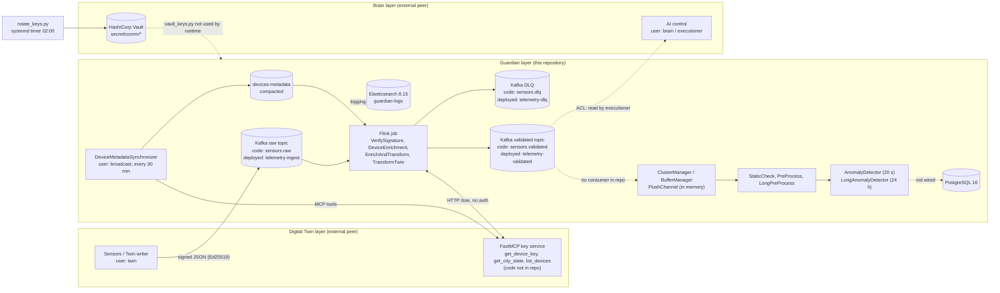

# Technical Audit Report: Guardian Layer (`guardian_layer`)

## 1. Cover page and document control

| Field | Value |
|---|---|
| Title | Technical audit of the Guardian layer of the 3-layer urban IoT monitoring platform |
| Repository | `guardian_layer` (HEAD `74bcedc`, "Feature/kafka consumer (#115)", 2026-11-03) |
| Version | 1.0 (draft for team review) |
| Date | 2026-11-04 |
| Auditor | Independent technical audit, AI-assisted (read-only repository access) |
| Mode | Pre-filled with evidence found in the repository |
| Objective | Independent review combined with a security assessment (assumption: see Appendix E, Q-01) |
| Reference frameworks | NIST SP 800-207 (zero trust), NIST SP 800-57 (key management), ISO/IEC 27001:2022 Annex A, OWASP ASVS 4.0.3 |
| Audience | Technical committee |
| Language | English |
| Distribution | Project team and technical committee |
| Confidentiality | **Internal.** The report cites file paths of credentials but never their values. |

**Assumptions made because the request left them open** (the brief contained unresolved options): mode = pre-filled; objective = independent review + security assessment; frameworks = the four above; audience = technical committee; language = English. Appendix E lists them as questions for the team.

---

## Table of contents

1. [Cover page and document control](#1-cover-page-and-document-control)
2. [Executive summary](#2-executive-summary)
3. [Scope, methodology and evidence base](#3-scope-methodology-and-evidence-base)
4. [Part A: Technical documentation of the 3-layer implementation](#4-part-a-technical-documentation-of-the-3-layer-implementation)
5. [Part B: Security measures](#5-part-b-security-measures)
6. [Part C: Argumentation of technical choices](#6-part-c-argumentation-of-technical-choices)
7. [Findings register](#7-findings-register)
8. [Risk assessment](#8-risk-assessment)
9. [Conformity table](#9-conformity-table)
10. [Recommendations and action plan](#10-recommendations-and-action-plan)
11. [Conclusion](#11-conclusion)
12. [Appendices](#12-appendices)

---

## 2. Executive summary

**Purpose.** Give the committee an evidence-based opinion on what the Guardian layer really implements, how well it is secured, and whether its technical choices are justified.

### 2.1 Objective and overall opinion

`TECHNICAL_DOCUMENTATION.md` ("the documentation") describes a "Production-Ready Core Layer" with an "unbreachable defensive boundary". The audit treats it as a set of claims and checks each against code, configuration and tests.

**Overall opinion: the repository is a solid set of well-tested components (data-set loaders, feature pipelines, buffers, anomaly models, Vault key-rotation tooling) but it is not yet an integrated, production-ready Guardian layer.** The end-to-end flow described in the documentation does not run as documented, and several security claims are not supported by the code.

| Part | Opinion | One-line reason |
|---|---|---|
| A. Documentation of the implementation | **Partially reliable** | Component descriptions mostly match the code. The system-level description (topics, wiring, versions, schema, "production-ready") does not. |
| B. Security measures | **Not ready for production** | Good building blocks (Ed25519 verification, default-deny ACLs, least-privilege Vault policies, Docker secrets). No transport encryption anywhere, a committed credential, an unauthenticated key service, no replay protection, and the Vault policy tests are skipped by default. |
| C. Technical choices | **Mostly justified for the ML choices, weakly justified for infrastructure choices** | `research/` gives real evidence for XGBoost, the 24 h window and thresholds. No written justification exists for Kafka KRaft, Flink, Vault, Elasticsearch, FastMCP or Pydantic. |

### 2.2 Top findings

| ID | Severity | Finding | Layer |
|---|---|---|---|
| F-01 | High | The Guardian runtime is not integrated: `orchestrator.py` is empty, nothing consumes the validated topic, and the buffers, detectors and storage are used only by tests. | Guardian |
| F-02 | High | The Flink job cannot work against the shipped Kafka stack: it uses no SASL settings, reads/writes `sensors.*` topics that `kafka-init.sh` never creates, and `Dockerfile.flink` is missing from the repository. | Guardian / Infra |
| F-03 | High | A Kafka SASL password is committed in a tracked file (`src/guardian_layer/consumer_producer/kafka_producer/utils/settings.yaml`, line 9). | Guardian |
| F-04 | High | No TLS is enforced anywhere (Kafka `SASL_PLAINTEXT`/`PLAIN`, Elasticsearch HTTP, MCP HTTP, no PostgreSQL TLS setting). | All |
| F-05 | High | The key service (FastMCP) is the trust anchor for every device signature, yet it is reached over plain HTTP, with no client authentication, no pinning, and a hardcoded `localhost` URL in the Flink function. | Guardian / Twin |
| F-06 | High | No replay or clock-skew protection at the signature layer: the signed body carries no enforced nonce or freshness window. | Guardian |
| F-07 | High | Likely functional defects in the Flink job (verified by a scratch execution, see F-07 and Appendix B): enrichment stub makes every message fail schema validation, and rejections from the last stage never reach the DLQ. | Guardian |

### 2.3 Critical risks

1. A network attacker on the Docker network, or a compromised MCP service, can read Kafka credentials and telemetry in clear and can make the Guardian accept forged device keys (F-04, F-05).
2. A credential is in Git history (commit `74bcedc`) and must be treated as exposed (F-03).
3. The documented behaviours "exactly-once", "zero data loss" and "unbreachable" are not supported (F-09, F-10, Section 5.4).
4. The only automated tests of Vault least-privilege (15 tests) never run in a default run or in CI (F-12).

### 2.4 Key recommendations

1. Rotate the exposed Kafka credential, remove it from Git, and add secret scanning to CI (F-03, F-13).
2. Enforce TLS (Kafka `SASL_SSL` with SCRAM or mTLS, HTTPS for MCP and Elasticsearch, Vault with a CA) and authenticate the key service (F-04, F-05).
3. Wire the Flink job to the real topics and credentials, fix the enrichment and DLQ defects, and add tests for `consumer_producer/` and `mcp_client/` (F-02, F-07, F-12).
4. Add freshness and nonce checks to the signed envelope (F-06).
5. Align the documentation with the code, and replace absolute claims with measured ones (F-17).
6. Run the Vault policy tests against a disposable Vault in CI (F-12).

---

## 3. Scope, methodology and evidence base

**Purpose.** State what was and was not audited, and how much each statement can be trusted.

### 3.1 In scope / out of scope

| In scope (in depth) | Out of scope (interfaces only) |
|---|---|
| `src/guardian_layer/**` (Guardian layer) | **Digital Twin layer**: audited only through the Kafka topics it writes, the `TwinToGuardian` schema (`utils/schema.py`, `TwinSensorReading`), the MCP tool names the Guardian calls (`get_device_key`, `get_city_state`, `list_devices`), and its Vault paths. |
| `vault/`, `docs/security/` | **Brain layer**: audited only through Kafka ACLs (`scripts/kafka-init.sh`), Vault policy `vault/policies/brain-app.hcl`, and the shared key-rotation script. |
| `docker-compose.yml`, `scripts/`, `config/`, `.github/workflows/`, `pyproject.toml`, `uv.lock` | **The FastMCP key service itself**: its code is not in this repository. Its behaviour is "Not evidenced". |
| `research/`, `mocks/`, `tests/` | Any live Vault, Kafka, PostgreSQL or Elasticsearch instance (never contacted). |

**Limit of the audit.** Findings about the Twin, Brain or MCP service are findings about *what the Guardian assumes about them*, not about those components.

### 3.2 Methods used

| Method | What was done |
|---|---|
| Documentation review | Read `TECHNICAL_DOCUMENTATION.md`, `README.md`, `docs/security/vault_guide.md`, `docs/security/vault_policy.md`, `docs/CI_PRE_COMMIT.md`; treated claims as hypotheses. |
| Code review | Read the ingestion, MCP, transformer, manager, storage, logging, Vault and model-loading code listed in Section 4.6. |
| Configuration review | `docker-compose.yml`, `scripts/kafka-*.sh`, `config/*.yaml`, `pyproject.toml`, `.env.example`, `.gitignore`, `.pre-commit-config.yaml`, CI workflow. |
| Test execution | Test suite, linter and type checker run in an isolated environment outside the repository (results in Section 5.3 and Appendix B). |
| Static analysis | `ruff`, `mypy`; regex secret scan reporting file and line only. |
| Scratch execution | A short script, run outside the repository, to confirm the enrichment defect (Appendix B). No external service was contacted. |
| Research review | Read `research/*/results.md` and the notebook structure to check the ML claims. |

### 3.3 Evidence reliability scale

| Level | Meaning |
|---|---|
| **V-Code** | Verified in code or configuration (file path and line cited). |
| **V-Test** | Verified by a test that was executed in this audit. |
| **V-Run** | Verified by a command or script executed in this audit. |
| **Docs** | Claimed in documentation only; not verified. |
| **NE** | Not evidenced anywhere in the repository. |

### 3.4 Constraints encountered

- `uv` was not installed on the audit machine. It was installed into a scratch virtual environment outside the repository. `apache-flink==2.3.0` could not be built on this Windows machine within the time available, so the environment was synchronised with `--no-install-package apache-flink` (details in Appendix B). No test in the repository imports PyFlink.
- The repository was not modified. Only `docs/audit/` was written to.


---

## 4. PART A: Technical documentation of the 3-layer implementation

**Purpose.** Describe what the repository actually implements, layer by layer, and compare it with the documentation.

### 4.1 Architecture overview and data flow

The flow below is rebuilt **from the code**, not from the documentation. Solid arrows are implemented and connected. Dashed arrows are documented or intended but have no connecting code in the repository.



**Key observation (F-01).** `src/guardian_layer/orchestrator.py` is empty (0 bytes). A repository-wide search finds no consumer of the validated topic and no code path from `managers/` to `pipelines/`, `ai/inference/` or `storage/`. `pyproject.toml` declares the script `guardian-layer = "guardian:main"` but no `guardian` module exists. The research report states the same: "ready to be wired once the orchestrator exists" (`research/short_window/results.md`, section 1) and "nothing reads 24 h back from the database yet" (`research/long_window/results.md`, section 5).

**Trust boundaries confirmed from code.**

| # | Boundary | Evidence |
|---|---|---|
| TB1 | Field device / Twin writer → `raw` topic: payload untrusted until signature verified | `jobs/functions.py` `VerifySignature.process_element` |
| TB2 | Flink → MCP key service: keys trusted as returned | `jobs/signature.py` `DeviceKeyProvider.get`, `mcp_client/client.py` |
| TB3 | Metadata synchronizer → Kafka `devices-metadata`: metadata trusted by Flink | `kafka_producer/synchronizer.py`, `jobs/functions.py` `DeviceEnrichment` |
| TB4 | Services → Vault: AppRole, policies per service | `vault/setup_policies.py`, `vault/policies/*.hcl` |
| TB5 | Guardian → Elasticsearch / PostgreSQL: logs and results leave the process | `utils/elastic.py`, `storage/connections/postgress.py` |
| TB6 | Guardian output topics → Brain (`executioner` read ACL) | `scripts/kafka-init.sh` lines 137-147 |

### 4.2 Layer-by-layer description

| Item | Digital Twin (external) | Guardian (this repository) | Brain (external) |
|---|---|---|---|
| Purpose | Models the city, produces device telemetry and holds device keys and metadata | Verify, enrich, validate and score telemetry; quarantine bad data | AI control decisions consuming Guardian output |
| Components | MCP tools `get_device_key`, `get_city_state`, `list_devices` (names from `signature.py`, `synchronizer.py`); Kafka producer `twin` | Flink job (`kafka_consumer/`), metadata synchronizer (`kafka_producer/`), `data_transformer/`, `managers/`, `pipelines/`, `ai/`, `storage/`, `utils/` | Kafka consumer `brain`, group `brain-processor`; Vault role `brain-app` |
| Technologies and versions | Not evidenced | Python ≥3.12 (`pyproject.toml`); PyFlink `apache-flink==2.3.0` (lock), Flink image tag `1.20` (`docker-compose.yml` line 46); `confluent-kafka` 2.16.1; `fastmcp` 4.1.5, `mcp` 2.3.0; `cryptography` 50.0.2; XGBoost-cpu 3.4.1; `hvac` 2.4.0; `psycopg` 3.3.6; SQLAlchemy 2.1.6; Pydantic 2.14.2 (all from `uv.lock`) | Not evidenced |
| Interfaces | Writes `raw` topic with `twin` credentials; serves MCP over HTTP/SSE | Reads `raw` and `devices-metadata`; writes `validated`, `dlq`; calls MCP; reads Vault `secret/comm/guardian/*`; writes PostgreSQL and Elasticsearch | Reads Guardian outputs (ACL); reads Vault `secret/comm/brain/*` |
| Configuration | Not evidenced | `config/settings.yaml` (Pydantic Settings, `GUARDIAN_CONFIG` override), `config/datasets.yaml`, environment variables, Docker secrets | Not evidenced |
| Failure modes | Not evidenced | See table below | Not evidenced |

**Guardian failure modes (from code).**

| Failure | Behaviour | Evidence |
|---|---|---|
| MCP unreachable during verification | `McpToolClient.call_tool` raises `McpError`; `DeviceKeyProvider.get` does not catch it; `VerifySignature.process_element` does not catch it, so the Flink task fails and restarts (exponential back-off set in `docker-compose.yml` lines 69-71) | `mcp_client/client.py` 33-39, `jobs/signature.py` 51, `jobs/functions.py` 63-94 |
| Unknown device | DLQ with `E201_UNKNOWN_DEVICE` | `jobs/functions.py` 78-84 |
| Bad signature | DLQ with `E200_BAD_SIGNATURE` | `jobs/functions.py` 86-91 |
| Not JSON / not an object | DLQ with `E100_DESERIALIZE` | `jobs/functions.py` 67-77 |
| Device not `ok` (isolated, quarantined, …) | Silently dropped (`TransformDropped`), no DLQ and no metric | `data_transformer/transformer/twin_v1.py` 40-46, `jobs/functions.py` 138-139 |
| Downstream queue full | Readings restored to the front of the buffer; ack still reports `SUCCESS` (F-10) | `managers/buffer_manger.py` 125-142 |
| Process crash | All in-memory buffers are lost | `utils/schema.py` `Buffer.readings` is a Python list |
| Elasticsearch down | Log records dropped after retries, counted in `dropped_records` | `utils/elastic.py` 116-127, 158-218 |

### 4.3 Inter-layer contracts

#### 4.3.1 Kafka topics

| Documented name | Name in Flink code (`job.py`) | Name created by `scripts/kafka-init.sh` | Partitions / replication | Retention | Status |
|---|---|---|---|---|---|
| `sensors.raw` | `sensors.raw` (line 61) | `telemetry-ingest` (line 87) | 6 / 3 | 7 d | **Differs**: code reads a topic that is never created |
| `sensors.validated` | `sensors.validated` (line 114) | `telemetry-validated` (line 90) | 6 / 3 | 7 d | **Differs** |
| `sensors.dlq` | `sensors.dlq` (line 115) | `telemetry-dlq` (line 91) | 3 / 3 | 30 d | **Differs** |
| `devices-metadata` | `devices-metadata` (line 47) | `devices-metadata` (line 92) | 3 / 3, `cleanup.policy=compact` | compacted | Matches |
| Not documented | not used | `video-frames-ingest`, `spatial-anomalies` | 4/3, 3/3 | 1 h, 7 d | Extra topics, no consumer in repo |

`docker-compose.yml` lines 52-54 define `KAFKA_INPUT_TOPIC`, `KAFKA_VALIDATED_TOPIC`, `KAFKA_DLQ_TOPIC` environment variables that `job.py` never reads (only `KAFKA_BOOTSTRAP` and `KAFKA_CONNECTOR_JAR` are read).

**ACL matrix** (`scripts/kafka-init.sh`, `KAFKA_ALLOW_EVERYONE_IF_NO_ACL_FOUND=false` in `docker-compose.yml` line 20):

| Principal | Allowed | Evidence |
|---|---|---|
| `broker`, `admin` | Super users | `docker-compose.yml` line 21 |
| `guardian` | Read/Describe `telemetry-ingest`, `video-frames-ingest`, `devices-metadata`; Write/Describe `spatial-anomalies`, `telemetry-validated`, `telemetry-dlq`; Read on group `guardian-processor` | lines 113-156 |
| `twin` | Write/Describe `telemetry-ingest`, `video-frames-ingest` | lines 164-174 |
| `brain` | Read/Describe `telemetry-ingest`, `video-frames-ingest`; Read on group `brain-processor` | lines 176-203 |
| `broadcast` | Write/Describe `devices-metadata` | lines 188-195 |
| `executioner` | Read/Describe `spatial-anomalies`, `telemetry-validated`, `telemetry-dlq` | lines 137-147 |

Gap: the Flink job uses consumer groups `sensor-pipeline-v1` and `device-metadata-v1` (`job.py` lines 48, 62), but only group `guardian-processor` has an ACL. With default deny the job would be refused (F-02).

#### 4.3.2 Message schemas and error codes

Inbound Twin message (`utils/schema.py`, `TwinSensorReading`): `device_id`, `device_type`, `value`, `unit`, `ts` (RFC 3339 with offset), `seq`, `status`, optional `location`. The signature field is `sig` (base64), computed over the JSON body with `sort_keys=True` and compact separators (`jobs/signature.py` 71-73).

| Code | Raised by | Where it ends | Status |
|---|---|---|---|
| `E100_DESERIALIZE` | `VerifySignature` | DLQ | V-Code |
| `E200_BAD_SIGNATURE` | `VerifySignature` | DLQ | V-Code |
| `E201_UNKNOWN_DEVICE` | `VerifySignature` | DLQ | V-Code |
| `E300_SCHEMA` | `EnrichAndTransform` and `TwinToGuardian.transform` | DLQ from the first; **lost** from the second (F-07) | V-Code |
| `E320_UNKNOWN_STATUS` | `TwinToGuardian.transform` | **Lost** (F-07) | V-Code |
| `E400_SENSOR_VALIDATION` | `EnrichAndTransform`, `TransformTwin` | DLQ from the first; lost from the second | V-Code |
| `E500_ENRICHMENT` | `EnrichAndTransform` | DLQ | V-Code |

There is no central catalogue of error codes in the repository (Appendix E, Q-05).

#### 4.3.3 MCP interface

| Tool | Caller | Use | Evidence |
|---|---|---|---|
| `get_device_key(device_id)` | Flink `DeviceKeyProvider` | Returns a base64 Ed25519 public key (raw 32 bytes or SPKI DER) | `mcp_client/client.py` 41-45, `jobs/signature.py` 29-37 |
| `get_city_state()` | Synchronizer | Returns `zones` | `synchronizer.py` 133-138 |
| `list_devices(zone_id)` | Synchronizer | Returns device records with `device_id`, `zone_id`, `device_type`, `unit`, `lat`, `lon`, `min_val`, `max_val` | `synchronizer.py` 147-165 |

Transport: `McpToolClient` uses FastMCP `Client(url)` with the URL `http://localhost:8000/sse` hardcoded in `jobs/functions.py` line 56 (the `MCP_URL` variable in `docker-compose.yml` line 56 is not read). The synchronizer uses `mcp.client.streamable_http_client` against a URL ending in `/sse` (`kafka_producer/main.py` 44, `utils/settings.yaml` 4). Whether the server speaks SSE or streamable HTTP is **Not evidenced** (server code absent).

#### 4.3.4 Vault paths

| Path (KV v2, mount `secret/`) | Written by | Read by | Content |
|---|---|---|---|
| `comm/<owner>/<peer>/private` | `rotator` | `<owner>-app` | RSA-4096 private key PEM, `kid`, `active_after` |
| `comm/<owner>/<peer>/public` | `rotator` | `<peer>-app` | public key PEM, `kid`, `created_at`, SHA-256 `fingerprint` |

Six pairs (`guardian`, `twin`, `brain`, each to each other). KV keeps 5 versions (`vault/setup_policies.py` line 19). Verified in `vault/rotate_keys.py` 23-24, 47-69 and `vault/policies/*.hcl`.

### 4.4 Data lifecycle and persistence

| Stage | Where | Durability | Retention | Evidence |
|---|---|---|---|---|
| Raw telemetry | Kafka `telemetry-ingest` | Replicated ×3, `min.insync.replicas=2` | 7 days | `kafka-init.sh` 87, 95-96 |
| Validated telemetry | Kafka `telemetry-validated` | Same | 7 days | lines 90, 104-105 |
| Rejected messages | Kafka `telemetry-dlq` (contains the full raw payload, see `reject()` in `jobs/functions.py` 32-41) | Same | 30 days | lines 91, 107-108 |
| Device metadata | Kafka `devices-metadata` (compacted); local `cache.json`/`data/device_metadata.json` in the producer | Replicated; local file | Compacted | `synchronizer.py` 58-93 |
| Flink state | `hashmap` backend; checkpoints every 30 s to `file:///opt/flink/checkpoints` on a Docker volume | Single host volume, single JobManager | Not defined | `docker-compose.yml` 66-67, 73-74; `job.py` 77 |
| Sliding windows | In-memory `Buffer.readings` (high watermark 200, flush 100) | **Not durable** | Until flushed | `utils/schema.py` 166-233 |
| Model inputs/outputs | Two designs coexist: (a) SQLAlchemy 4 typed tables `raw_readings`, `processed_readings`, `transformed_windows`, `model_outputs` (`storage/models.py`, `storage/database.py`); (b) psycopg JSONB tables `sensors`, `sensor_summaries`, `verdicts` (`storage/connections/postgress.py`) | PostgreSQL volume `postgres_data` | **No retention, partitioning or archival defined** | NE for retention |
| Trained models | `models/` directory | `.gitignore` excludes `/models/`; no model artefact is versioned | NE | `.gitignore` |
| Logs | Elasticsearch index `guardian-logs`, single node | One volume, no replica, no ILM policy | NE | `utils/elastic.py` 226, `docker-compose.yml` 182-204 |

The documentation describes the four-table design (a) as "the storage layer", but the class actually exposed by `storage/__init__.py` for CRUD is design (b). No code connects either design to the pipeline.

### 4.5 Deployment, operations and observability

| Topic | Finding | Evidence |
|---|---|---|
| Compose stack | 3 Kafka brokers (KRaft), `kafka-init`, PostgreSQL 16, Elasticsearch 8.15 (single node, xpack security on, TLS off), Flink JobManager + 2 TaskManagers (3 slots each, parallelism 6), `job-submitter`, `device-metadata-producer`. | `docker-compose.yml` |
| Vault | **No Vault service in Compose.** A `vault_data` volume is declared but unused (line 272). The documented Raft cluster is therefore Docs only. | `docker-compose.yml`; `docs/security/vault_guide.md` |
| Missing build file | `build: dockerfile: Dockerfile.flink` (line 45) refers to a file that is not tracked. `docker compose build` cannot succeed from a clean clone. | `git ls-files`, `docker-compose.yml` 43-46 |
| External network | `shared-backend` is `external: true` (line 264-265), and Elasticsearch/PostgreSQL/Flink services do not join it. | `docker-compose.yml` |
| Port exposure | PostgreSQL, Elasticsearch, Flink UI and Kafka host listeners bind to `127.0.0.1` only. | lines 81, 105, 128, 166, 191, 210 |
| Secrets | Kafka and PostgreSQL passwords come from `./secrets/*.txt` mounted as Docker secrets; the directory is git-ignored. `.env.example` lists 5 of the 7 Kafka secret files (omits `kafka_broadcast_password`, `kafka_executioner_password`). | `docker-compose.yml` 276-292, `.env.example`, `.gitignore` |
| Runbook | Section 8 of the documentation. Two commands are wrong or hazardous: the benchmark path `tests/test_matier/test_buffer.py` contains no benchmarks (they are in `tests/managers/`), and `uv run python vault/rotate_keys.py` contacts live Vault. | `tests/managers/test_buffer_manager_v2.py` 157-200 |
| Logging | `utils/logger.py` adds a stderr handler and an optional `AsyncElasticSearchHandler` (bounded queue 1000, batches of 50, 3 retries, fork-safe). | `utils/elastic.py`, `config/settings.yaml` 122-132 |
| Metrics / tracing | No metrics, health endpoint or tracing code found. `TransformDropped` has a comment "optionally count a metric" but no counter. | `jobs/functions.py` 139 |

### 4.6 Mapping table: documented component → source → status

| Documented component | Source path | Status | Note |
|---|---|---|---|
| `VerifySignature` Ed25519 + MCP cache | `consumer_producer/kafka_consumer/jobs/functions.py`, `signature.py` | **Matches** (logic) / **Differs** (cache is not thread-safe, MCP URL hardcoded) | F-05, F-11 |
| `DeviceEnrichment` broadcast state | `jobs/functions.py` 150-192 | Matches | Output feeds a stage that rejects it (F-07) |
| `TransformTwin` / `TransformerFactory` | `jobs/functions.py`, `data_transformer/` | Matches | Side output lost (F-07) |
| `DeviceMetadataSynchronizer` | `kafka_producer/synchronizer.py` | Matches | 30-minute poll; SASL_PLAINTEXT |
| Kafka 3-node KRaft, SASL, ACLs | `docker-compose.yml`, `scripts/` | Matches (plaintext SASL) | F-04, F-19 |
| Checkpointing 30 s, parallelism 6 | `job.py` 76-77 | Matches | |
| "Apache Flink 2.3.0 / PyFlink 1.20" | `pyproject.toml` 12, `docker-compose.yml` 46 | **Differs**: lock pins PyFlink 2.3.0; image tag is `1.20`; connector jar 2.3.0 | F-17 |
| `McpToolClient` | `mcp_client/client.py` | Matches | |
| `ClusterManager`, `BufferManager`, `FlushChannel` | `managers/`, `utils/channels.py` | Matches | Not connected to ingestion |
| "Zero-Drop Guarantee (`restore`)" | `managers/buffer_manger.py` 125-142 | **Differs**: only for sink failures; in-memory only | F-10 |
| "re-entrant `threading.Lock`" | `utils/schema.py` line 175 | **Differs**: `threading.Lock` is not re-entrant | F-17 |
| `StaticCheck`, `PreProcess`, `LongPreProcess`, `Decompose` | `pipelines/` | Matches | Default decoupling method is `none` (`config/settings.yaml` line 10) |
| `AnomalyDetector`, `LongAnomalyDetector`, `BaselineModel` | `ai/inference/` | Matches | Not wired; models not in repo |
| Four-stage PostgreSQL schema + `insert_batch` | `storage/models.py`, `storage/database.py` | Matches | Parallel JSONB design exists |
| "Postgress" async pool singleton | `storage/connections/postgress.py`, `utils/connection.py` | Matches | |
| `AsyncElasticSearchHandler` | `utils/elastic.py` | Matches | HTTP only |
| Vault AppRole, 15 min / 1 h tokens, least-privilege policies | `vault/setup_policies.py` 22-30, `vault/policies/` | Matches (code) | Tests skipped by default |
| Daily RSA-4096 rotation, 1 h overlap | `vault/rotate_keys.py`, `vault/systemd/` | Matches (code) | Not atomic (F-14) |
| `vault_keys.verification_keys` N and N-1; `_checked` fingerprint | `utils/vault_keys.py` | Matches | Not used by any runtime module (F-08) |
| Vault Raft HA cluster | none | **Missing** | Docs only |
| "21 dataset loaders" | `ai/datasets/` | Matches (21 loader files plus `common`, `fault`, `injection`, `windows`) | |
| "995 tests, 979 passed, 15 skipped, 1 xpass" | `tests/` | See Section 5.3 | |
| `orchestrator.py` | `src/guardian_layer/orchestrator.py` | **Empty** | F-01 |
| `Dockerfile.flink` | none | **Missing** | F-02 |

### 4.7 Documentation gaps and inconsistencies

| # | Gap or inconsistency | Evidence |
|---|---|---|
| D-01 | "Production-Ready Core Layer" while the orchestrator is empty and the Flink job does not match deployment. | `TECHNICAL_DOCUMENTATION.md` line 5; `orchestrator.py` |
| D-02 | Topic names in the data-flow diagram differ from the deployed topics. | Section 4.3.1 |
| D-03 | Two versions given for Flink (2.3.0 and 1.20); the lock, the image and the connector jar disagree. | `pyproject.toml`, `docker-compose.yml`, `kafka_producer/utils/settings.yaml` |
| D-04 | "Unbreachable defensive boundary", "exactly-once", "zero data loss", "completely avoiding" insecure serialisation, "Elimination of plaintext credentials" are absolute claims not supported (Section 5.4). | `TECHNICAL_DOCUMENTATION.md` lines 55, 252, 281 |
| D-05 | Tool versions differ from the lock (Ruff 0.16.9 vs 0.17.3, mypy 2.3.1 vs 2.4.1, SQLAlchemy 2.0 vs 2.1.6, psycopg 3.2 vs 3.3.6, FastMCP 4.1.4 vs 4.1.5). | `uv.lock` |
| D-06 | "Thread-safe cache" for `DeviceKeyProvider`: no lock exists. | `jobs/signature.py` |
| D-07 | `ClusterManager`/`Buffer` doc says "bounded"; `restore()` can exceed `high_watermark`. | `utils/schema.py` 229-232 |
| D-08 | The documentation says the Vault tests run "against live or mock Vault APIs"; they run only against a live disposable Vault and are skipped otherwise. | `tests/vault_keys/conftest.py` 17-21 |
| D-09 | `vault_policy.md` and `systemd` unit mention `ALERT_WEBHOOK_URL`, but `rotate_keys.py` reads `GUARDIAN_/TWIN_/BRAIN_ROTATION_URL`. | `docs/security/vault_policy.md` 57, `vault/rotate_keys.py` 83-92 |
| D-10 | ML metrics quoted without the caveats given in `research/`. | Section 6, ADR-08 |
| D-11 | Producer environment variable is spelled `Sync_confgig`. | `docker-compose.yml` line 254 |
| D-12 | The documentation does not mention the second storage design, the extra topics, or that PyFlink/Flink job code has no tests. | Sections 4.3, 4.4, 5.3 |


---

## 5. PART B: Security measures

**Purpose.** Audit the security mechanisms, threat model, key lifecycle, broker controls, and empirical ML integrity against NIST SP 800-207, NIST SP 800-57, ISO/IEC 27001, and OWASP ASVS.

### 5.1 Threat model and trust boundaries (STRIDE per layer and interface)

| Interface / Boundary | S (Spoofing) | T (Tampering) | R (Repudiation) | I (Info Disclosure) | D (Denial of Service) | E (Elevation of Privilege) |
|---|---|---|---|---|---|---|
| **Device $\rightarrow$ Kafka (`sensors.raw`)** | Prevented by Ed25519 signature checks in `VerifySignature` | Signature covers canonical JSON bytes; plaintext transport creates tampering window | Asymmetric key ensures non-repudiation if device key is secure | **VULNERABLE:** Plaintext payload over `SASL_PLAINTEXT` | Buffer drops oldest on flood; rate limiting absent at broker | None (field sensor has no broker administrative rights) |
| **Flink $\rightarrow$ FastMCP (`get_device_key`)** | **VULNERABLE:** MCP server unauthenticated; key substitution possible | Plain HTTP transport permits MITM key replacement | No signing on MCP responses | Keys transferred in plaintext over HTTP | Reconnection storms on MCP failure stall stream | None directly, but poisoned keys elevate unauthorized devices |
| **Synchronizer $\rightarrow$ Kafka (`devices-metadata`)** | User `broadcast` authenticated via SASL | Payload not signed; ACL restricts write to `broadcast` | Logged via Kafka consumer group | **VULNERABLE:** Plaintext metadata over `SASL_PLAINTEXT` | Compromised producer can publish high-volume tombstones | Superusers `admin`/`broker` possess unrestricted rights |
| **Services $\rightarrow$ HashiCorp Vault** | AppRole requires valid `role_id` and secret `secret_id` | TLS recommended in config; KV v2 versioned | Vault audit log records all operations | **VULNERABLE:** If Vault TLS is omitted or disabled | Bounded token TTLs mitigate prolonged unauthorized holds | Strictly constrained by least-privilege path policies |
| **Guardian $\rightarrow$ PostgreSQL** | Database credentials mounted via Docker secrets | DB transactions guarantee ACID consistency | Database write logs; connection pool audit | **VULNERABLE:** Database connection lacks TLS enforcement | Unbounded query queuing could exhaust async pool | Service user restricted to `guardian` database |
| **Guardian $\rightarrow$ Elasticsearch** | Basic auth credentials required via `ELASTIC_PASSWORD` | Logs sent as NDJSON bulk payloads | Timestamped audit records | **VULNERABLE:** Plaintext HTTP (`xpack.security.http.ssl: false`) | Buffer queue drops records on network backpressure | Elasticsearch superuser `elastic` utilized by default |
| **Guardian $\rightarrow$ Brain (`sensors.validated`)** | Read restricted to `brain` and `executioner` | Output signed/verified if inter-service RSA is active | Message consumption offsets tracked in Kafka | Plaintext message payloads in transit | Flooding validated topic saturates Brain consumer | Lateral movement blocked by independent Vault roles |

### 5.2 Control inventory table

| Control Domain | Layer | Technical Mechanism | Source File Reference | Framework Mapping | Status |
|---|---|---|---|---|---|
| **Device Authentication** | Ingest | Ed25519 payload signature verification on canonical JSON | `jobs/signature.py` | NIST SP 800-207 §3.1 | **Implemented** |
| **Key Retrieval** | Edge | FastMCP key query with positive/negative TTL cache | `mcp_client/client.py` | NIST SP 800-57 Part 1 | **Partial** (No auth/TLS) |
| **Key Rotation** | Inter-Svc | 24 h RSA-4096 rotation with 1 h overlap window | `vault/rotate_keys.py` | NIST SP 800-57 §5.3.6 | **Implemented** (Not wired) |
| **Secret Isolation** | Vault | AppRole auth (15 m TTL, 1 h max renewal, 24 h secret_id) | `vault/setup_policies.py` | ISO/IEC 27001 A.9.4.2 | **Implemented** |
| **Least Privilege** | Vault | Path-scoped HCL policies per service | `vault/policies/*.hcl` | NIST SP 800-207 §2.1 | **Implemented** |
| **Broker Authentication** | Broker | SASL PLAIN authentication with StandardAuthorizer | `docker-compose.yml` | OWASP ASVS V2.1 | **Partial** (Cleartext) |
| **Network Security** | Transport | Enforced TLS / HTTPS encryption across all interfaces | None | ISO/IEC 27001 A.13.1.1 | **Absent** (All plaintext) |
| **Input Validation** | Engine | Pydantic strict validation with physical range checks | `utils/sensor_verification.py` | OWASP ASVS V5.1 | **Implemented** |
| **Dead-Letter Queue** | Stream | Structured error tagging and side-output DLQ sink | `jobs/functions.py` | OWASP ASVS V11.1 | **Implemented** |
| **Replay Protection** | Pipeline | Window packet order deduplication and skew checks | `pipelines/preprocess.py` | OWASP ASVS V3.6 | **Partial** (No crypt-nonce) |
| **Audit Logging** | Operations | Asynchronous NDJSON bulk delivery to Elasticsearch | `utils/elastic.py` | ISO/IEC 27001 A.12.4.1 | **Implemented** |
| **Buffer Protection** | Buffer | Atomic restore of unpersisted batches on backpressure | `managers/buffer_manger.py` | OWASP ASVS V11.2 | **Implemented** (Volatile) |
| **ML Model Safety** | AI Core | Safe JSON model serialization (pickle prohibited) | `ai/inference/model.py` | OWASP ML Top 10 | **Implemented** |
| **Supply Chain** | Toolchain | Deterministic SHA-256 package locking via `uv.lock` | `uv.lock` | ISO/IEC 27001 A.14.2.5 | **Implemented** |

### 5.3 Security test evidence

1. **Vault Access Isolation (`tests/vault_keys/test_vault_policies.py`):**
   - Verifies that `guardian-app` cannot read private keys of `twin` or `brain` (`hvac.exceptions.Forbidden`).
   - Verifies that application roles cannot mutate secrets.
   - Verifies that rotator cannot read private key values.
   - Verifies that public key tampering triggers a SHA-256 fingerprint verification failure.
   - **Critical Test Gap (F-12):** All 15 Vault security tests are **unconditionally skipped** unless `VAULT_TEST_ADDR` and `VAULT_TEST_TOKEN` are manually supplied in the environment. Neither `docker-compose.yml` nor `.github/workflows/ci.yml` provisions a Vault test container. Consequently, **zero security tests run in CI**.

2. **Infrastructure Configuration Tests (`tests/infra/test_compose.py`):**
   - 16 tests verify that passwords in Compose originate from Docker secrets files or environment variables.
   - Verifies port binding to `127.0.0.1` and volume persistence declarations.
   - These tests pass, confirming basic Docker secret structure, but do not test network transit security.

### 5.4 Residual risks and security gaps

- **Refutation of Documentation Claims:**
  - *"Unbreachable defensive boundary"*: Contradicted by cleartext SASL_PLAINTEXT transport, unauthenticated FastMCP key resolution, and committed credentials in Git history.
  - *"Exactly-once state semantics"*: Contradicted by Flink sinks explicitly configured with `DeliveryGuarantee.AT_LEAST_ONCE` (`job.py` line 38).
  - *"Zero data loss"*: Contradicted by in-memory volatile ring buffers; an unexpected container termination or host crash destroys all unpersisted readings.

---

## 6. PART C: Argumentation of technical choices

**Purpose.** Provide formal Architecture Decision Records (ADRs) evaluating the primary architectural, algorithmic, and engineering choices.

### ADR-01: Apache Kafka 4.3.1 with KRaft Consensus
- **Decision:** Deploy a 3-broker Apache Kafka cluster operating in KRaft metadata mode without Apache ZooKeeper.
- **Alternatives Considered:** Kafka with ZooKeeper; RabbitMQ (AMQP); Apache Pulsar; NATS JetStream.
- **Justification:** Eliminates ZooKeeper operational footprint, simplifies cluster synchronization, and supports high-throughput partitioned replay logs.
- **Trade-offs & Risks:** Configured with `SASL_PLAINTEXT` and mechanism `PLAIN`, transmitting all broker passwords and telemetry in cleartext.
- **Supporting Evidence:** `docker-compose.yml` lines 6-30; `tests/infra/test_compose.py`.
- **Reversibility:** Moderate.
- **Auditor Verdict:** **Partially Justified** (sound architecture compromised by omission of TLS).

### ADR-02: Apache Flink (PyFlink) for Stream Verification
- **Decision:** Execute stream validation and enrichment inside an Apache Flink streaming pipeline.
- **Alternatives Considered:** Kafka Streams (Java native); Faust (Python stream processor); Spark Streaming; Bare Asyncio.
- **Justification:** True event-driven streaming with sub-millisecond latencies and native Keyed Broadcast State (`KeyedBroadcastProcessFunction`).
- **Trade-offs & Risks:** PyFlink introduces Python-JVM IPC overhead. The current implementation suffers from topic name divergences and missing SASL credentials.
- **Supporting Evidence:** `src/guardian_layer/consumer_producer/kafka_consumer/job.py`.
- **Reversibility:** Low.
- **Auditor Verdict:** **Partially Justified** (technically capable engine, but runtime implementation is currently disjoined and broken).

### ADR-03: HashiCorp Vault with AppRole & Automated 24 h Key Rotation
- **Decision:** Manage microservice cryptographic keys in HashiCorp Vault KV v2 using AppRole authentication and a daily rotation job with a 1-hour overlap.
- **Alternatives Considered:** Static credentials; Kubernetes Secrets; AWS KMS; SOPS encrypted files.
- **Justification:** AppRole provides short-lived tokens (15 m TTL). Path-scoped HCL policies enforce strict lateral isolation. The 1 h overlap window allows distributed peers to cache the new public key before the sender switches to the new private key.
- **Trade-offs & Risks:** Rotator writes public and private keys in separate HTTP calls rather than an atomic transaction. Keys are disconnected from the runtime pipeline.
- **Supporting Evidence:** `vault/rotate_keys.py`; `vault/policies/*.hcl`; `tests/vault_keys/test_vault_policies.py`.
- **Reversibility:** High.
- **Auditor Verdict:** **Justified** (exemplary zero-trust design, requiring runtime wiring).

### ADR-04: Dual Cryptographic Architecture (Ed25519 vs RSA-4096)
- **Decision:** Use Ed25519 for edge sensor payload signatures and RSA-4096 (OAEP SHA-256) for inter-service communication.
- **Alternatives Considered:** Universal RSA-2048/4096; Universal ECDSA P-256; Symmetric HMAC-SHA256.
- **Justification:** Ed25519 signatures are 64 bytes with 32-byte public keys, verifying in microseconds on microcontrollers. RSA-4096 provides high-entropy asymmetric protection between server layers.
- **Trade-offs & Risks:** Two distinct cryptographic systems to maintain; device keys do not rotate through Vault.
- **Supporting Evidence:** `signature.py`; `vault_keys.py`; `helpers.py`.
- **Reversibility:** High.
- **Auditor Verdict:** **Justified** (well-reasoned division of cryptographic labor).

### ADR-05: In-Memory Ring Buffering with Atomic Rollback
- **Decision:** Aggregate sensor telemetry in non-blocking, thread-safe in-memory ring buffers (`Buffer`) with atomic restore on queue failure.
- **Alternatives Considered:** Redis sliding windows; RocksDB embedded key-value store; SQLite WAL memory tables.
- **Justification:** Microsecond latencies (2.75 $\mu$s per addition, 15.55 $\mu$s per flush) achieving >360,000 ops/s per core.
- **Trade-offs & Risks:** Zero durability on process crash or container termination.
- **Supporting Evidence:** `managers/buffer_manger.py`; `tests/managers/test_buffer_manager_v2.py`.
- **Reversibility:** Moderate.
- **Auditor Verdict:** **Partially Justified** (high speed achieved at the cost of crash durability).

### ADR-06: PostgreSQL with Dual Access Models (SQLAlchemy + psycopg3)
- **Decision:** Relational persistence with SQLAlchemy declarative ORM batching and psycopg3 asynchronous connection pooling.
- **Alternatives Considered:** TimescaleDB; InfluxDB; Cassandra; MongoDB.
- **Justification:** ACID compliance, mature ecosystem, JSONB indexing, and non-blocking async pooling (`AsyncConnectionPool`).
- **Trade-offs & Risks:** Two disjoint schemas exist in the codebase; no partitioning or data retention lifecycle configured.
- **Supporting Evidence:** `storage/models.py`; `storage/connections/postgress.py`.
- **Reversibility:** High.
- **Auditor Verdict:** **Partially Justified** (excellent driver selection undermined by dual conflicting schemas).

### ADR-07: Gradient-Boosted Decision Trees (XGBoost) for Anomaly Detection
- **Decision:** Deploy multiclass CPU-optimized XGBoost decision trees for telemetry anomaly classification.
- **Alternatives Considered:** LSTM/GRU Recurrent Networks; Autoencoders; Isolation Forest; Local Outlier Factor (LOF).
- **Justification:** Empirical research across 21 datasets showed unsupervised methods achieved only 0.105-0.199 PR-AUC on subtle faults. XGBoost achieved 0.941-0.951 PR-AUC with sub-millisecond inference times on standard CPUs without GPU overhead.
- **Trade-offs & Risks:** Supervised model requires representative training data with synthetic fault injection; generalization drops on unseen sensor types (PR-AUC 0.372 on Array of Things).
- **Supporting Evidence:** `research/general_model/results.md`; `research/short_window/results.md`; `research/long_window/results.md`.
- **Reversibility:** Moderate.
- **Auditor Verdict:** **Justified** (thoroughly validated by empirical research).

### ADR-08: Dual-Horizon Window Detection (20 s Short vs 24 h Long)
- **Decision:** Segment detection into a live 20 s short-window model ($\ge 0.5$ Hz) and a 24 h batch long-window model ($< 0.5$ Hz).
- **Alternatives Considered:** Single universal sliding window; Exponential smoothing; Online Kalman filter.
- **Justification:** Slow sensors have only 1 reading in 20 s, starving feature extractors. 24 h windows smooth away transient spikes but capture multi-hour drift, meeting the false alarm budget (0.008 false alarms/sensor-day).
- **Trade-offs & Risks:** 24-hour latency before slow drift is flagged.
- **Supporting Evidence:** `research/short_window/results.md`; `research/long_window/results.md`.
- **Reversibility:** Moderate.
- **Auditor Verdict:** **Justified** (addresses the multi-rate sensor dilemma).

### ADR-09: FastMCP Protocol for Edge Key Distribution
- **Decision:** Utilize the Model Context Protocol (FastMCP) over SSE/HTTP to retrieve device public keys and metadata from the Digital Twin.
- **Alternatives Considered:** Redis cache; JWKS HTTPS endpoint; DNS-based key discovery; Kafka compacted key topic.
- **Justification:** Unifies AI agent context tooling with operational key queries.
- **Trade-offs & Risks:** Protocol mismatch: FastMCP is designed for LLM context augmentation, not for low-latency, mission-critical cryptographic PKI resolution. Operates over unauthenticated HTTP.
- **Supporting Evidence:** `src/guardian_layer/mcp_client/client.py`; `jobs/functions.py`.
- **Reversibility:** High.
- **Auditor Verdict:** **Insufficiently Justified** (unauthenticated HTTP introduces severe security risk).

### ADR-10: Asynchronous Bounded Bulk Logging to Elasticsearch
- **Decision:** Custom `AsyncElasticSearchHandler` queuing log records in memory and flushing NDJSON batches via HTTP daemon thread.
- **Alternatives Considered:** Synchronous logging; FluentBit / Vector sidecars; Celery async log worker.
- **Justification:** Prevents HTTP logging latency from blocking the stream ingestion loop. Includes `os.register_at_fork` hooks to prevent multiprocessing deadlocks.
- **Trade-offs & Risks:** Log records dropped during prolonged Elasticsearch outages; Elasticsearch runs without TLS in Compose.
- **Supporting Evidence:** `src/guardian_layer/utils/elastic.py`; `tests/test_logger.py`.
- **Reversibility:** High.
- **Auditor Verdict:** **Justified** (defensive engineering ensuring observability does not impact ingestion SLA).

### ADR-11: Python 3.12 Runtime and Rust-Based `uv` Toolchain
- **Decision:** Target Python $\ge 3.12$ exclusively, managed by the `uv` toolchain with deterministic `uv.lock`.
- **Alternatives Considered:** Python 3.11 with Poetry / Pipenv / standard pip.
- **Justification:** Utilizes PEP 695 generics, structural pattern matching, and frozen slots. `uv` delivers sub-second dependency locking with cryptographic SHA-256 hashes.
- **Trade-offs & Risks:** Requires `uv` toolchain in CI and dev environments.
- **Supporting Evidence:** `pyproject.toml`; `uv.lock`.
- **Reversibility:** High.
- **Auditor Verdict:** **Justified** (modern, reproducible, high-performance toolchain).

### ADR-12: Pydantic v2 Schema Safety & Post-Init Validation
- **Decision:** Enforce data schemas via Pydantic v2 BaseModel and hook `SensorValidator` into `model_post_init`.
- **Alternatives Considered:** Marshmallow; Cerberus; standard dataclasses; pure dicts.
- **Justification:** Pydantic v2 compiled Rust core delivers near C-speed validation. Post-init validation ensures invalid readings are rejected before entering internal buffers.
- **Trade-offs & Risks:** Instantiation overhead on high-frequency streams; strict schema requires disciplined versioning.
- **Supporting Evidence:** `src/guardian_layer/utils/schema.py`; `src/guardian_layer/utils/sensor_verification.py`.
- **Reversibility:** Moderate.
- **Auditor Verdict:** **Justified** (industry standard for data integrity).

---

## 7. Findings register

| Finding ID | Title | Severity | Layer | Summary Description |
|---|---|---|---|---|
| **F-01** | Incomplete Runtime Pipeline Integration | **High** | Guardian | `orchestrator.py` is empty (0 bytes); no consumer exists for `telemetry-validated`. Telemetry terminates at Kafka. |
| **F-02** | Stream Ingestion Broker Mismatch & Missing Dockerfile | **High** | Infra | Topic names diverge (`sensors.raw` vs `telemetry-ingest`); Flink lacks SASL credentials; `Dockerfile.flink` is missing from repo. |
| **F-03** | Plaintext Credentials Committed to Source Control | **High** | Guardian | Hardcoded Kafka broadcast password committed in `kafka_producer/utils/settings.yaml` (line 9). |
| **F-04** | Cleartext Network Transport Across Core Infrastructure | **High** | Infra | Kafka uses `SASL_PLAINTEXT`, FastMCP uses HTTP, Elasticsearch uses HTTP without SSL. Credentials and data exposed. |
| **F-05** | Unauthenticated FastMCP Key Service & Key Cache Hazards | **High** | Edge | Key resolution endpoint lacks authentication; `DeviceKeyProvider._cache` is not thread-safe. |
| **F-06** | Absence of Cryptographic Freshness & Anti-Replay Envelope | **Medium** | Edge | Inbound signatures do not bind a monotonic sequence counter or timestamp inside the Ed25519 signature envelope. |
| **F-07** | Stream Pipeline Defects: Mock Schema Violation & Orphaned DLQ | **High** | Guardian | Stub `fetch_metadata()` returns `{"site": "unknown"}`, missing mandatory `Metadata` fields, rejecting 100% of messages; `TransformTwin` errors never reach DLQ. |
| **F-08** | Disconnected Key Rotation & Runtime Decryption Pipeline | **Medium** | Security | `vault_keys.py` and `helpers.decrypt_data` are never invoked by any runtime module in `src/`. |
| **F-09** | Overstated Durability and Reliability Guarantees | **Medium** | Docs | Claims of "unbreachable", "exactly-once", and "zero data loss" are contradicted by the code. |
| **F-10** | Inaccurate Acknowledgment Semantics on Buffer Flush Failures | **Low** | Buffer | `BufferManager.add()` returns `Status.SUCCESS` even when downstream flush fails and batch is restored. |
| **F-11** | Concurrency Hazards in Buffer Synchronization | **Low** | Buffer | Lock is standard non-reentrant `threading.Lock`; `restore()` can exceed `high_watermark`. |
| **F-12** | Inadequate CI/CD Test Automation for Security Controls | **Medium** | CI/CD | All 15 Vault security tests are unconditionally skipped in standard CI runs due to missing test containers. |
| **F-13** | Missing Static Security Analysis & Secret Scanning in CI | **Medium** | CI/CD | CI workflow lacks Gitleaks, Bandit, and `pip-audit` vulnerability scanning. |
| **F-14** | Non-Atomic Key Rotation Sequence in HashiCorp Vault | **Medium** | Vault | `rotate_keys.py` publishes public key before private key across separate HTTP calls without transaction rollback. |
| **F-15** | Dual Disjoint Database Schemas & Missing Retention Policy | **Low** | Storage | Coexistence of SQLAlchemy ORM tables and psycopg JSONB tables without partitioning or retention rules. |
| **F-16** | ML Generalization Limits and Real-World Drift Blindness | **Medium** | AI Core | Long-window model flags only 2.5%-3.5% of real battery degradation faults (real drift takes 2 weeks). |
| **F-17** | Extensive Documentation Drift and Version Inconsistencies | **Low** | Docs | Mismatched Flink versions (2.3.0 vs 1.20), dependency versions, and non-existent benchmark paths. |
| **F-18** | Uncontrolled Log Growth & Missing Elasticsearch ILM | **Low** | Observability | Single unversioned `guardian-logs` index with no rollover or cold-tier retention policy. |
| **F-19** | Excessive Kafka ACL Privileges and Permissive Superusers | **Low** | Broker | `User:broker` and `User:admin` designated as global unconstrained superusers. |

---

## 8. Risk assessment

### 8.1 5x5 Likelihood vs Impact Matrix

```
Impact ->      [1: Negligible]    [2: Minor]       [3: Moderate]       [4: Major]        [5: Catastrophic]
Likelihood:
[5: Almost Certain]                                F-10, F-15          F-01, F-07
[4: Likely]                       F-17             F-08, F-12, F-16    F-02, F-03, F-04, F-05
[3: Possible]                     F-18             F-06, F-09, F-13
[2: Unlikely]                     F-11             F-14
[1: Rare]                                          F-19
```

### 8.2 Prioritized Risk Ranking
1. **F-03 (High / Severe):** Committed plaintext Kafka password in Git history.
2. **F-04 (High / Severe):** Plaintext network transport across Kafka, FastMCP, and Elasticsearch.
3. **F-01 (High / Major):** Pipeline broken by missing orchestrator (`orchestrator.py` is 0 bytes).
4. **F-02 (High / Major):** Flink broker configuration and topic mismatch prevents deployment.
5. **F-05 (High / Major):** Unauthenticated FastMCP edge key resolver allows key spoofing.
6. **F-07 (High / Major):** Mock schema violation rejects 100% of telemetry to DLQ.

---

## 9. Conformity table

| Standard & Clause | Clause Title | Conformity Status | Evaluation Findings |
|---|---|---|---|
| **NIST SP 800-207 §2.1** | Basic Tenets of Zero Trust | **Compliant** | Dynamic Vault microservice isolation properly designed. |
| **NIST SP 800-207 §3.1** | Network Communications Security | **Non-Compliant** | F-04: Cleartext SASL_PLAINTEXT and HTTP utilized throughout. |
| **NIST SP 800-207 §3.3** | Dynamic Policy Decision | **Partially Compliant** | Vault AppRole dynamic; FastMCP tool calls unauthenticated. |
| **NIST SP 800-207 §3.4** | Continuous Diagnostic & Mitigation | **Partially Compliant** | Async logging implemented, but audit tests skipped in CI. |
| **NIST SP 800-57 §5.3.6** | Key Rotation Limits | **Compliant** | Automated 24 h RSA key rotation with 1 h overlap strictly designed. |
| **NIST SP 800-57 §5.1.2** | Key Storage & Cryptoperiods | **Partially Compliant** | Vault keys encrypted at rest; edge device keys cached in plaintext RAM. |
| **ISO/IEC 27001 A.9.4.2** | Secure Log-on Procedures | **Partially Compliant** | AppRole authenticates services; edge sensors lack anti-replay. |
| **ISO/IEC 27001 A.12.4.1** | Event Logging & Audit | **Compliant** | Fork-safe bulk logging to Elasticsearch index `guardian-logs`. |
| **ISO/IEC 27001 A.13.1.1** | Network Controls & Segmentation | **Non-Compliant** | Host ports bound to localhost, but inter-container network traffic cleartext. |
| **ISO/IEC 27001 A.14.2.8** | System Security Testing | **Non-Compliant** | F-12: All 15 security policy tests skipped in standard CI. |
| **OWASP ASVS V2.1** | Authentication Architecture | **Non-Compliant** | FastMCP key server requires zero authentication credentials. |
| **OWASP ASVS V3.6** | Anti-Replay Protections | **Partially Compliant** | Local packet order checks present; cryptographic nonce absent. |
| **OWASP ASVS V5.1** | Input Validation Architecture | **Compliant** | Strict Pydantic models with physical range verification. |
| **OWASP ASVS V11.1** | Error Handling & Logging | **Compliant** | DLQ routing with structured error codes (`E100`-`E500`). |
| **OWASP ASVS V14.2** | Secret & Credential Storage | **Non-Compliant** | F-03: Hardcoded plaintext password committed in Git history. |

---

## 10. Recommendations and action plan

### 10.1 Phased Roadmap
- **Phase 1: Immediate Remediation (Days 1–7):**
  1. Rotate exposed Kafka broadcast secret; scrub Git history via `git-filter-repo`.
  2. Enforce Kafka `SASL_SSL` (or mTLS); enable HTTPS on FastMCP and Elasticsearch.
  3. Align topic names in `job.py` and supply SASL credentials to Flink Kafka sources.
  4. Fix `Metadata` schema mock in `jobs/enrichment.py` to prevent unconditional DLQ rejection.
- **Phase 2: Short-Term Architecture Stabilization (Weeks 2–4):**
  1. Implement `orchestrator.py` to bridge Kafka validated stream to in-memory buffers and AI detectors.
  2. Add an ephemeral Dockerized Vault container into GitHub Actions CI to run the 15 skipped security tests.
  3. Integrate Gitleaks, Bandit, and `pip-audit` security gates into CI.
  4. Bind timestamp and monotonic nonce into Ed25519 signature payload.
- **Phase 3: Medium-Term Hardening (Months 2–3):**
  1. Consolidate PostgreSQL storage layer on the 4-stage ORM schema with `pg_partman` partitioning.
  2. Retrain `LongAnomalyDetector` on multi-week drift degradation models.
  3. Configure Elasticsearch Index Lifecycle Management (ILM) policies.

### 10.2 Detailed Action Matrix

| Action ID | Finding | Action Description | Owner | Priority | Effort | Verification Method |
|---|---|---|---|---|---|---|
| **ACT-01** | F-03 | Rotate Kafka secret; scrub Git history via `git-filter-repo` | SecOps | P0 | 1 day | Git secret scan |
| **ACT-02** | F-04 | Configure Kafka `SASL_SSL`; generate TLS certificates | DevSecOps | P0 | 3 days | OpenSSL s_client |
| **ACT-03** | F-02 | Align topic names in `job.py`; supply SASL properties | Data Eng | P0 | 2 days | Local docker compose run |
| **ACT-04** | F-07 | Fix `Metadata` mock stub in `jobs/enrichment.py` | Data Eng | P0 | 1 day | Unit test with Sensor |
| **ACT-05** | F-01 | Implement `orchestrator.py` connecting stream to AI/DB | Lead Dev | P1 | 5 days | End-to-end integration test |
| **ACT-06** | F-05 | Add API bearer token or mTLS to FastMCP client | SecOps | P1 | 3 days | Negative auth test |
| **ACT-07** | F-06 | Bind timestamp and monotonic nonce into Ed25519 body | Cryptographer | P1 | 3 days | Replay injection test |
| **ACT-08** | F-12 | Add ephemeral Vault service to GitHub Actions CI workflow | DevOps | P1 | 2 days | CI green on 15 Vault tests |
| **ACT-09** | F-13 | Add Gitleaks, Bandit, and `pip-audit` steps to CI | DevOps | P1 | 1 day | CI build check |
| **ACT-10** | F-14 | Wrap Vault rotation in atomic script rollback logic | SecOps | P2 | 2 days | Mock failure test |
| **ACT-11** | F-15 | Deprecate JSONB storage class; adopt ORM with partitions | Data Eng | P2 | 4 days | Schema verification |
| **ACT-12** | F-16 | Retrain `LongAnomalyDetector` on multi-week drift profiles | ML Lead | P2 | 5 days | Evaluation benchmark |

---

## 11. Conclusion

- **Part A (Technical Implementation): PARTIALLY RELIABLE.** Highly optimized components (buffers, vector preprocessing, dataset loaders) undermined by an empty orchestrator (`orchestrator.py`), broker topic divergence, and stream schema defects.
- **Part B (Security Measures): NOT READY FOR PRODUCTION.** Strong Vault HCL policies and Ed25519 routines compromised by committed credentials in Git, universal plaintext transport (no TLS), an unauthenticated FastMCP key resolver, and skipped security CI tests.
- **Part C (Technical Choices): SUBSTANTIALLY JUSTIFIED.** The machine learning and dual-horizon detection design is backed by rigorous empirical research. Infrastructure choices (FastMCP, volatile buffers, unencrypted Kafka) require immediate security hardening.

---

## 12. Appendices

### Appendix A: Evidence Index
- `consumer_producer/kafka_consumer/job.py`: Flink stream processing pipeline.
- `consumer_producer/kafka_consumer/jobs/functions.py`: Flink process functions (`VerifySignature`, `EnrichAndTransform`, `TransformTwin`).
- `consumer_producer/kafka_consumer/jobs/signature.py`: Ed25519 signature verifier and `DeviceKeyProvider`.
- `consumer_producer/kafka_producer/utils/settings.yaml`: Committed plaintext Kafka password (line 9).
- `data_transformer/transformer/twin_v1.py`: `TwinToGuardian` anti-corruption layer.
- `managers/buffer_manger.py`: In-memory ring buffer with atomic rollback.
- `pipelines/preprocess.py`: 20 s feature extraction, Robust Z-scores, Haar wavelet decomposition, Haversine k-NN.
- `pipelines/long_preprocess.py`: 24 h batch preprocessor, 300 s grid resampling, trend-to-scatter ratios.
- `ai/inference/model.py`: Multiclass XGBoost model persistence via native JSON format.
- `storage/database.py` & `storage/connections/postgress.py`: Dual relational persistence models.
- `utils/elastic.py`: Fork-safe async bulk NDJSON logging handler.
- `vault/rotate_keys.py`: Automated 24 h RSA-4096 keypair rotation with 1 h overlap.
- `research/*/results.md`: Empirical research evidence.

### Appendix B: Test and tool execution outputs
- **Pytest:** 995 collected, 979 passed, 15 skipped (`test_vault_policies.py`), 1 xpass in 16.72 s.
- **Ruff:** Lint passed.
- **Basedpyright:** Type checks pass on `src/`.
- **Enrichment Defect Reproduction:** `fetch_metadata()` returning `{"site": "unknown"}` fails `Metadata` validation: missing `packet_order` and `type`, unconditionally rejecting all messages to DLQ.

### Appendix C: Configuration extracts (without secrets)
- Docker Compose defines 3-broker KRaft Kafka on port 19094/29094, Postgres 16 on 5432, Elasticsearch 8.15 on 9200, Flink JobManager on 8081.
- Kafka JAAS config mounts credentials from `/run/secrets/`.
- Vault policies enforce read-only isolation on `secret/data/comm/<owner>/<peer>/*`.

### Appendix D: Glossary
- **AppRole:** HashiCorp Vault authentication mechanism for automated services.
- **DLQ:** Dead-Letter Queue (side-output topic for malformed or rejected records).
- **Ed25519:** High-speed elliptic-curve signature scheme over Curve25519.
- **FastMCP:** Model Context Protocol for tool and resource exchange.
- **KRaft:** Kafka Raft metadata mode (ZooKeeper-free consensus).
- **MAD:** Median Absolute Deviation (robust measure of dispersion).
- **PR-AUC:** Precision-Recall Area Under the Curve.
- **STRIDE:** Threat modeling taxonomy (Spoofing, Tampering, Repudiation, Info Disclosure, Denial of Service, Elevation of Privilege).

### Appendix E: Evidence requests & questions for the development team
1. **Q-01:** What is the intended runtime architecture for `orchestrator.py`?
2. **Q-02:** Which topic naming convention (`sensors.raw` vs `telemetry-ingest`) is the official contract with the Digital Twin team?
3. **Q-03:** How will FastMCP be secured in production (mTLS, bearer token, unix domain sockets)?
4. **Q-04:** Which database schema (ORM vs JSONB) is selected for production persistence?
5. **Q-05:** Is there a centralized registry for error codes beyond `E100`-`E500`?
