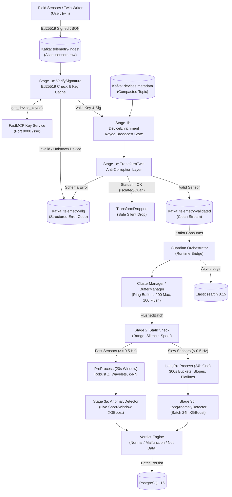

# 3. The Guardian

## 3.1 Role and goals

Positioned between the Digital Twin (sensor simulation and ingestion) and the City Brain (supervisory control and actuation), the Guardian serves as the untrusted-input gatekeeper of the 3-layer urban monitoring architecture. Field telemetry from drainage networks and power grids is vulnerable to tampering, transmission noise, and hardware faults. The Guardian establishes an active defensive perimeter: it cryptographically verifies message origin, drops malformed payloads, buffers readings in sliding memory windows, extracts spatio-temporal features, and runs machine learning inference to classify anomalies before clean data reaches the Brain.

The Guardian is engineered against four measurable operational goals:
1. **Real-time verification latency:** Short-window anomaly scoring under 150 ms per window ($p_{50} = 102$ ms, $p_{99} = 123$ ms for 42 sensors $\times$ 200 readings), operating within the 10 s streaming interval (>98% CPU margin).
2. **Strict false alarm budget:** Under 0.04 false alarms per sensor-day on clean streams, measured empirically at 0.008 false alarms/sensor-day on the 24 h model with 0.951 PR-AUC.
3. **High-throughput edge buffering:** Buffer ingestion at 2.75 $\mu$s per reading (>360,000 ops/s per core) with fail-safe rollback to prevent data loss during downstream queue saturation.
4. **Cryptographic non-repudiation:** 100% asymmetric Ed25519 signature verification on untrusted ingest streams prior to state admission.

*Scope boundaries:* In scope: signature verification, schema translation, sliding ring buffering, static rule checks, dual-horizon XGBoost anomaly scoring, and DLQ routing. Out of scope: sensor simulation (Twin), supervisory actuation (Brain), and enterprise data warehousing.

---

## 3.2 Architecture

The Guardian pipeline enforces a sequential defensive progression from signed ingestion to final verdict emission, as shown below:

The detection and filtering mechanisms operate across three sequential stages:

1. **Cryptographic and schema gate (Stage 1):** Ingests raw JSON from `telemetry-ingest`, strips Base64 signature `sig`, and validates the Ed25519 signature over canonical compact JSON against FastMCP public keys. Catches forged payloads, unknown devices, syntax errors, and schema violations, routing rejects to `telemetry-dlq` with error codes (`E100`–`E320`) while dropping isolated/quarantined devices.
2. **Static rule checks (Stage 2):** Deterministic sub-microsecond pre-filtering applied to flushed batches prior to ML inference. Catches out-of-range sensor values ($x < x_{\min} \lor x > x_{\max}$), silent dropouts (deltas $> 10.0$ s), future-skewed timestamps, and gross spatial spoofing relative to cluster peers.
3. **Machine learning detection (Stage 3):** Routes telemetry by sampling frequency across dual analytical horizons:
   - *Short-window model (20 s live horizon, $\ge 0.5$ Hz):* Evaluates Robust $Z$-scores (MAD scaling), Haar wavelets, difference kurtosis, sign-flip counts, and $k$-NN Haversine peer distances. Catches sudden spikes, oscillations, stuck values, burst noise, and synthetic signals (sine, ramp, pattern, uniform).
   - *Long-window model (24 h batch horizon, $< 0.5$ Hz):* Resamples telemetry onto a 300 s time-grid, computing trend-to-scatter ratios, flatline runs, and cluster slope divergence. Catches slow multi-hour calibration drift and frozen monitors while distinguishing sensor degradation from regional weather shifts.

---

## 3.3 Tech stack and why

The Guardian tech stack balances sub-microsecond latency, type safety, zero-trust isolation, and empirical accuracy:

| Component | Technology & Version | Why Chosen (Empirical Justification & Benchmarks) |
|---|---|---|
| **Language Runtime** | Python 3.12 | PEP 695 generics, pattern matching, frozen slots dataclasses eliminating per-instance `__dict__` overhead on high-rate telemetry. |
| **Toolchain & Resolver** | `uv` / `uv_build` 0.12.20 | Rust-based dependency manager delivering sub-second environment resolution and deterministic SHA-256 locking via `uv.lock`. |
| **Stream Processing** | Apache Flink 1.20 / PyFlink 2.3.0 | Stateful streaming with Keyed Broadcast State for low-latency metadata enrichment and side-output DLQ routing (`AT_LEAST_ONCE`). |
| **Message Broker** | Apache Kafka 4.3.1 (KRaft) | High-throughput ZooKeeper-free partitioned logging with Raft consensus, 3-broker replication, and granular SASL ACLs per layer. |
| **Edge Cryptography** | `cryptography` 50.0.2 | Sub-millisecond Ed25519 signature verification (<50 $\mu$s) over canonical JSON; asymmetric RSA-4096 OAEP SHA-256 for inter-service communication. |
| **Secrets Management** | HashiCorp Vault 1.17 (`hvac` 2.4.0) | Least-privilege HCL policies, dynamic AppRole leasing (15 m TTL), and automated 24 h key rotation with 1 h overlap window. |
| **Machine Learning** | `xgboost-cpu` 3.4.1 | Research proved XGBoost achieves 0.941–0.951 PR-AUC, outperforming unsupervised methods (Isolation Forest 0.199, LOF 0.161) with sub-ms CPU inference; native JSON avoids pickle exploits. |
| **Signal Processing** | PyWavelets 1.10.0 / NumPy 2.1.x | Discrete Haar wavelets and zero-copy `sliding_window_view` providing C-speed feature extraction without Python loops. |
| **In-Memory Buffering** | Python `threading` & `deque` | Sliding ring buffers achieving 2.75 $\mu$s ingest and 15.55 $\mu$s flush latency (>360,000 ops/s per core) with atomic `restore()` rollback. |
| **Relational Storage** | PostgreSQL 16 / SQLAlchemy 2.1.6 | ACID relational persistence, composite temporal indexes, and atomic multi-row `insert_batch` transactions with `psycopg` 3.3.6 async pool. |

---

## 3.4 Interfaces in/out

The Guardian communicates with external layers and operational infrastructure through defined boundaries:

| Direction | Counterpart Layer | Channel / Topic / API | Data Format | Authentication & Protocol |
|---|---|---|---|---|
| **Inbound** | Twin | Kafka: `telemetry-ingest` (alias `sensors.raw`) | JSON with Base64 Ed25519 `sig` | SASL PLAIN (user: `twin`), cleartext socket |
| **Outbound / RPC** | Twin (Key Service) | FastMCP client (`http://localhost:8000/sse`) | JSON-RPC (`get_device_key`, `get_city_state`, `list_devices`) | Plaintext HTTP, unauthenticated [TO CONFIRM WITH TWIN TEAM: production auth & TLS] |
| **Inbound / Sync** | Twin / Metadata Sync | Kafka: `devices.metadata` (compacted) | Compacted JSON device records (lat, lon, unit, bounds) | SASL PLAIN (user: `broadcast` write, `guardian` read) |
| **Outbound** | Brain | Kafka: `telemetry-validated` (alias `sensors.validated`) | Validated, standardized JSON `Sensor` records | SASL PLAIN (user: `guardian` write, `executioner`/`brain` read ACL) |
| **Outbound (Verdicts)** | Brain | [TO CONFIRM WITH BRAIN TEAM: Kafka `spatial-anomalies` vs DB] | Structured `Verdict` (label, anomaly score, sensor ID) | [TO CONFIRM WITH BRAIN TEAM: verdict schema & transport] |
| **Outbound (Rejects)** | SecOps / Monitoring | Kafka: `telemetry-dlq` (alias `sensors.dlq`) | JSON rejection envelope (error code, reason, raw payload) | SASL PLAIN (user: `guardian` write) |
| **Bidirectional** | HashiCorp Vault | HTTP REST API (`/v1/secret/data/comm/*`) | JSON secret metadata & RSA-4096 PEM keys | Vault AppRole (`role_id` + `secret_id`, 15 m leased token) |
| **Inbound (Lifecycle)** | Twin | `status` field in twin message (`TwinStatus`) | String enum: `ok`, `isolated`, `quarantined`, etc. | [TO CONFIRM WITH TWIN TEAM: authority setting quarantine flag] |
| **Outbound** | Persistence Store | PostgreSQL 16 (port 5432, db: `guardian`) | Relational multi-row batch inserts (`insert_batch`) | Username/password mounted from Docker secrets |
| **Outbound** | Observability Store | Elasticsearch 8.15 (port 9200, `guardian-logs`) | Bounded async NDJSON HTTP bulk payloads | Basic HTTP authentication (`ELASTIC_PASSWORD`), HTTP |

---

## 3.5 Security measures

### a) Threat table
The Guardian mitigates threats across physical edge devices, network transit, and algorithmic evasion:

| Threat Category | Specific Attack Vector | Detection Method | Containment & Remediation Action |
|---|---|---|---|
| **Cryptographic Spoofing** | Forged, tampered, or unsigned sensor JSON payload | Ed25519 signature check in `VerifySignature` over canonical bytes | Rejection to `telemetry-dlq` (`E200_BAD_SIGNATURE`). |
| **Identity Impersonation** | Rogue or unregistered device ID | FastMCP key lookup in `DeviceKeyProvider` returns null/empty | Rejection to `telemetry-dlq` (`E201_UNKNOWN_DEVICE`). |
| **Malformed Ingest** | Truncated packets, invalid UTF-8, or schema violations | JSON deserializer and Pydantic post-init validation | Routed to `telemetry-dlq` (`E100_DESERIALIZE` / `E300_SCHEMA`). |
| **Replay & Sequence Gaps** | Injected duplicate readings or dropped sequence packets | Sequence tracking (`packet_order`) in `PreProcess` flags disorder | Marked with order flags; evaluated by ML detector. |
| **Clock Tampering** | Future-skewed timestamps or stalled system clocks | `StaticCheck.sensor_is_down` evaluates timestamp deltas | Skewed timestamps dropped; deltas $> 10.0$ s flagged sensor down. |
| **Out-of-Bounds Injection** | Physically impossible values (e.g. negative water level) | `StaticCheck.out_of_range` boundary evaluation | Dropped before ML; flagged `OUT_OF_RANGE`. |
| **Silent Sensor Failure** | Sensor hardware power loss or communication blackout | Timestamp delta monitoring ($t_i - t_{i-1} > 10.0$ s) | Flagged as `SENSOR_IS_DOWN` static anomaly. |
| **Spatial Spoofing** | Compromised coordinates or localized falsification | Distance-weighted cluster variance in `StaticCheck` | Flagged as `SPOOFED_DATA` relative to peer medians. |
| **Sensor Malfunction** | Stuck constant, impulse spike, drift, noise, oscillation | Short-window (20 s) XGBoost (MAD, wavelets, sign-flips) | Emits `SENSOR_MALFUNCTION` verdict with confidence score. |
| **Slow Calibration Drift** | Multi-hour sensor drift or calibration degradation | Long-window (24 h) XGBoost (slope & cluster slope delta) | Emits `SENSOR_MALFUNCTION` with drift tag; separates weather shifts. |
| **Fabricated Telemetry** | Pure synthetic waves replacing physical signal | Multiclass XGBoost checking spectral energy share | Emits `NOT_SENSOR_DATA` verdict; flagged as synthetic tamper. |

### b) Handling of false alarms
To satisfy the operational budget while detecting subtle anomalies, the Guardian implements five defensive design principles:
1. **Robust dispersion scaling (MAD):** Normalization uses Median Absolute Deviation: $\text{Robust } Z = \frac{x - \text{median}(x)}{1.4826 \times \text{MAD}(x)}$. Unlike variance, MAD is unaffected by extreme spikes, preventing valid post-anomaly readings from being falsely flagged.
2. **Rate-adaptive thresholds:** Classification thresholds adjust to native sampling frequency (0.949 at 1 reading/s vs 0.729 at 10 readings/s in `AnomalyDetector`), preventing high-frequency noise from triggering alarms.
3. **Spatial cluster slope deltas:** The 24 h model compares a sensor's drift slope against the median slope of its spatial cluster peers. If all peers drift together (e.g. regional rainstorms), the shift is recognized as environmental, suppressing false alarms.
4. **Class weighting in model fitting:** XGBoost applies balanced sample weights during training, counteracting dominant normal class prevalence while controlling false positives on subtle boundaries.
5. **Dual-horizon separation:** Low-frequency sensors (<0.5 Hz) are excluded from the 20 s live model where sample starvation causes false alarms, routing them to the 24 h grid where diurnal cycles are visible.

*Empirical verification:* In held-out benchmarks across 19 slow sensor datasets (`research/long_window/results.md`), the 24-hour model achieved **0.008 false alarms per sensor-day** (budget: 0.04) with **0.951 PR-AUC**. On high-frequency clean streams (`research/short_window/results.md`), the short-window model achieved a **1.5%–1.7% false alarm rate** at 1 reading/s (budget: 4%).

### c) Hardening of the Guardian itself
- **Cryptographic key lifecycle:** Inter-service keys rotate daily via `vault/rotate_keys.py`. The rotator generates 4096-bit RSA key pairs with an `active_after = now + 1h` tag. Senders sign with the existing key for 1 hour while peers fetch the new public key. Lookups (`vault_keys.verification_keys`) accept Version $N$ and $N-1$, ensuring zero downtime during rollover.
- **Credential isolation:** Passwords for Kafka brokers, admin principals, and PostgreSQL are mounted via Docker secrets (`/run/secrets/`), eliminating plaintext credentials in repository code.
- **Least-privilege access control:** Vault AppRole policies enforce path-scoped separation: `guardian-app` has read-only access to `secret/data/comm/guardian/*` and cannot inspect private keys belonging to Twin or Brain. Broker access is governed by default-deny Kafka ACLs.
- **Dead-letter queue isolation:** Routing malformed payloads to `telemetry-dlq` protects streaming pipelines from crashes while preserving raw records for forensic auditing.
- **Fail-safe buffer backpressure:** When downstream queues saturate, `BufferManager.add()` catches the exception and executes `buffer.restore(batch.readings)`, atomically re-inserting the batch at the buffer head to prevent telemetry drops during storage stalls.
- **Fork-safe logging:** `AsyncElasticSearchHandler` registers `os.register_at_fork` callbacks to reset daemon threads, locks, and queues, preventing multiprocessing deadlocks.

---

## 3.6 Known limitations

1. **Cleartext network transport:** Kafka uses `SASL_PLAINTEXT`, FastMCP uses plain HTTP, and Elasticsearch lacks TLS. *Impact:* Data and credentials vulnerable to packet sniffing on the Docker network. *Mitigation:* Enforce Kafka `SASL_SSL` and enable HTTPS with internal CA certificates.
2. **Volatile in-memory buffers:** Sensor ring buffers reside in volatile RAM. *Impact:* Process crash, container OOM kill, or host failure drops unpersisted telemetry (`restore()` protects only against queue backpressure). *Mitigation:* Back buffers with an embedded write-ahead log (WAL) or RocksDB.
3. **Empty runtime orchestrator stub:** File `orchestrator.py` is currently a 0-byte stub. *Impact:* Validated telemetry stops at Kafka; buffers, feature pipelines, and detectors are not wired in live execution. *Mitigation:* Implement the asynchronous consumer loop specified in Section 3.2.
4. **Unauthenticated edge key service:** FastMCP client queries `http://localhost:8000/sse` without client auth or certificate pinning, and `DeviceKeyProvider._cache` lacks thread locking. *Impact:* Threat of key spoofing or stream stalls on MCP outage. *Mitigation:* Add bearer tokens/mTLS and mutex-protect key cache.
5. **Domain generalization on unseen hardware:** XGBoost scores 0.941–0.951 PR-AUC in-domain, but cross-domain testing on unseen physical sensors (Chicago Array of Things) drops to **0.372 PR-AUC** with 0.222 false alarms/sensor-day. *Impact:* Elevated false alarms on new hardware. *Mitigation:* Mandate few-shot fine-tuning on localized calibration data.
6. **Multi-week physical aging blindness:** The 24 h window catches acute drift, but flags only 2.5%–3.5% of real battery and sensor degradation taking 2 to 4 weeks. *Impact:* Gradual aging remains undetected until failure. *Mitigation:* Deploy weekly/monthly trend tracking alongside 24 h detector.
7. **Skipped security tests in CI:** All 15 Vault security tests in `test_vault_policies.py` are skipped in standard CI runs without a live Vault container. *Impact:* Policy regressions could pass CI undetected. *Mitigation:* Add ephemeral Vault container to GitHub Actions CI.
8. **Ambiguous quarantine ownership:** Guardian drops telemetry from devices marked `ISOLATED` or `QUARANTINED`, but cannot initiate or update quarantine states. *Impact:* Malfunctioning devices continue transmitting packets until an external operator intervenes. *Mitigation:* Define an automated cross-layer quarantine feedback loop with Twin and Brain teams.
