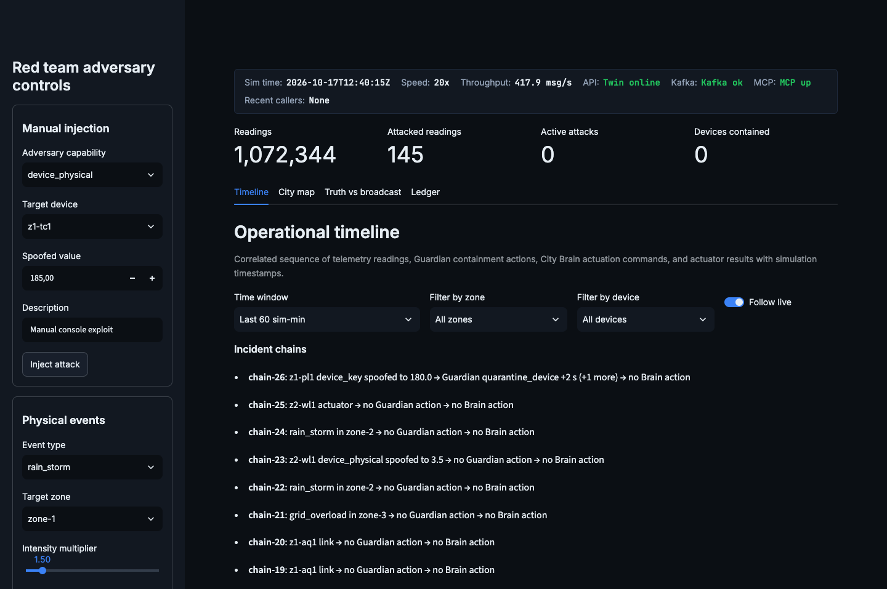
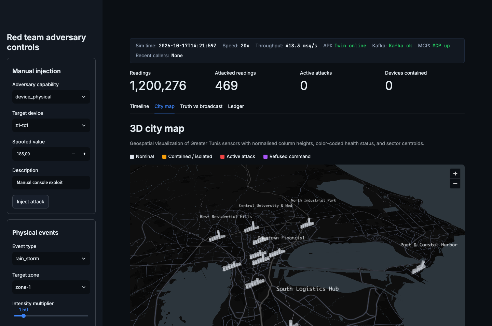
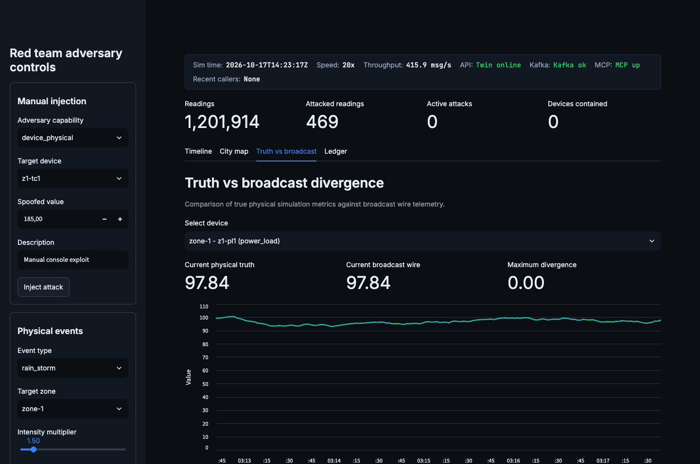
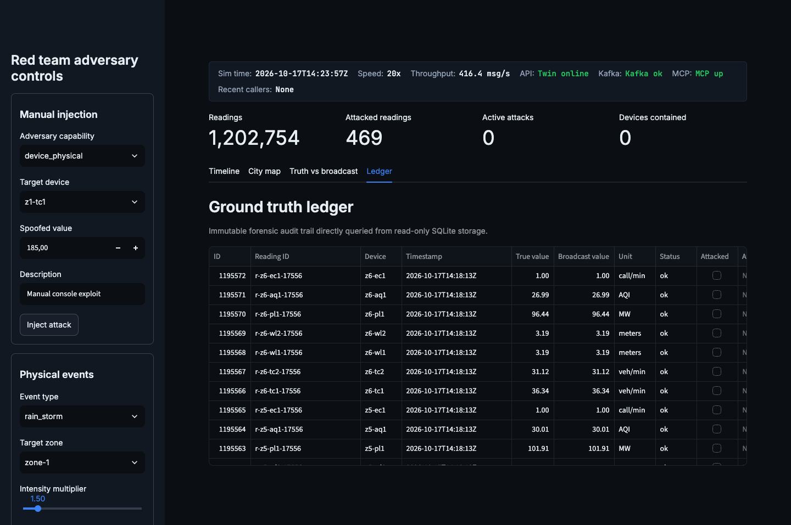
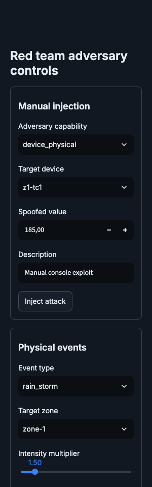

# Twin layer operations console guide

This guide documents the operations console for Layer 1 (the Digital Twin) in the TSYP 14 City Brain Convergence architecture. It explains the user interface layout, the live incident timeline, telemetry visualizations, audit capabilities, and the red team adversary controls.

---

## 1. Interface tour and visual design

The operations console runs with dark theme styling (`#0b0f14` background, `#121821` card surfaces, `#e6edf3` body text, `#3b82f6` primary accents). Telemetry and state indicators adhere to functional semantic coloring:
- Nominal: `#22c55e` (green)
- Contained or isolated: `#f59e0b` (amber)
- Attacked or diverging: `#ef4444` (red)
- Actuator refused or blocked: `#a855f7` (purple)

### Top status bar and operational KPIs

The top status bar provides a single-line overview of the runtime environment:
- Simulation time: Full RFC 3339 timestamp formatted in monospace without truncation.
- Simulation speed: Configured multiplier relative to real time (for example, 20x).
- Throughput: Current wire publication velocity in messages per second.
- Kafka broker status: Online or offline indicator for the telemetry streaming broker.
- MCP server status: Online or offline indicator for the synchronous tool-call server.
- Recent callers: Identities observed calling MCP tools within the last 5 simulation minutes (such as brain and guardian).

Below the status bar, four headline KPI tiles display key operational metrics:
- Readings: Total count of logged telemetry records.
- Attacked readings: Total volume of records marked under active attack.
- Active attacks: Number of active adversary capabilities currently executing.
- Devices contained: Total number of devices under quarantine or isolation.

---

## 2. Console tabs

The console organizes monitoring and audit functions across four tabs.

### Tab 1: Timeline

The timeline tab is the primary operational view. It correlates events across five distinct lanes:
1. Twin lane: Physical event lifecycles (start, escalation, resolution), adversary attack injections and clearances, and the first attacked reading for each incident.
2. Guardian lane: Automated containment and countermeasure actions, including quarantine, isolation, release, reinstatement, and reading rollback operations.
3. Brain lane: Supervisory command decisions, including incident dispatch and valve adjustments.
4. Actuator lane: Physical actuation execution results, distinguishing successful operations from refused commands (such as refusal under an actuator tampering attack).
5. Test harness lane: Diagnostic actions originating from scenario test runners, kept collapsed by default to preserve operational clarity.

Incident chains correlate related events from the incident origin through its resolution plus a 120 simulation-second cooldown window. A summary list above the table displays full incident chain narratives (newest first), while the operational data grid presents columns for Time, Lane, Event, Target, Reaction time, Summary, and Chain identifier. Selecting any row in the timeline data grid displays its full underlying JSON record for deep forensic inspection.

---

### Tab 2: City map

The city map tab presents a 3D tactical visualization of Greater Tunis divided into six municipal zones:
- Downtown Financial (`zone-1`)
- Port and Coastal Harbor (`zone-2`)
- North Industrial Park (`zone-3`)
- West Residential Hills (`zone-4`)
- Central University and Medical District (`zone-5`)
- South Logistics Hub (`zone-6`)

Each sensor is represented as a 3D column positioned at its registered geographic coordinates. Column heights are individually normalised to each device type's configured range (`[min_val, max_val]`), preventing disparate units (such as megawatts and air quality index) from distorting relative visual scale. Pillars reflect device status through semantic coloring (neutral for nominal, red for attacked, and amber for contained). Interactive tooltips provide exact device identifiers, device types, broadcast values, physical units, and active threat conditions.

---

### Tab 3: Truth vs broadcast

The truth versus broadcast tab compares physical reality against wire transmissions:
- Solid green line: Ground truth value recorded in the private simulation ledger.
- Dashed blue line: Wire telemetry broadcast over Kafka.
- Red shaded region: Divergence between truth and wire, illustrating the impact of physical spoofing, drift, or replay attacks.

A device picker grouped by municipal zone allows rapid inspection of any of the 42 city sensors. Discrepancy metrics summarise the maximum observed deviation across the selected window.

---

### Tab 4: Ledger

The ledger tab exposes the read-only forensic audit trail directly from `readings_truth`. Every record includes:
- Unique reading identifier (`r-{device_id}-{seq}`)
- Simulation timestamp
- Device identifier and municipal zone
- Ground truth value and broadcast wire value
- Attack classification flag and adversary capability type

Records with active attacks are highlighted with red row tinting, allowing operators and auditors to inspect historical incidents without risk of ledger corruption.

---

## 3. Red team adversary controls

The sidebar provides authenticated controls to inject attacks and physical events into the simulation:

### Manual injection
Enables targeted adversary capabilities against specific devices or zones:
- `device_physical`: Spoofs sensor output on wire while preserving truth in the ledger.
- `device_key`: Emulates cryptographic key theft and unauthorized signing.
- `link`: Manipulates network communication (corrupt bytes, invalid signature, replay, delay, frame drop).
- `rogue`: Introduces unauthorized transmitters into a target zone.
- `sensor_fault`: Injects calibration drift or stuck values.
- `actuator`: Forces actuation mechanisms to refuse supervisory commands.

### Physical events
Injects municipal conditions into selected zones:
- Types: `rain_storm`, `traffic_accident`, `fire`, `grid_overload`, `air_hazard`.
- Parameters: Target zone, intensity multiplier, and simulation duration.

### Active threats and events
Displays an inventory of all currently active exploits and environmental conditions. Each row provides a one-click clearance button, and a global "Clear all threats" button restores all devices and actuators to nominal baseline.

---

## 4. Operational verification workflow

To verify complete end-to-end telemetry and defense responses:
1. Start the Twin unified runtime and console.
2. In the sidebar, select target device `z1-tc1`, capability `device_physical`, and enter a spoofed value (such as 185 veh/min). Click "Inject attack".
3. Observe the Timeline tab: A new incident chain appears showing the attack injection, the attacked reading, and the corresponding Guardian verdict.
4. Switch to the City map tab: The column for `z1-tc1` turns red.
5. Switch to the Truth vs broadcast tab: View the divergence curve showing real physical traffic (~45 veh/min) against the spoofed wire reading (185 veh/min).
6. Return to the sidebar and click "Clear all threats": The system returns to nominal baseline across all tabs and metrics.
